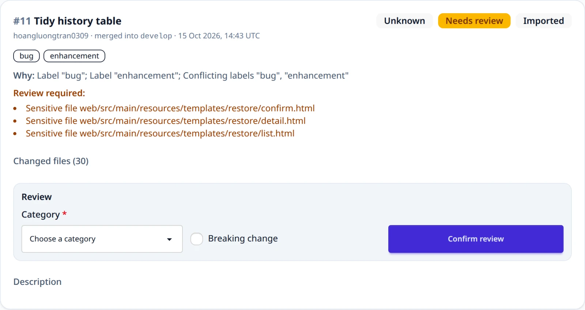
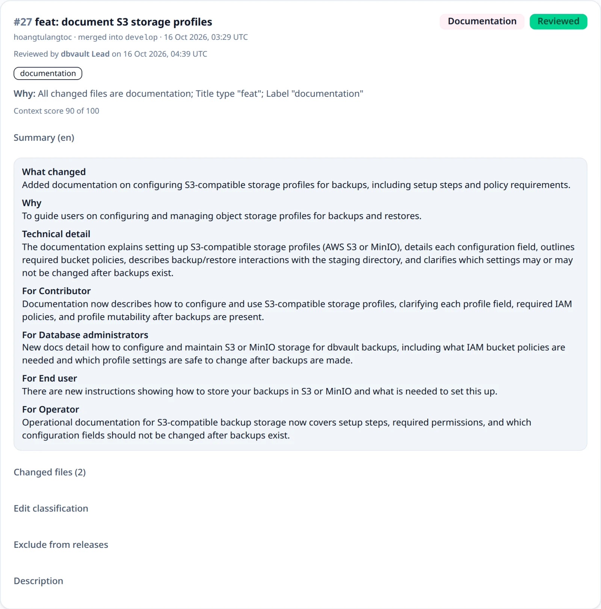
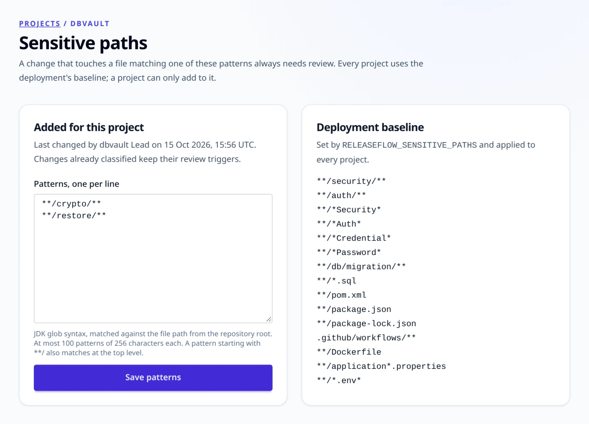
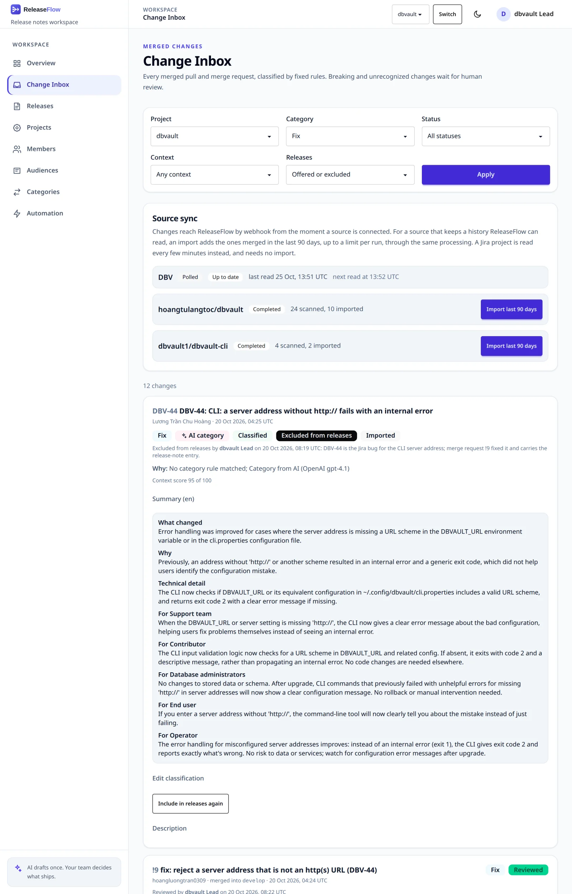
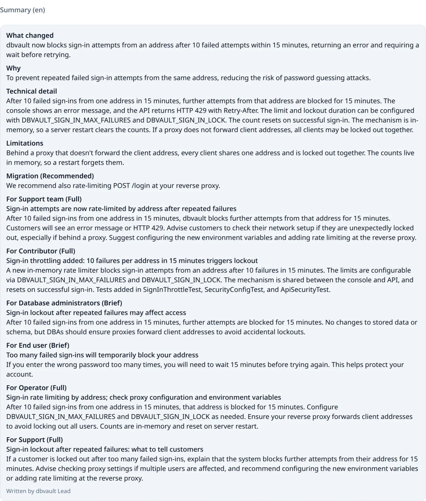
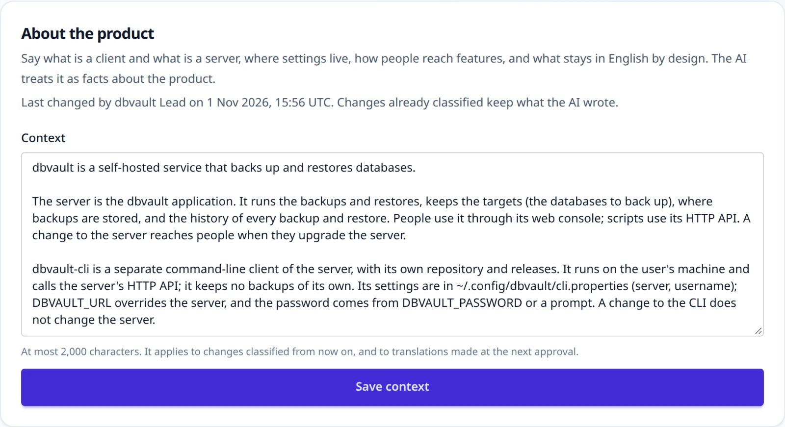
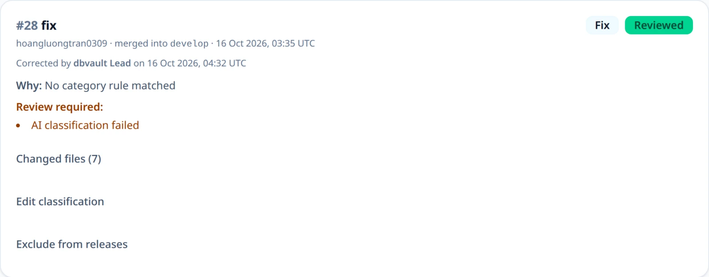
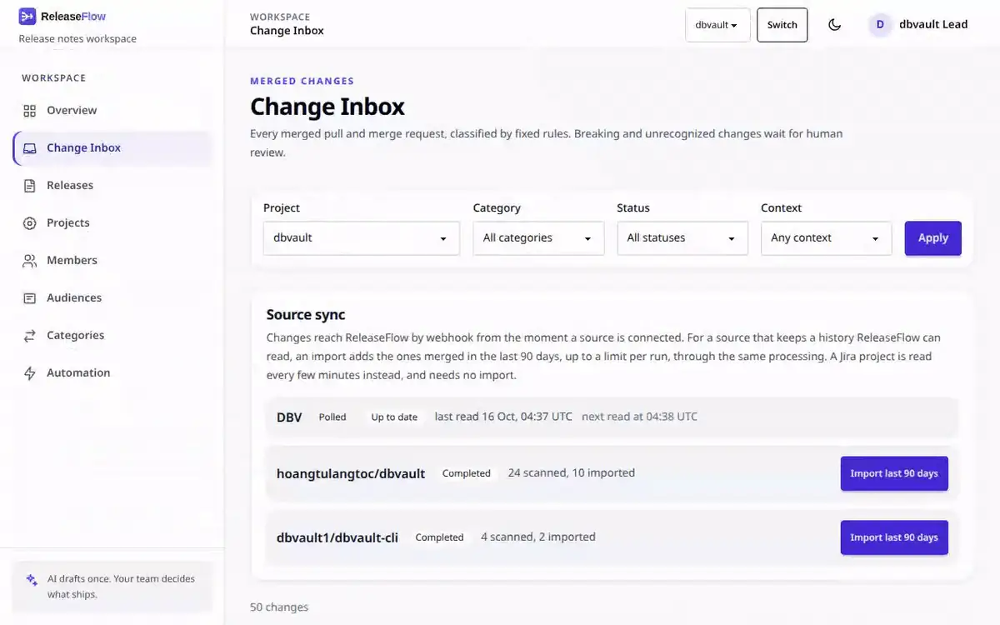
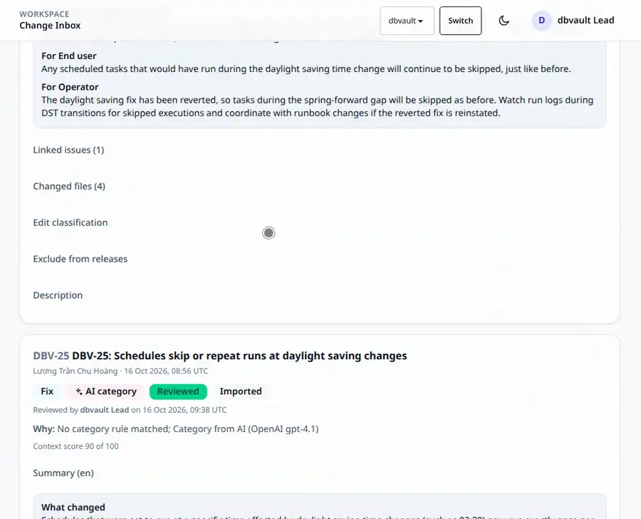
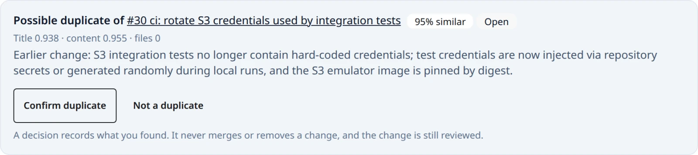

# Changes and review

Every merged pull request, merged merge request, and completed issue becomes a
**change**. Rules classify it, AI may summarize it, and a person reviews whatever the
rules and the AI cannot settle on their own.

## Processing

A recorded change first shows as **Processing**. Within about a second, a background
worker asks the change's provider, outside any database transaction, for what it can
add — using the source's own access token — and then classifies it:

- GitHub lists the pull request's changed files, at most five pages of a hundred, so a
  pull request with 500 files or more has no usable list;
- GitLab lists the merge request's diffs, at most ten pages of a hundred (see
  [Access tokens](sources.md#access-tokens));
- Linear reads the issue back, so the change carries its current wording; an issue has
  no files;
- Jira adds nothing, because the poll read the issue moments earlier.

When the Project has a Jira source, a GitHub or GitLab change is also checked for the
Jira issues it mentions (see [Linked Jira issues](sources.md#linked-jira-issues)).

A timeout, a network error, a rate limit, or a server error is retried up to three
times, waiting 2 and then 4 seconds. If the files still cannot be listed, if the token is
missing or refused, or if the list is too long, the change is classified anyway with a
**Changed files unavailable** review trigger. A Processing change cannot be reviewed,
sent to AI, or added to a release. Work survives restarts, and a claim left by a
stopped worker is taken over after ten minutes.

## Classification rules

Classification uses fixed rules:

- a Conventional Commit type at the start of the pull request title (`feat`,
  `fix`, `perf`, `docs`, `refactor`, `chore`, `ci`, `build`, `test`, with an
  optional scope) selects Feature, Fix, Performance, Documentation, or
  Maintenance (see [Categories](#categories) for how a rule picks a category
  from the catalog);
- without a title type, familiar labels such as `enhancement`, `bug`,
  `documentation`, or `dependencies` select the category, unless they disagree;
- when every changed file is in `docs/` or ends in `.md`, `.adoc`, or `.rst`,
  the change is Documentation, whatever its title says;
- a `!` after the title type, a `breaking-change` label, or a
  `BREAKING CHANGE:` footer in the description marks the change as breaking;
- a `security`, `security-fix`, `security fix`, or `vulnerability` label, in any case,
  or a CVE identifier such as `CVE-2026-12345` in the title, description, or a label,
  marks the change as a **security change**;
- anything else is Unknown.

Security is a flag beside the category, like breaking, never a category of its own: a
security fix is still a Fix wherever categories are used, and its note lists it under
🔒 Security (see [What each audience reads](release-notes.md#what-each-audience-reads)).
Words such as `auth`, `password`, or `encryption` do not mark a change security by
themselves; they stay [sensitive-path](#sensitive-paths) or sensitive-word evidence. A
change recorded before security flags existed is not security until a person marks it.

Breaking, security, and Unknown changes always need review, and so does any change with
a review trigger:

| Trigger | When |
| --- | --- |
| Sensitive file | A changed file, or the previous path of a renamed one, matches a sensitive-path pattern |
| Changed files unavailable | The files could not be listed |
| Sensitive word | The source has no files (Linear, Jira), and its title or description says `breaking change`, `migration`, `security`, `auth`, `credential`, `password`, or `encryption` |
| Linked issues incomplete | Commits could not be read, or Jira would not show an issue the change mentions |
| AI classification failed | The AI call failed or its answer was unusable |
| Not enough context | The [context score](#review-signals) is below the threshold |
| Possible duplicate of an earlier change | The change looks like an earlier one (see [Review signals](#review-signals)) |
| AI proposed a new category | No category of the catalog fits (see [Categories](#categories)) |
| Migration kind corrected | The AI's migration kind did not match its migration step, so ReleaseFlow corrected it (see [AI classification](#ai-classification-and-summaries)) |



Each change keeps the rules that matched, its typed `reviewTriggers`, and its
`changedFiles`, and the inbox shows them. A review settles a triggered change
but keeps the trigger as a record.



### Sensitive paths

Sensitive paths are JDK glob patterns. The default list covers `security` and
`auth` directories, files named like `*Security*`, `*Auth*`, `*Credential*`,
or `*Password*`, database migrations and `*.sql`, `pom.xml`, `package.json`,
`package-lock.json`, `.github/workflows/`, `Dockerfile`,
`application*.properties`, and `*.env*`. A pattern starting with `**/` also
matches at the repository root. Replace the list with the comma-separated
`RELEASEFLOW_SENSITIVE_PATHS` (brace groups such as `{a,b}` are not
supported). An invalid pattern or an empty list stops the application from
starting, so the rule cannot be switched off by accident.

A Project can add its own patterns to this baseline, for example
`**/billing/**`, but can never remove any of it. Follow **Sensitive paths** on
a Project's card, or call `GET /api/projects/{projectId}/sensitive-paths`,
which returns the `baseline`, the Project's `additions`, the `effective` list,
and who last changed it. Every member can read them; only administrators
change them, one pattern per line on the page or with
`PUT /api/projects/{projectId}/sensitive-paths` and `{"additions": [...]}`.
Patterns are trimmed, and blank lines and repeats are dropped. A Project can
add at most 100 patterns of at most 256 characters; a pattern that does not
compile, or too many or too long ones, return `400 invalid_sensitive_paths`.
New patterns apply to changes classified afterwards, including an AI retry;
changes already classified keep their triggers. See
[ADR-0014](adr/0014-project-sensitive-paths.md).



## Change Inbox

Open `/changes` to browse a Project's inbox, or call
`GET /api/projects/{projectId}/changes`. Both accept `category` (a category
code such as `feature` or `security`, in any case), `status`
(`needs-review`, `classified` for changes settled by rules without a person,
`reviewed`), and `context=insufficient` (see
[Review signals](#review-signals)). A value that is not a code or status returns
`400 invalid_change_filter`, and another Organization's Project returns
`404 project_not_found`. Each change returns its `category` code with its
`categoryName` and `categoryGroup`, as recorded when it was classified.




## AI classification and summaries

AI is optional. To enable it, choose one provider and give it a key and a
model before starting the application:

```bash
export RELEASEFLOW_AI_PROVIDER=anthropic          # or openai, deepseek
export RELEASEFLOW_ANTHROPIC_API_KEY='replace-with-an-api-key'
export RELEASEFLOW_ANTHROPIC_MODEL='replace-with-a-model-id'   # from the provider's model list
```

OpenAI and DeepSeek work the same way with their own variables. There is no default
model; pick one that supports structured JSON output. Startup fails when the
configuration is incomplete; every variable and check is listed under
[Configuration](configuration.md#ai). With no provider, changes are classified by the
rules alone.

With a provider, the change worker asks the AI **once** for every new change,
after its changed files are known. It sends the change's title, labels,
target branch, up to 4000 characters of the description, and whether it is
merged code (a pull or merge request) or an issue a tracker completed (Linear,
Jira), together with the Organization's output language, the Organization's
active [categories](#categories), the category the rules chose, if any, the Jira
issues it mentions as untrusted evidence, the code and communication intent of each
[audience](release-notes.md#audiences), and the [Project context](#project-context).
It does not send the author, and OpenAI requests set `store: false`. The answer is
one category code from the catalog (or a proposal for a new category when none
fits), a breaking flag, a security flag (whether the change alters a security property,
or fixes or introduces a vulnerability), whether a person should review it, a **neutral
summary**,
and a **narrative** for each audience, all written in the output language. The
neutral summary is what changed (one sentence), why, technical detail, a migration
step with its kind, and limitations: what the change deliberately does not do yet.
Each audience's narrative has a relevance (`none`, `brief`, or `full`), a one-line
headline, and a body; a release note leaves out a change that is `none` for its audience
unless the change is breaking (see
[What each audience reads](release-notes.md#what-each-audience-reads)). A missing or
empty narrative is simply left out.

A **dependency update**, a change whose author is `dependabot[bot]` or `renovate[bot]`
or whose head branch starts with `dependabot/` or `renovate/`, reaches the AI without what
it quotes from upstream: its `<details>` and `<blockquote>` elements, Markdown blockquotes,
and its "Release notes", "Changelog", and "Commits" sections are left out, so only what is
bumped, and from which version to which, remains. The change itself keeps its whole
description. It is breaking, or has a migration step, only when its own words say so;
the AI is told this only for a dependency update, so any other change it is unsure about
is still marked breaking and sent to review.

The AI is told to state only what the evidence supports, in every field: no
consequence the change does not describe (a crash, an outage, a blocked startup),
no place in the product the change or the Project context does not name, nothing
from a dependency's quoted changelog presented as this project's own change, no
files or code for a tracker issue whose text names none, and no remarks about what
the evidence lacks, where an empty field belongs.

A migration step has a kind:

| Kind | Meaning |
| --- | --- |
| `REQUIRED` | Existing installations stop working, or lose a protection, until the step is done |
| `CONDITIONAL` | Only some installations need it, and the step says which |
| `RECOMMENDED` | Advisable, but nothing breaks without it |
| `NONE` | There is no step |
| `UNSPECIFIED` | A step recorded before kinds existed, or by a caller that named none; never treated as required |

A kind that does not match its step is corrected rather than rejected, since the
answer is asked for only once: `none` with a step becomes `recommended`, and any
other kind without a step becomes `none`, and a step whose kind is missing is
`UNSPECIFIED`. The change then gets a **Migration kind corrected** review trigger, so a
person checks the step. A step the AI writes that only says nothing needs doing, such as
"No immediate action is required" or "No migration required", is dropped first, so the
kind is `NONE`; one that still asks something ("No action is required unless you enable
verification", "Rename the setting; no further action is required") is kept.

Limitations are only what the change's own text says it deliberately does not do yet.
A sentence the AI writes there about its input instead, such as "Rollback steps are not
provided" or "The version is not specified", is dropped, and so is one that only states
the change's scope, such as "This does not affect the CLI" or "It only affects the CI
environment", since an audience's relevance already says who the change matters to. A
limitation such as "Certificate validation is enforced only for MongoDB" is kept, and a
missing limitations field is empty. Every request asks for the same temperature, `0` unless
the deployment sets `RELEASEFLOW_AI_TEMPERATURE`, so the same change varies as little as the
model allows (see [Configuration](configuration.md#ai)).

The Change Inbox shows the summary and narratives under each change, each narrative
with its relevance and headline, and the changes API returns them as `neutralSummary`,
`audienceNarratives` (each audience's narrative text, keyed by audience code), and
`audienceNarrativeDetails` (an object per audience code with `relevance`, `headline`, and
`body`), with `contentLanguage` and `aiProvider`. A summary written by a person on a
release page is never replaced by a later AI answer.



### Project context

The AI knows nothing about a product beyond the change in front of it. A
Project's **context** tells it what it cannot guess: what is a client and what
is a server, where settings live, how people reach features, and what stays in
English by design. Follow **Project context** on a Project's card, or call
`GET /api/projects/{projectId}/context`, which returns the `context` and who
last changed it. Every member can read it; only administrators write it, on the
page or with `PUT /api/projects/{projectId}/context` and `{"context": "..."}`.
It is plain text of at most 2000 characters; longer returns
`400 validation_failed`, and an empty one clears it.



Every AI request for one of the Project's changes sends it as facts about the
product from its administrators, never as instructions. An edit applies to
changes classified afterwards, an AI retry included; changes already classified
keep what the AI wrote. It is also DeepL's `context` for the Project's
translations (see [Release note languages](release-notes.md#release-note-languages)), which DeepL neither
translates nor bills. See [ADR-0035](adr/0035-evidence-bound-notes-and-audience-relevance.md).

The rules always win:

- a category the rules chose is kept;
- the AI may mark a change breaking or security but never clears either flag;
- breaking, security, Unknown, and triggered changes, and changes the AI asks to have
  reviewed, stay in review.

Otherwise the AI's answer settles the change, and an Unknown change can
receive its category from the AI.

If the AI call fails or returns something unusable, the change keeps the rule
result, records `aiStatus: FAILED` with a safe message, and gets an
**AI classification failed** review trigger. Nothing is retried automatically,
and a worker that stops mid-call never asks again. A person can press **Retry
with AI** in the Change Inbox, or call
`POST /api/projects/{projectId}/changes/{changeId}/ai-classification` with the
session and a CSRF token. The failure trigger stays, so a person still reviews the change.
An Unknown change that was classified while no provider was configured, and that nobody
has reviewed, can be sent the same way once one is.



| Outcome | REST response |
| --- | --- |
| AI answer stored | `200` with the updated change |
| Change not in this Organization's Project | `404 change_not_found` |
| Change still being processed | `409 change_processing` |
| Change already classified by AI, or reviewed | `409 change_not_eligible_for_ai` |
| The provider failed; the failure is stored and shown | `502 ai_classification_failed` |
| AI not configured | `503 ai_classification_unavailable` |

## Human review

Every change in the Change Inbox has a review form prefilled with its current
category, breaking flag, and security flag. Changes that need review show the form directly;
other changes show it under **Edit classification**. The reviewer keeps or
changes the values and presses **Confirm review**. ReleaseFlow stores exactly
the submitted values, clears the need for review, and records the reviewer and
time. A reviewer chooses an active category of the catalog, since a reviewed
change cannot stay Unknown, and may clear a breaking or security flag set by the rules
or AI, or mark a change security that nothing marked.

Confirming without changes keeps the original classification source (rules or
AI). Changing the category, breaking flag, or security flag makes the reviewer the source,
shown as "Corrected by". A change can be reviewed again; the latest review is
kept.



REST clients call `POST /api/projects/{projectId}/changes/{changeId}/review`
with the session, a CSRF token, and `{"category": "fix", "breaking": false, "security": true}`.
The category is a code of the catalog in any case. `security` may be left out, as clients
written before it do: the review then confirms the flag the change has, and an explicit
`false` clears it. Every change the API returns carries `security`. It returns the updated
change, `400 invalid_change_review` for `unknown`, an archived category, or a
code that is not in the catalog, `400 validation_failed` when a field is missing, and
`404 change_not_found` for another Organization's change.

## Excluding a change from releases

Some changes will never ship: a tracker issue that duplicates the pull request that did
the work, a fix and the revert that undid it, a task with nothing to tell readers. An
administrator opens **Exclude from releases** on the change's card, says why, and
confirms. The change stays in the Inbox with an **Excluded from releases** badge and the
name, time, and reason of whoever excluded it, and no release offers it again: **Add
all available** skips it. Nothing is deleted and nothing is settled: the change keeps
its category, breaking flag, and review state, and can still be reviewed, though the
overview no longer counts it among the changes that need review. **Include in releases
again** takes the decision back. The **Releases** filter of the Inbox shows only the
excluded changes. See [ADR-0033](adr/0033-change-exclusion.md).



A change that belongs to a release, of any status, is removed from it first: take it
out of the draft, or reject it during review. A change still processing cannot be
excluded.

```text
POST   /api/projects/{projectId}/changes/{changeId}/exclusion   {"reason"}
DELETE /api/projects/{projectId}/changes/{changeId}/exclusion
GET    /api/projects/{projectId}/changes?release=excluded
```

Both are for administrators and return the change, with `exclusion` holding
`excludedBy`, `excluderName`, `excludedAt`, and `reason`, or absent when the change is
offered to releases. Including a change that is not excluded changes nothing.

| Situation | Response |
| --- | --- |
| A member, not an administrator | `403` |
| A reason that is missing, blank, or longer than 500 characters | `400 validation_failed` |
| A `release` filter other than `excluded` | `400 invalid_change_filter` |
| An unknown change, or one of another Organization | `404 change_not_found` |
| A change still processing | `409 change_processing` |
| A change that is already excluded | `409 change_excluded` |
| A change in a release | `409 change_in_release` |

## Review signals

Two signals point reviewers at changes that deserve a closer look. Both only add
a need for review; they never merge, remove, or settle a change. See
[ADR-0013](adr/0013-context-sufficiency-and-duplicates.md).

**Context sufficiency.** With AI enabled, the AI also scores from 0 to 100 how
much evidence the pull request gives about what changed and why. Fixed caps can
only lower that score:

| Pull request | Score at most | Reason |
| --- | --- | --- |
| Empty description | 30 | `DESCRIPTION_MISSING` |
| Title shorter than 12 characters | 50 | `TITLE_TOO_SHORT` |
| Title of just fix, update, change, cleanup, misc, or wip, with a description under 160 characters | 40 | `GENERIC_TITLE` |

A score below `RELEASEFLOW_CONTEXT_THRESHOLD` (default 60, 0–100) needs review
with a **Not enough context** trigger. The Change Inbox shows the score, and
`context=insufficient` filters to these changes; the changes API returns
`context` (`score`, `status`, `reasons`). Without an AI answer, context is not
assessed.

**Possible duplicates.** When a change finishes processing, it is compared with
the Project's other changes from the last 180 days (at most 500). The
comparison uses title, content (description and what changed), and changed
files. A pair at least `RELEASEFLOW_DUPLICATE_THRESHOLD` similar (default
0.82) is recorded with its evidence, up to five per change. The new change
needs review with a **Possible duplicate** trigger. Both cards show the pair,
and any member can **Confirm duplicate** or mark it **Not a duplicate**, once.



```text
GET  /api/projects/{projectId}/duplicate-candidates?status=OPEN
POST /api/projects/{projectId}/duplicate-candidates/{candidateId}/decision   {"decision": "CONFIRMED" | "DISMISSED"}
```

A decision that is missing or `OPEN` returns `400 validation_failed`, a second
decision `409 duplicate_candidate_decided`, and an unknown or foreign candidate
`404 duplicate_candidate_not_found`.

## Categories

Every Organization has its own category catalog. It starts with six categories:
Feature, Fix, Performance, Documentation, Maintenance, and Unknown. Administrators manage it on the **Categories** page
or through `/api/categories`; every member can read it.

A category has a code (letters, digits, and underscores, starting with a
letter; upper-cased and fixed once created), a display name, and one of six
groups: Feature, Fix, Performance, Documentation, Maintenance, or Other.
Release notes are sectioned by group, so a new `SECURITY` category in the Fix
group appears under **Bug Fixes**. Breaking stays a separate flag.


- **Rules.** Each fixed rule names a group and a preferred code, for example
  `fix` names Fix and `FIX`. The preferred category is used if it is active;
  otherwise the first active category of the group by code; if the group has
  none, the rule locks nothing and the change is left to the AI or a person.
- **Archiving** stops offering a category to the rules, the AI, and reviewers.
  Changes that already carry it keep it, with the name and group they were
  given, and it can be restored. Unknown is a system category: it can be
  renamed but not regrouped or archived.
- **AI proposals.** When no category fits, the AI returns Unknown with a
  proposed category. The change needs review with an **AI proposed a new
  category** trigger, and the proposal waits on the Categories page and on the
  change's card in the Change Inbox. An administrator can:
  - **Add to catalog**: the category is created, or restored if it was
    archived;
  - **Map** the proposal to an existing active category;
  - **Reject** it.

  After Add to catalog or Map, the change takes that category, shown as
  **Suggested category**, and still needs a person's review. A proposal never
  becomes a category by itself, and each is decided once.


See [ADR-0012](adr/0012-category-catalog.md).

```text
GET    /api/categories                                   (every member)
POST   /api/categories                                   {"code", "displayName", "group"}
PUT    /api/categories/{categoryId}                      {"displayName", "group"}
DELETE /api/categories/{categoryId}                      (archives it)
POST   /api/categories/{categoryId}/unarchive
GET    /api/category-suggestions?status=PENDING_REVIEW
POST   /api/category-suggestions/{suggestionId}/decision {"decision": "APPROVED" | "MAPPED" | "REJECTED", "categoryId"}
```

| Situation | Response |
| --- | --- |
| A member changing the catalog or deciding a proposal | `403` |
| A missing field, a code that is not a valid code, or MAPPED without `categoryId` | `400 validation_failed` |
| The code is already in the catalog | `409 category_code_taken` |
| Regrouping or archiving Unknown | `409 category_system` |
| Deciding a proposal again | `409 category_suggestion_decided` |
| An unknown or foreign category, or mapping to an archived one | `404 category_not_found` |
| An unknown or foreign proposal | `404 category_suggestion_not_found` |
