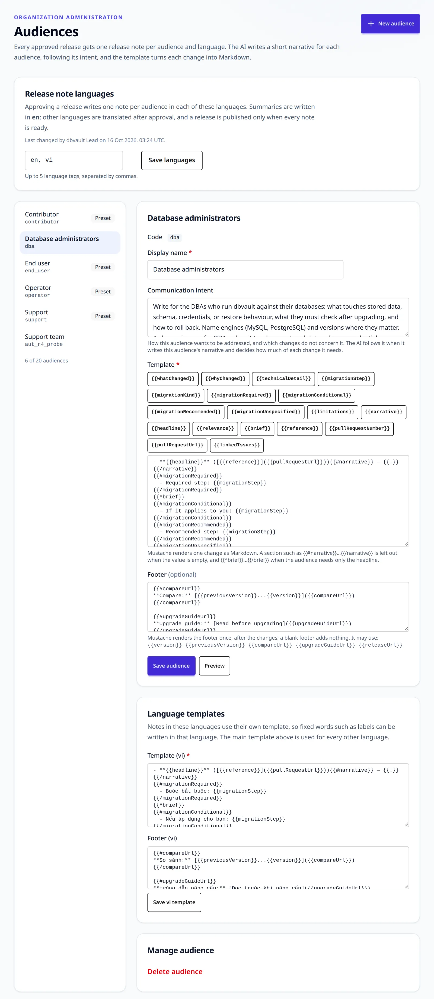
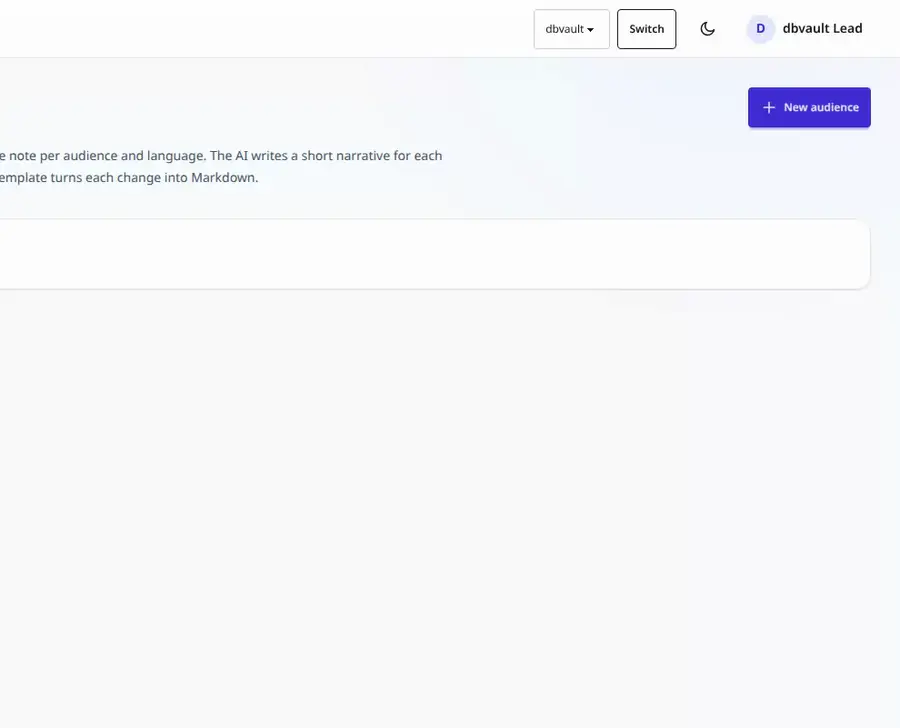
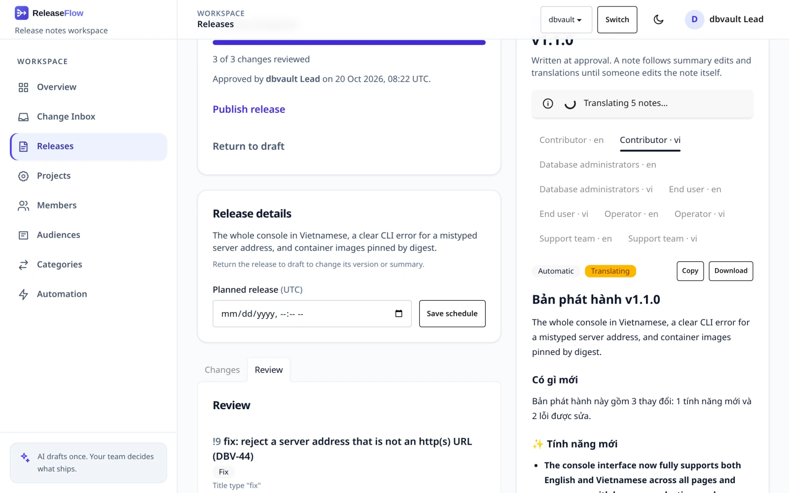
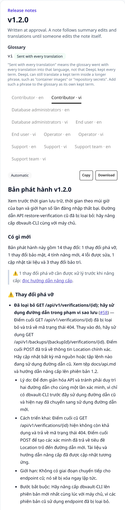
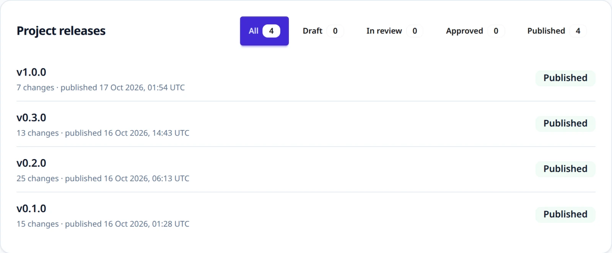
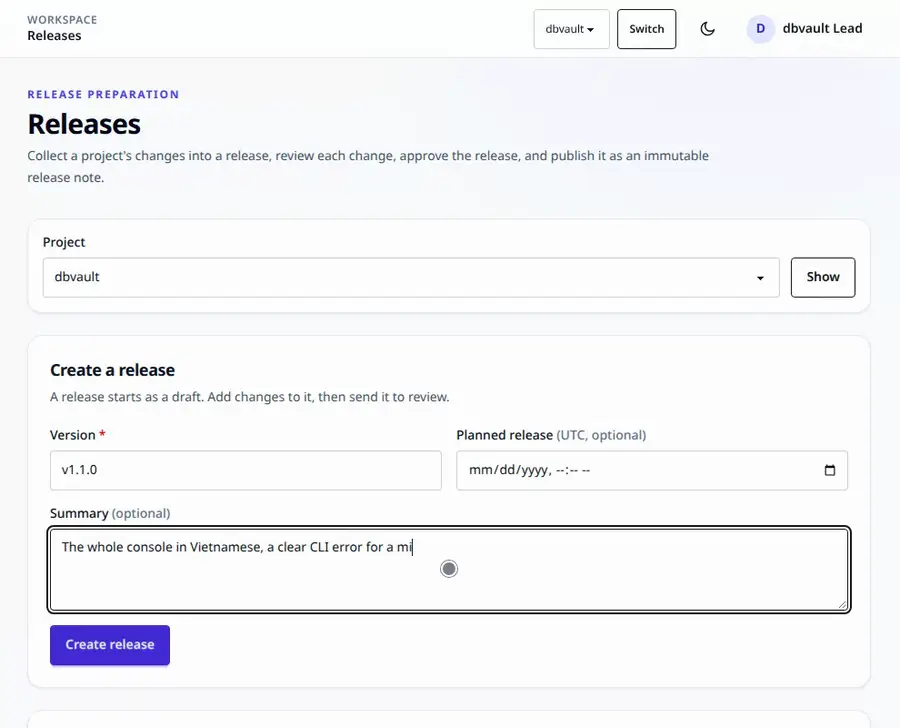
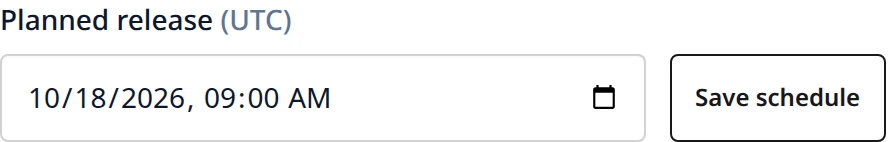
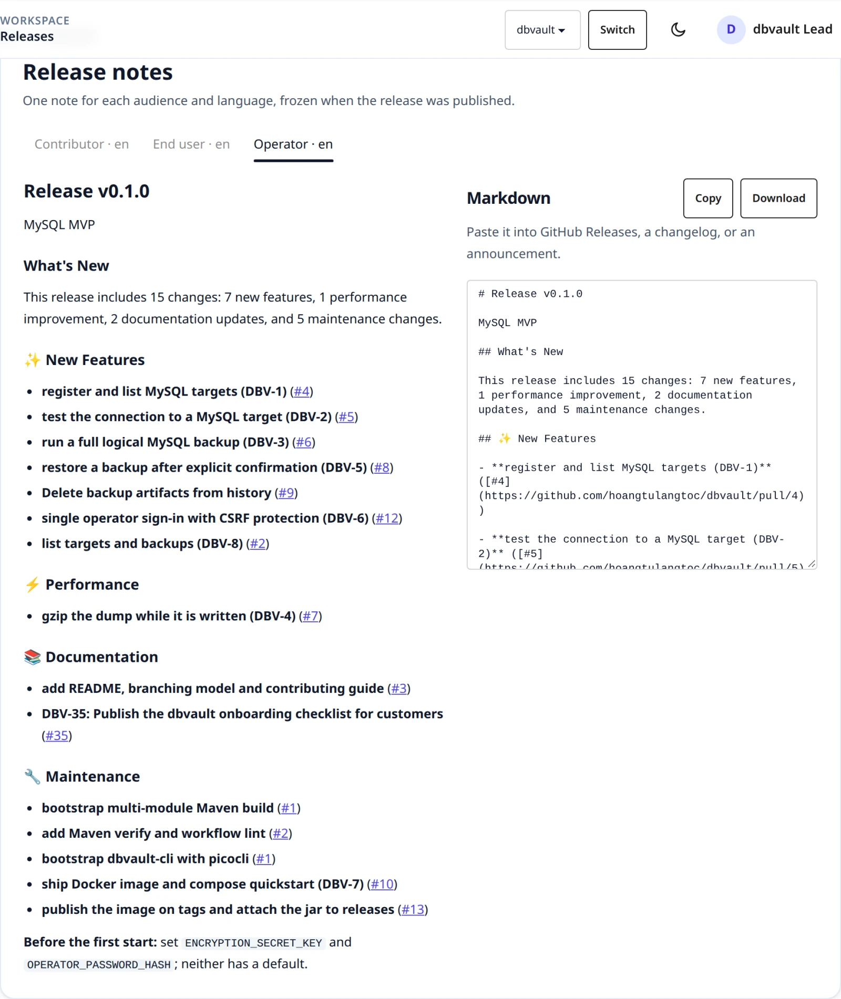
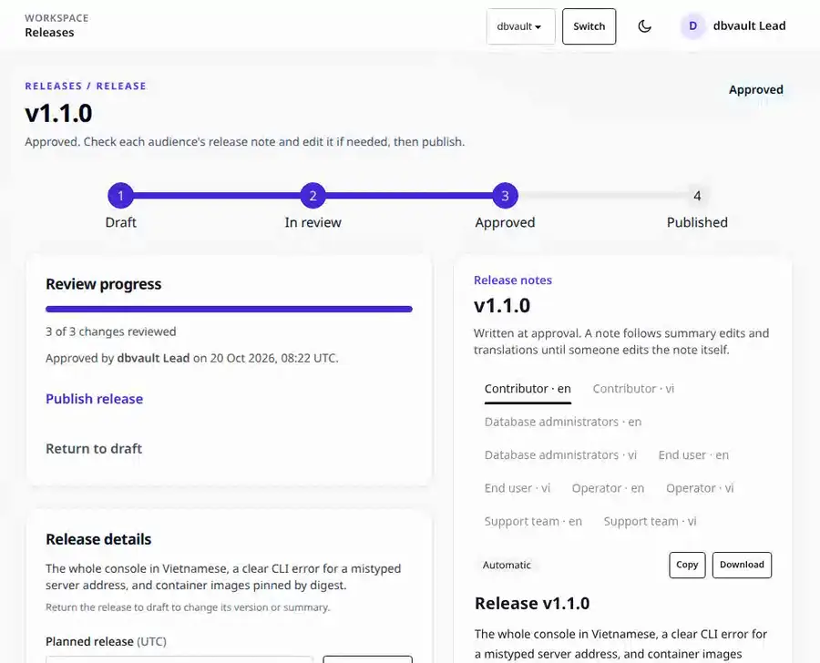

# Release notes

A release collects reviewed changes. When it is approved, ReleaseFlow writes one note
for every audience in every release note language; when it is published, those notes
are frozen.

## Audiences

Every approved release gets one release note per **audience**. Administrators
manage audiences on the **Audiences** page or through `/api/audiences`. Each
Organization starts with four presets, named in its output language
(English or Vietnamese):

| Code | Writes for | Template |
| --- | --- | --- |
| `operator` | operational risk, rollback, and how the product is deployed and run | the headline with the pull request link and narrative, then why, detail, limitations, and the migration step under its kind |
| `contributor` | implementation detail and code changes | as operator, with implementation instead of detail |
| `end_user` | plain language, what people notice | the headline and the narrative, and a migration step only when it is required |
| `support` | what customers may ask about, and what to tell them | the headline with the link and narrative, the migration step under its kind, and limitations |



An audience has a **code** (lowercase letters, digits, and underscores,
starting with a letter; fixed once created), a **display name**, a
**communication intent** that the AI follows when it writes the audience's
narrative, and a **template**. Each preset's intent ends by saying when a change is
none of its audience's concern: for end users, build, CI, dependency, test, and internal
changes they cannot see. The operator intent asks for something to watch after deploying
only when the change or the [Project context](changes.md#project-context) names one. Templates are
[Mustache](https://mustache.github.io/mustache.5.html) and render one change as
Markdown with the variables `whatChanged`, `whyChanged`, `technicalDetail`,
`migrationStep`, `migrationKind`, `limitations`, `narrative`, `headline`, `relevance`,
`brief`, `reference`, `pullRequestNumber`, `pullRequestUrl`, and `linkedIssues` — a list whose items have `key`, `title`, `type`, `status`, and
`url`, escaped like any other tracker text, as they were read when the change was recorded
([Linked Jira issues](sources.md#linked-jira-issues)). `migrationKind` is `required`,
`conditional`, `recommended`, or `unspecified` for a step recorded before kinds
existed, and is empty without a step (see
[AI classification](changes.md#ai-classification-and-summaries)). Since Mustache cannot
compare values, the sections `migrationRequired`, `migrationConditional`,
`migrationRecommended`, and `migrationUnspecified` are each true for one kind.
`headline` is the audience's one-line headline, or `whatChanged` when it has none, so it
always has a value; `relevance` is `brief` or `full`, and the section `brief` is true for
a brief change (see [What each audience reads](#what-each-audience-reads)). The
summary values, `headline`, and `narrative` keep their Markdown, but any raw HTML in them is escaped, so a placeholder
such as `<id>` shows as written wherever the note is read. `reference` is how the change's source
names it: `#12` for a GitHub pull request, `!12` for a GitLab merge request, and the
issue key, such as `APP-12` or `ENG-12`, for Jira and Linear; `pullRequestNumber` is
the bare number whatever the source. A section such as
`{{#narrative}} — {{.}}{{/narrative}}` disappears when the value is empty. **Preview** renders a sample change. A template is checked when
it is saved: it must compile, use only these variables, and use `{{narrative}}`
rather than naming another audience.

The shipped templates lead with `**{{headline}}**`, and the detailed ones link a change
as `[{{reference}}]({{pullRequestUrl}})`. They label a migration step by its kind:
**Required step**, **If it applies to you**, **Recommended step**, or the neutral
**Migration** for an unspecified one, so a step nobody called required is never
presented as one. Their detail lines sit inside `{{^brief}}`, so a brief change keeps its
headline, its narrative, and a required step, which is printed whatever the relevance.
Audiences created before these templates keep their own until a preset is reset, and an
Organization created before the `support` preset can add an audience coded `support` and
reset it to the preset.

### What each audience reads

For each audience, the AI says how much a change concerns it: `none` (this reader would
neither notice nor need it), `brief` (its headline is enough), or `full`. It also writes a
**headline**, one line of at most 20 words, beside the narrative. A headline that is
longer, runs over several lines, or remarks on missing evidence is dropped, and so is any
sentence of a narrative that remarks on it ("not provided", "not specified"). An unknown
relevance reads as `full`.

A note leaves out a change that is `none` for its audience, unless the change is
breaking: a breaking change is in every note, and `none` on it reads as `brief`. A change
with no narrative for the audience (no AI, a failure, or an audience added later) is
included in full. The counts and the breaking-change warning describe what the note
shows. An audience that nothing in the release concerns still gets its note: the title,
the release summary, and one line saying that nothing in the release concerns it.
Approval still writes one note per audience and language, and an automation action
delivers that note like any other. See
[ADR-0035](adr/0035-evidence-bound-notes-and-audience-relevance.md).



An Organization keeps between 1 and 20 audiences. An audience cannot be deleted
while something still names it: a release note, an automation rule's action, or an
automation run's history. A rule that is enabled or disabled can be pointed at another
audience first. An archived rule cannot be changed, and run history keeps the
audience it delivered to, so either keeps the audience for good; a refusal says
which of these holds it. A preset can be reset to its shipped version in the current
output language. See [ADR-0011](adr/0011-audience-release-notes.md).

Every audience endpoint is for administrators only:

```text
GET    /api/audiences
POST   /api/audiences                          {"code", "displayName", "communicationIntent", "templateBody"}
GET    /api/audiences/{audienceId}
PUT    /api/audiences/{audienceId}             {"displayName", "communicationIntent", "templateBody"}
PUT    /api/audiences/{audienceId}/templates/{language}   {"templateBody"}
DELETE /api/audiences/{audienceId}
POST   /api/audiences/{audienceId}/reset-to-preset
POST   /api/audiences/preview                  {"templateBody"} -> {"markdown", "html"}
```

| Situation | Response |
| --- | --- |
| A member, not an administrator | `403` |
| A missing field, or a code that is not `[a-z][a-z0-9_]*` | `400 validation_failed` |
| A template that does not compile or uses an unknown variable | `400 template_invalid` |
| A template naming `narratives.<code>` | `400 template_narratives_path` |
| The code is already used | `409 audience_code_taken` |
| The Organization already has 20 audiences | `409 audience_limit` |
| Deleting the last audience | `409 audience_last` |
| Deleting an audience that has release notes, that an automation rule's action delivers to (enabled, disabled, or archived), or that a run's history names | `409 audience_in_use`; `detail` says which |
| Resetting an audience your team created | `409 audience_not_preset` |
| A language template for a language that is not a release note language | `400 template_language_not_targeted` |
| An unknown or foreign audience | `404 audience_not_found` |

## Release note languages

By default every note is written in the Organization's output language. An
administrator can choose up to five **release note languages** at the top of
the Audiences page, or with `PUT /api/organization/release-languages` and
`{"targetLanguages": ["en", "vi"]}`; every member can read them with `GET`.
Tags are canonicalized and repeats dropped; an empty list, more than five, or
an invalid tag returns `400 invalid_release_languages`. Approving a release
then writes one note per audience and language, so four audiences in English
and Vietnamese make eight notes.

Each audience has its own template for every release note language that the
output language does not cover, created when the language or the audience is
added: a shipped audience starts from its shipped template in that language,
with translated labels, and any other audience from a copy of its main
template. Edit them under **Language templates** on the audience's page or
with `PUT /api/audiences/{audienceId}/templates/{language}`. Resetting a shipped
audience resets these templates too.

A change's summary, headlines, and narratives are written in the language the AI (or a
person) used; a relevance is not text and is never translated. For a note in another language they are translated with
[DeepL](https://developers.deepl.com/docs) after approval, never inside it:

```sh
export RELEASEFLOW_TRANSLATION_PROVIDER=deepl   # the default is disabled
export RELEASEFLOW_DEEPL_API_KEY=...            # a key ending in :fx uses the free API
# RELEASEFLOW_DEEPL_BASE_URL overrides the host chosen from the key.
```

Translations are queued per change and language, and a background worker sends
them to DeepL in batches. A translated text is cached for the Organization, so
the same text is never sent twice, and an unchanged summary is never translated
again, even when a release returns to draft and is approved again. A rate limit,
a server error, or a network failure is retried up to five times with growing
delays; any other failure is final. A pull request title used in place of a
missing summary is not translated.

DeepL also receives the Project's [context](changes.md#project-context) as its
`context`, which guides the translation and is neither translated nor billed. It is
part of what a translation is cached by: editing it translates again at the next
approval, and an unchanged context still never sends the same text twice.

The release's own **summary**, the line under the note's heading, is translated the
same way. A person writes it, in the Organization's output language, so a note in that
language prints it as written and a note in any other language waits for its
translation like a change's content. The translation never replaces what was typed:
the release keeps its summary, and only the note in the other language reads the
translated text. A release with no summary has nothing to translate.

Until its translations are in, a note shows the untranslated text and is
**Translating**; the release page updates by itself when they arrive. A note
whose translation failed, or that needs translation while the provider is
disabled, is **Not translated**. **Retry translations** starts the failed ones
over, and editing such a note by hand makes it ready. A release is published only
when every note is ready: otherwise publishing returns
`409 translations_not_ready`, and the database refuses it as well. Editing a
summary after approval translates the new text. See
[ADR-0015](adr/0015-multilingual-release-notes.md).





```text
GET  /api/organization/release-languages
PUT  /api/organization/release-languages                               {"targetLanguages"}
POST /api/projects/{projectId}/releases/{releaseId}/translations/retry
```

## Releases

Open **Releases** to prepare a Project's releases. The page creates a release
with a version (up to 50 characters), an optional summary, and an optional
planned release time in UTC, and lists the Project's releases with status
filters and counts. A Project can prepare several releases at once, and each
change belongs to at most one release.



A release moves through four steps, shown at the top of its page:

1. **Draft.** Add changes that have finished processing, by hand or with
   **Add all available**. A change that still needs review can be added; the
   release's review settles it. A change an administrator
   [excluded from releases](changes.md#excluding-a-change-from-releases) is not
   offered. Edit the version and summary, remove changes,
   then **Request review**, which needs at least one change.
2. **In review.** The change list is fixed except for rejections. On the
   **Review** tab, each change gets a decision: **Approve as shown** confirms
   its category and breaking flag, **Edit classification** corrects them, and
   **Reject** removes the change from the release so it becomes available for
   another one. Approving and editing record the reviewer on the change itself,
   exactly like a review in the Change Inbox, with an optional note. An Unknown
   change must be edited. **Approve release** becomes available once every
   change has a decision. A change whose title is fewer than three words, once
   its Conventional Commit prefix and issue keys are removed (`fix`,
   `update deps`), is marked **Needs a summary** unless a person wrote its
   summary, or the AI wrote one from a description of at least ten words (HTML
   comments not counted) whose context it did not find insufficient. A title that
   short cannot stand alone in a note, and an AI given nothing else can only
   restate it, so approval waits until a person writes the summary.
3. **Approved.** The approver and time are recorded, and a release note is
   written for every audience in every release note language from its
   template (see [Release note languages](#release-note-languages)). Check each
   note's tab,
   edit a note's Markdown if needed (the note becomes **Manual** and no longer
   follows its template), then **Publish release**.
4. **Published.** See [Publishing](#publishing).



Any member can take every step, so one person can prepare, review, approve, and publish
the same release. ReleaseFlow records who reviewed each change, who approved, and who
published, but it does not require two different people.

Until it is published, a release can be scheduled or unscheduled, returned to
draft (from review or approval, clearing its decisions and approval but not
the reviews on its changes), or discarded (its changes become available
again). Returning to draft also deletes the release notes; approving again
writes new ones.



Before approval, the preview shows what each audience's note would say. A note
starts with the release title and summary and a **What's New** overview with
counts, warns about breaking changes, and lists breaking changes first, then
features, fixes, performance, documentation, and maintenance. Each change is
written by the audience's template from its neutral summary and the audience's
narrative; without a summary, the pull request title is used, with its
Conventional Commit prefix removed. Labels are English or Vietnamese, following
the output language.



During review and after approval, **Edit summary** on the Review tab lets a
person write or correct a change's summary, including its migration kind and
limitations, and each audience's relevance, headline, and narrative. This works whether
or not the AI wrote one, and the AI never replaces what a person chose. Through the API,
each audience's narrative is `{"relevance": "NONE" | "BRIEF" | "FULL", "headline", "body"}`
or, as callers written before relevance existed send, a plain string, which is a full
narrative without a headline. A full narrative with neither headline nor body is not
kept, since it says no more than having none; an unknown relevance returns
`400 malformed_request`. A request that names no `migrationKind`, as callers written before it
existed send, records `UNSPECIFIED` for a step and `NONE` without one; a kind that
does not match the step (`NONE` with a step, any other without) returns
`400 validation_failed`. The change records who wrote it, and the
notes of an approved release that still follow their template are rendered
again. Notes reflect the changes at approval: to pick up a classification
corrected later in the Change Inbox, return the release to draft and approve it
again. See [ADR-0010](adr/0010-release-review-lifecycle.md) and
[ADR-0011](adr/0011-audience-release-notes.md).

REST clients use the same rules:

```text
GET    /api/projects/{projectId}/releases
POST   /api/projects/{projectId}/releases                                {"version", "summary", "plannedReleaseAt"}
GET    /api/projects/{projectId}/releases/{releaseId}
PUT    /api/projects/{projectId}/releases/{releaseId}                    {"version", "summary"}
DELETE /api/projects/{projectId}/releases/{releaseId}
PUT    /api/projects/{projectId}/releases/{releaseId}/schedule           {"plannedReleaseAt"} (null clears it)
GET    /api/projects/{projectId}/releases/{releaseId}/available-changes
POST   /api/projects/{projectId}/releases/{releaseId}/changes            {"changeIds": [...]} or {"allAvailable": true}
DELETE /api/projects/{projectId}/releases/{releaseId}/changes/{changeId} (remove, or reject during review)
POST   /api/projects/{projectId}/releases/{releaseId}/request-review
PUT    /api/projects/{projectId}/releases/{releaseId}/changes/{changeId}/decision
                                                                         {"action": "APPROVE" | "EDIT", "category", "breaking", "note"}
POST   /api/projects/{projectId}/releases/{releaseId}/approve
POST   /api/projects/{projectId}/releases/{releaseId}/return-to-draft
POST   /api/projects/{projectId}/releases/{releaseId}/publish
POST   /api/projects/{projectId}/releases/{releaseId}/translations/retry
PUT    /api/projects/{projectId}/releases/{releaseId}/changes/{changeId}/summary
                                                                         {"whatChanged", "whyChanged", "technicalDetail", "migrationStep",
                                                                          "migrationKind", "limitations",
                                                                          "narratives": {"<code>": {"relevance", "headline", "body"} or "..."}}
GET    /api/projects/{projectId}/releases/{releaseId}/note-previews
GET    /api/projects/{projectId}/releases/{releaseId}/notes
PUT    /api/projects/{projectId}/releases/{releaseId}/notes/{noteId}     {"content"}
GET    /api/projects/{projectId}/releases/{releaseId}/notes/{noteId}/download
GET    /api/projects/{projectId}/release-assignments
```

`plannedReleaseAt` is an ISO-8601 instant such as `2026-10-01T09:00:00Z`; a
value without an offset is read as UTC. A release returns its `changes`, its
`decisions` (`changeId`, `action`, `reviewerName`, `note`, `decidedAt`),
`reviewedCount`, `plannedReleaseAt`, `approvedAt`, `approverName`, and its
`notes` (`id`, `audienceCode`, `audienceName`, `language`, `content`,
`autoRerender`, `lastEditorName`, `updatedAt`, and `translationStatus`:
`READY`, `PENDING`, or `FAILED`). The download is `text/markdown`, named
`<version>-<audience code>-<language>.md`.
`release-assignments` lists which release, by ID, version, and status, each
of the Project's changes belongs to. Errors:

| Situation | Response |
| --- | --- |
| The operation does not fit the release's status | `409 release_status_conflict` |
| Review requested or approval attempted with no changes | `409 release_empty` |
| Approval attempted before every change has a decision | `409 release_review_incomplete` |
| Approval attempted while a change with a title of fewer than three words has no summary a person wrote, and too little description for the AI's; `detail` names them | `409 change_summary_required` |
| `APPROVE` sent with a classification other than the change's current one | `409 classification_changed` |
| `unknown` or an unsupported category in a decision | `400 invalid_change_review` |
| `APPROVE` of an Unknown change, whatever category it names: approving keeps the current classification, so an Unknown change takes `EDIT` with a category | `400 invalid_change_review` |
| An unreadable or past planned release time | `400 invalid_release_schedule` |
| A change still processing or already in another release | `409 change_not_releasable` |
| A change excluded from releases | `409 change_excluded` |
| The version is already used in this Project | `409 release_version_taken` |
| A summary or note edit outside the allowed status | `409 release_status_conflict` |
| An audience template that cannot render at approval | `409 release_note_render_failed` |
| Publishing an approved release that has no notes | `409 release_notes_missing` |
| Publishing while a note is still translating or could not be translated | `409 translations_not_ready` |
| An empty summary or note, or a field over its limit | `400 validation_failed` |
| An unknown or foreign change | `404 change_not_found` |
| An unknown or foreign release | `404 release_not_found` |
| An unknown note of this release | `404 release_note_not_found` |

## Publishing

On an approved release's page, open **Publish release**. Publishing freezes
every audience's note, together with who published the release and when. The
page then becomes read-only. It shows who approved and published the release,
and offers one tab per audience and language with the rendered note, its
Markdown, a **Copy** button, and a **Download** link for GitHub Releases or a
changelog. Downloaded files are named `<version>-<audience>-<language>.md`.



A published release cannot be edited, scheduled, reviewed, discarded,
unpublished, or changed in content, and neither can its notes. Its changes can
still be corrected in the Change Inbox, but the published notes keep what was
published. PostgreSQL triggers enforce this even for direct SQL. See [ADR-0005](adr/0005-immutable-release-note-snapshots.md) and
[ADR-0011](adr/0011-audience-release-notes.md).

REST clients call `POST /api/projects/{projectId}/releases/{releaseId}/publish`.
It returns the release with `status`, `publishedAt`, `publisherName`, and
`notes`. Until publication, `preview` groups the release's current changes into the
note's sections; after it, `preview` is empty and the notes are in `notes`. `markdown` is
null, except for a release published before Flyway `V13`. Publishing a release that is not
approved returns `409 release_status_conflict`; any operation on a published
release returns `409 release_published`.
