# Sources

A Project collects changes from one or more sources: GitHub repositories, GitLab
projects, Linear teams, and Jira Cloud projects. GitHub, GitLab, and Linear deliver
signed webhooks; Jira is polled. Every change is recorded once, by its source and the
source's own ID for it, whether it arrived by webhook, poll, or [history
import](#history-import).

## Connect a source

Administrators connect sources on the **Projects** page, or through REST:

```text
GET  /api/projects/{projectId}/sources                       (every member)
POST /api/projects/{projectId}/sources                       (administrator; 201)
PUT  /api/projects/{projectId}/sources/{sourceId}/token      (administrator; 204)
```

The body of `POST` depends on the type:

| Type | Body | What comes back |
| --- | --- | --- |
| GitHub | `{"type": "GITHUB", "owner", "repository"}` | The webhook path and a signing secret, **shown once** |
| GitLab | `{"type": "GITLAB", "apiBaseUrl", "projectPath", "webhookAuthMode"}` | The webhook path and a signing secret, **shown once**; with signed headers, also `signingToken`, the same secret in the form GitLab's signing token takes |
| Linear | `{"type": "LINEAR", "teamId", "webhookSecret", "apiToken"}` | The webhook path; Linear mints the secret, so you supply it and nothing secret is returned |
| Jira | `{"type": "JIRA", "siteUrl", "projectKey", "accountEmail", "apiToken"}` | Nothing secret; Jira has no webhook |

Save a returned secret immediately: it is stored encrypted with AES-256-GCM and never
shown again. Repository owners, repository names, and GitLab project paths are
canonicalized to lowercase. A repository or project can be connected to one Project per
Organization, while different Organizations may connect the same one, and the same name
on two providers is two separate sources. A source can be
[disconnected](#disconnect-a-source) and [reconnected](#reconnect-a-source), and its
webhook secret [rotated](#rotate-a-webhook-secret) without changing its path.

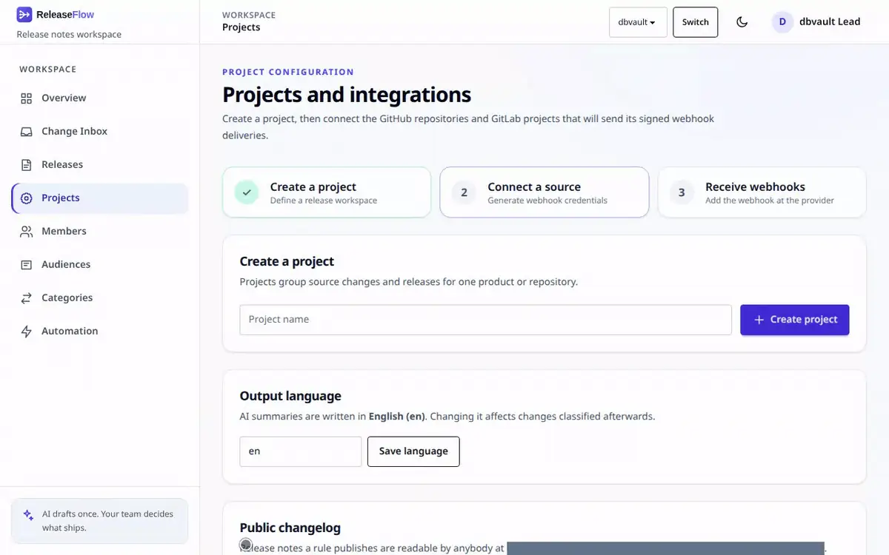

An unknown source returns `404 source_not_found`, and one already connected returns
`409 github_repository_already_connected`, `409 gitlab_project_already_connected`,
`409 linear_team_already_connected`, or `409 jira_project_already_connected`. One the
same Project holds disconnected returns `409 source_reconnect_required`: reconnect it
instead, which keeps its changes. Members get `403` for the administrator endpoints.

## Receive GitHub webhooks

In the GitHub repository, open **Settings → Webhooks → Add webhook** and enter:

- **Payload URL**: the public ReleaseFlow address followed by the webhook path
  shown for the Project, for example
  `https://releaseflow.example.com/webhooks/github/<webhook-id>`;
- **Content type**: `application/json`;
- **Secret**: the signing secret saved when the repository was connected;
- **Events**: *Let me select individual events* → *Pull requests*.

`POST /webhooks/github/{webhookId}` needs no session or CSRF token. ReleaseFlow
verifies `X-Hub-Signature-256` with that integration's own secret before it
reads the payload, and takes the Organization and Project from the integration,
never from the payload. It answers:

| Delivery | Response |
| --- | --- |
| Larger than 1 MiB | `413` `webhook_payload_too_large` |
| Unknown webhook ID, missing or wrong signature | `401` `webhook_signature_invalid` |
| `repository.full_name` is not the configured repository | `422` `webhook_repository_mismatch` |
| Verified delivery with invalid JSON, no `X-GitHub-Event`, or a merged pull request missing fields or `X-GitHub-Delivery` | `400` `webhook_payload_malformed` |
| `ping` | `200` `{"outcome":"pong"}` |
| Merged pull request (`closed` with `merged: true`) | `200` `recorded`, or `duplicate` when already recorded |
| Any other event or action | `200` `ignored` |

Each merged pull request is stored once per repository, so GitHub redeliveries
are harmless, and two repositories of one Project may both have a pull request #12.
The Projects page shows the time of the last accepted delivery,
which appears as soon as GitHub sends its initial `ping`, and so do the Change Inbox and
the overview, with the source's [health](#source-health).

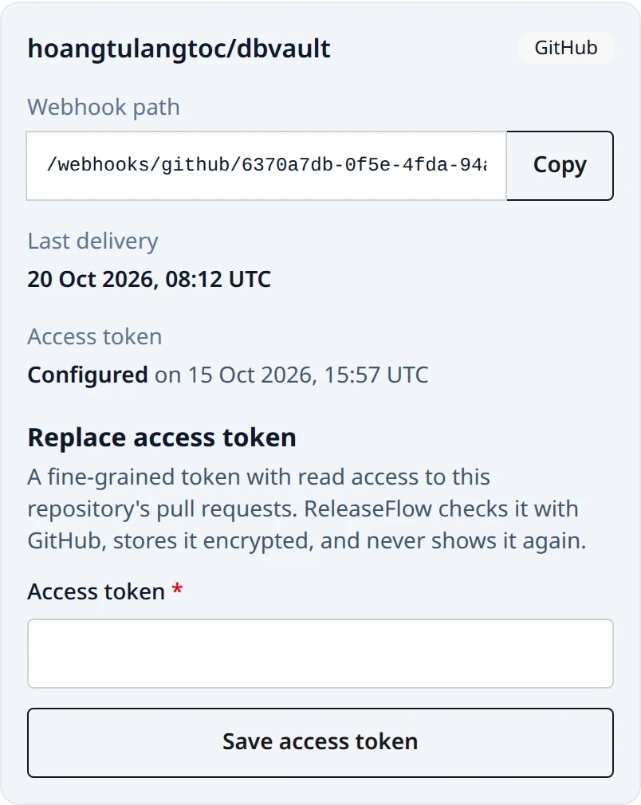

To exercise the endpoint locally without GitHub, sign the exact bytes you send:

```bash
WEBHOOK_PATH=/webhooks/github/replace-with-the-webhook-id
WEBHOOK_SECRET='replace-with-the-saved-secret'
BODY='{"zen":"Keep it logically awesome.","repository":{"full_name":"owner/repository"}}'
SIGNATURE="sha256=$(printf '%s' "$BODY" | openssl dgst -sha256 -hmac "$WEBHOOK_SECRET" | awk '{print $NF}')"
curl -sS -X POST "http://localhost:8080$WEBHOOK_PATH" \
  -H 'Content-Type: application/json' \
  -H 'X-GitHub-Event: ping' \
  -H "X-GitHub-Delivery: $(uuidgen)" \
  -H "X-Hub-Signature-256: $SIGNATURE" \
  --data-binary "$BODY"
```

## Receive GitLab webhooks

In the GitLab project, open **Settings → Webhooks → Add new webhook** and enter:

- **URL**: the public ReleaseFlow address followed by the webhook path shown for
  the source, for example
  `https://releaseflow.example.com/webhooks/gitlab/<webhook-id>`;
- with **signed headers** (the default): the **signing token** shown when the
  project was connected in GitLab's **Signing token** field (`signing_token` in the
  hooks API), and **Secret token** left empty;
- with a **secret token header**: the saved secret in **Secret token**;
- **Trigger**: *Merge request events*.

GitLab clears a hook's secret token whenever its URL changes, so whenever you edit the
URL, enter the token again in the same save, or send `url` and the token together
through the hooks API (see [Rotate a webhook secret](#rotate-a-webhook-secret)).

The signing token is the secret written the way Standard Webhooks, and so GitLab,
expects it: `whsec_` followed by the standard, padded Base64 of the secret's 32 bytes.
The secret itself is unpadded Base64url of the same bytes, which GitLab refuses as a
signing token. Both are shown once, on the page and in the `signingToken` field of
the response that connects the source. To write the signing token from a saved
secret:

```bash
printf 'whsec_%s\n' "$(printf '%s=' "$WEBHOOK_SECRET" | tr '_-' '/+' | base64 -d | base64 -w0)"
```

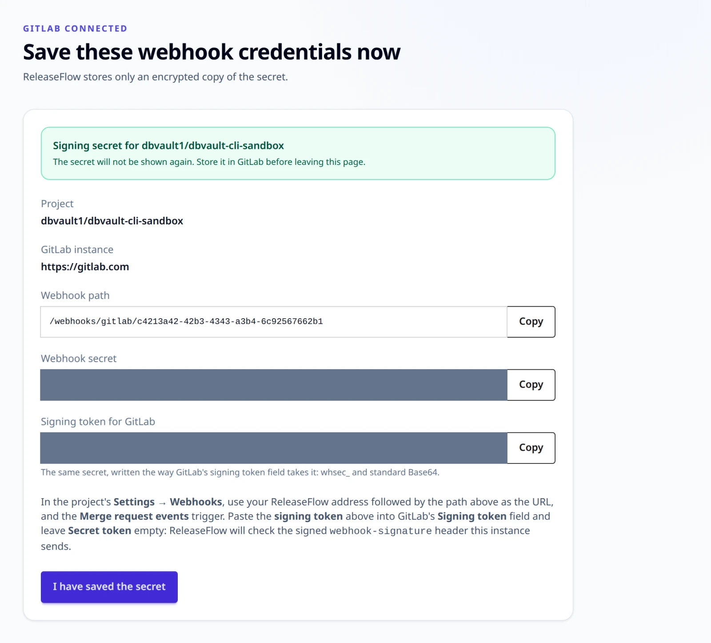

`POST /webhooks/gitlab/{webhookId}` needs no session or CSRF token, and
ReleaseFlow proves the delivery with that source's own secret before it reads
the payload. Which check applies is chosen when the source is connected:

- **Signed headers (Standard Webhooks)**, the default: `webhook-id`,
  `webhook-timestamp`, and `webhook-signature` must all be present, the
  signature must be `v1,` followed by the Base64 HMAC-SHA256 of
  `id.timestamp.body` under the secret — any one of several space-separated
  candidates may match — and the timestamp must be within five minutes of
  ReleaseFlow's clock.
- **Secret token header**: `X-Gitlab-Token` must equal the secret.

The Organization and Project come from the source, never from the payload:

| Delivery | Response |
| --- | --- |
| Larger than 1 MiB | `413` `webhook_payload_too_large` |
| Unknown webhook ID, a source of another type, missing, stale, or wrong proof | `401` `webhook_signature_invalid` |
| `project.path_with_namespace` is not the connected project | `422` `webhook_repository_mismatch` |
| Proven delivery with invalid JSON, or a merged merge request missing fields | `400` `webhook_payload_malformed` |
| Merged merge request (`object_kind: merge_request` with `action: merge`) | `200` `recorded`, or `duplicate` when already recorded |
| Any other event or action | `200` `ignored` |

Each merge request is stored once per source, so redeliveries are harmless.
GitLab identifies a delivery only in its signing mode, so a change records
`X-Gitlab-Event-UUID` when it is a GUID and nothing otherwise.

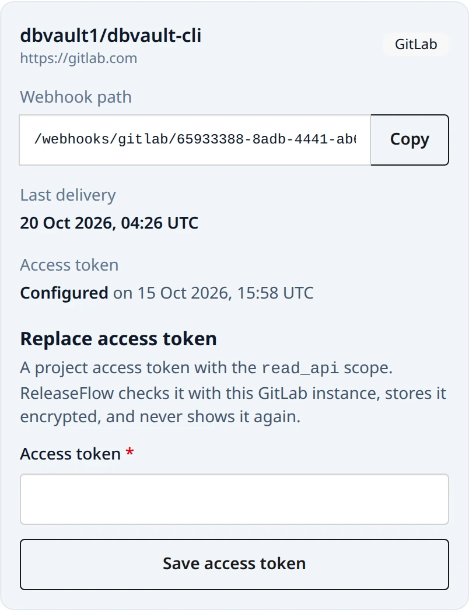

Only instances named in `RELEASEFLOW_GITLAB_ALLOWED_HOSTS` (default
`gitlab.com`) can be connected. An entry is `host` or `host:port`, which means
HTTPS, or a full origin such as `http://gitlab.internal:8080`; writing the
scheme is the only way to accept an instance reached without TLS. A URL with
credentials, a query, or a fragment is refused with
`400 gitlab_base_url_invalid`, and any other host with
`400 gitlab_host_not_allowed`. ReleaseFlow never follows a redirect from a
GitLab instance.

To exercise the endpoint locally without GitLab, sign the exact bytes you send:

```bash
WEBHOOK_PATH=/webhooks/gitlab/replace-with-the-webhook-id
SIGNING_TOKEN='whsec_replace-with-the-signing-token'
BODY='{"object_kind":"push"}'
DELIVERY_ID="$(uuidgen)"
TIMESTAMP="$(date +%s)"
SIGNATURE="v1,$(printf '%s' "$DELIVERY_ID.$TIMESTAMP.$BODY" \
  | openssl dgst -sha256 -mac HMAC -macopt "hexkey:$(printf '%s' "${SIGNING_TOKEN#whsec_}" \
      | base64 -d | xxd -p -c 256)" -binary | base64)"
curl -sS -X POST "http://localhost:8080$WEBHOOK_PATH" \
  -H 'Content-Type: application/json' \
  -H "webhook-id: $DELIVERY_ID" \
  -H "webhook-timestamp: $TIMESTAMP" \
  -H "webhook-signature: $SIGNATURE" \
  --data-binary "$BODY"
```

## Receive Linear webhooks

Linear mints the signing secret itself, so create the webhook there first: under
**Settings → API → Webhooks**, set the URL to your ReleaseFlow address followed
by the path ReleaseFlow shows for the source, and enable the **Issues** event.
Copy the secret Linear displays and paste it, with an API key, when connecting
the team in ReleaseFlow.

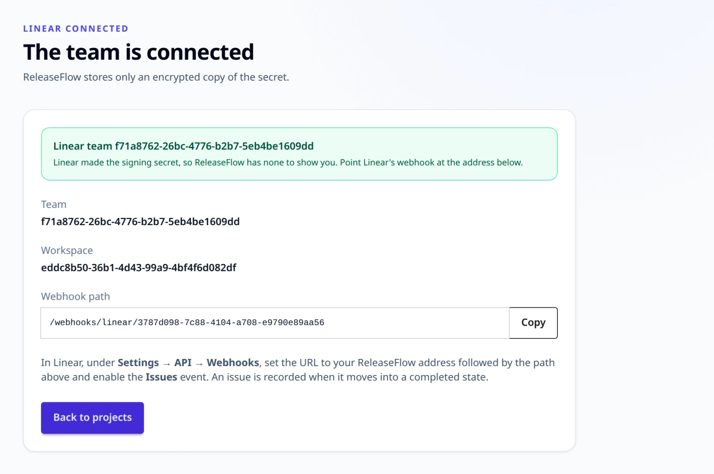

`POST /webhooks/linear/{webhookId}` needs no session or CSRF token. A delivery
proves itself with four things, all of which must hold:

- a `Linear-Delivery` header;
- a `createdAt` within `RELEASEFLOW_LINEAR_WEBHOOK_CLOCK_SKEW` (60 seconds) of
  ReleaseFlow's clock, in ISO-8601 or as epoch seconds or milliseconds;
- an `organizationId` equal to the workspace the team belongs to, which
  ReleaseFlow learned when the team was connected;
- a hex HMAC-SHA256 of the raw body in `Linear-Signature`.

| Delivery | Response |
| --- | --- |
| Larger than 1 MiB | `413` `webhook_payload_too_large` |
| Unknown webhook ID, a source of another type, a missing header, a stale stamp, another workspace, or a wrong signature | `401` `webhook_signature_invalid` |
| A body that is not a JSON object, even with a correct signature: the stamp and the workspace are read from the body, so it can never be proven | `401` `webhook_signature_invalid` |
| An issue of a team other than the connected one | `422` `webhook_repository_mismatch` |
| A proven delivery whose issue is missing fields | `400` `webhook_payload_malformed` |
| An issue that has just moved into a completed state | `200` `recorded`, or `duplicate` when already recorded |
| Any other event, action, or state change | `200` `ignored` |

An issue counts only when it really moved into being done: `type` `Issue`,
`action` `update`, an `updatedFrom` that carries a state, a new state of
`completed`, and an old state that is not. Editing an issue that was already
completed changes nothing.

Linear names no delivery ReleaseFlow can record as a GUID, so a Linear change
carries no delivery ID. Each issue is still stored once per source, by its UUID,
so redeliveries are harmless.

## Poll Jira

Jira needs nothing configured on its side. Connect a Jira Cloud project with its
site (`https://your-site.atlassian.net`), its project key (`APP`), the email of
the account ReleaseFlow signs in as, and an
[Atlassian API token](https://id.atlassian.com/manage-profile/security/api-tokens)
for that account that can browse the project. ReleaseFlow asks Jira to confirm
them before storing anything, and answers `400 jira_site_invalid` for a site that
is not an HTTPS `atlassian.net` address with no port, credentials, query, or
fragment, `400 jira_token_rejected` when Jira refuses the account and token, and
`503 jira_unavailable` when it cannot be reached.

From then on, ReleaseFlow reads the project every
`RELEASEFLOW_JIRA_POLL_INTERVAL` (five minutes). Each read asks for the issues in
a Done status category that were updated since the previous read, reaching back
`RELEASEFLOW_JIRA_POLL_OVERLAP` (ten minutes) so nothing at the edge is lost, and
records each issue that was resolved in that window once. Issues resolved before
the project was connected are never read. A change from Jira:

- is numbered after its key — `APP-123` is `#123` — and titled
  `APP-123: summary`, with the reporter as its author and
  `{site}/browse/APP-123` as its link;
- has no changed files, so it is checked with the same sensitive-word scan as a
  Linear issue;
- starts with its key, so the Conventional Commit title rule never matches it:
  without AI, a Jira change is Unknown and needs review.

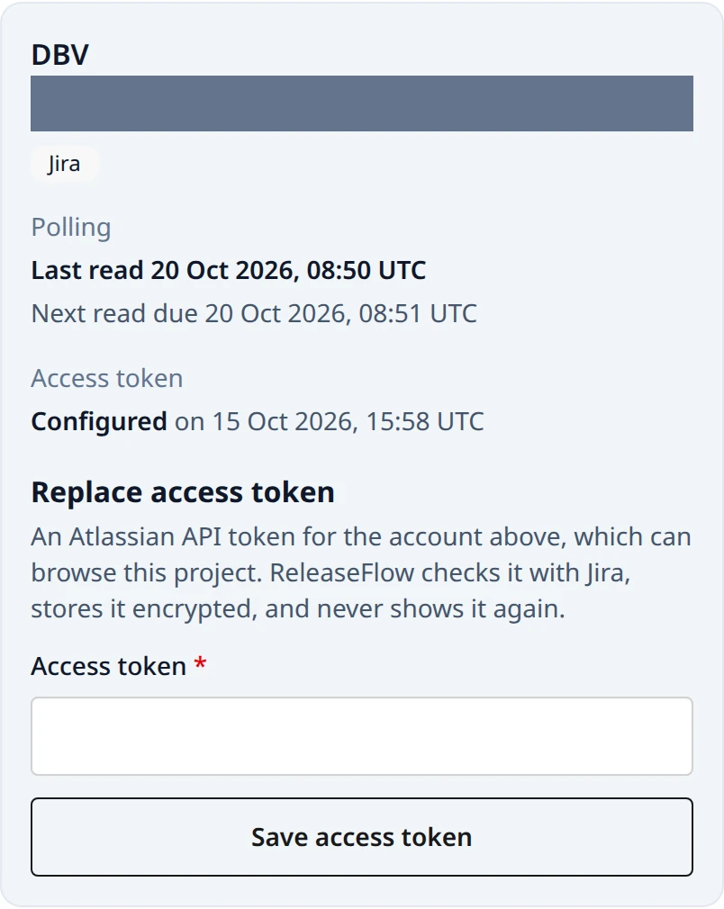

A read that fails keeps its place and tries again, and the source shows
**Connection failing** until one succeeds. A failure Jira may get over, such as a
rate limit or an outage, is tried up to five times, after the wait Jira asked for (at
most an hour) or after 2, 4, 8 … seconds (at most five minutes). A read that still
fails, or that Jira refused outright, such as a token it rejected, books the next read
**15 minutes** later rather than after `RELEASEFLOW_JIRA_POLL_INTERVAL`. That wait is
fixed in ReleaseFlow, not configured, and neither saving a new token nor restarting
brings the booked read forward. The Change Inbox shows each Jira project's last and next
read; a Jira project has no history import.

### Linked issues

When a Project has a Jira source or a Linear source with its token, each GitHub or GitLab
change is checked for the issues it mentions: keys of the Jira project, such as `APP-12`,
and identifiers of the Linear team, such as `OPS-7`, matched without regard to case. It
looks in the change's title, description, target branch, head branch (the branch the pull
or merge request came from), and up to 250 commit messages. At most ten keys of each
tracker are read, each from its own tracker, and shown under **Linked issues** on the
change, given to the AI as untrusted evidence, and available to audience templates:

```mustache
{{#linkedIssues}} [{{key}}]({{url}}) {{title}} ({{type}}{{#status}}, {{status}}{{/status}}){{/linkedIssues}}
```

What counts as a mention depends on where the key is:

| Where | Counts | Does not count |
| --- | --- | --- |
| Head branch | `feature/APP-47-retention-preview`, `APP-47/preview`, `bugfix/app-47_restore` | `release/2026-APP-47x`, `APP-047` |
| Description, commit message | `Spec: APP-12-quartz`: a key followed by a hyphen and a lowercase word | `APP-12-3`, `APP-12-Q`, and `ISO-8601-compliant`, whose prefix is no tracker of the Project |
| Title, target branch | `APP-3` standing alone | `feature/APP-3-export`: a key followed by a hyphen |

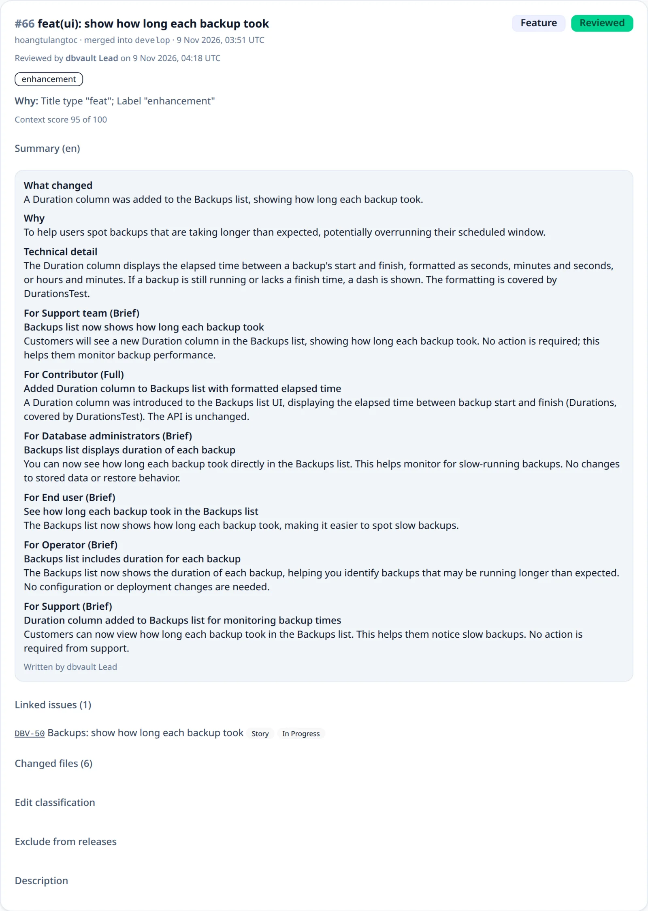

A Linear team's key is read when the team is connected and kept; a team connected before
1.2.0 has it read at the first change checked afterwards. A team whose key cannot be read
links nothing, and the change says so. An issue of another Linear team is not linked.

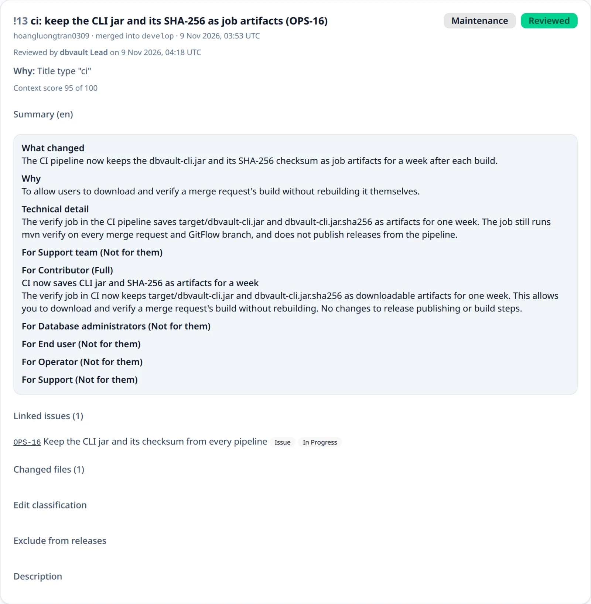

An issue is read when the change is recorded, and what was read then is what the change
keeps. A release reads its changes' issues again when its review is requested, so a note
shows each status as of review (see
[Linked issues at review](release-notes.md#linked-issues-at-review)). They are evidence
of what the change pointed at, never a live view of the tracker.

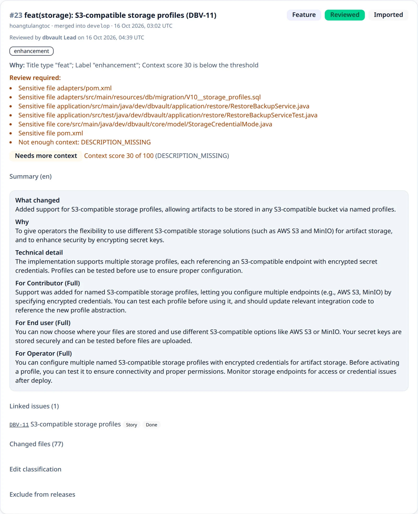

Commit messages are only searched for keys; they are never stored. When commits
could not be read, or Jira or Linear would not show an issue the change mentions, the
change is retried and then marked **Linked issues incomplete**, which forces
review.

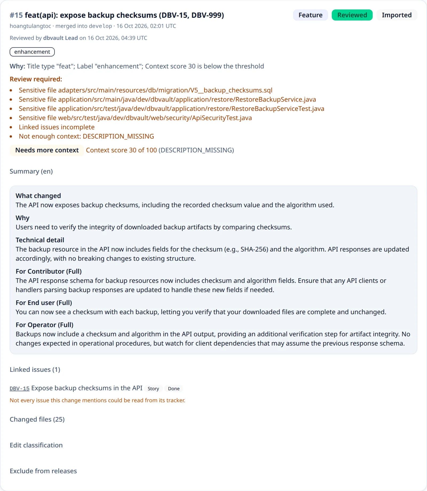

## Access tokens

With an access token, ReleaseFlow lists the files each merged pull or merge
request touched, so changes to sensitive files are always reviewed. Without one, every
new GitHub or GitLab change needs review, because nothing can be ruled out. Linear and
Jira need their token from the moment they are connected.

For GitHub, create a fine-grained personal access token limited to the
repository, with **Pull requests: Read-only** permission (a classic token needs
`repo` for a private repository). For GitLab, create a project access token with
the `read_api` scope. For Linear, create an API key that can read the team —
that one is required when the team is connected, because confirming it is also
how ReleaseFlow learns the workspace. For Jira, the API token is required too,
and belongs to the source's account email; a new token from another account comes with
that account's email, as `accountEmail`, and both are confirmed together. An
administrator enters it under the
source in the Project's card on the Projects page, or calls:

```text
PUT /api/projects/{projectId}/sources/{sourceId}/token {"token", "accountEmail"?}   (administrator; 204)
```

ReleaseFlow first asks the provider to confirm the token — GitHub for the
repository's pull requests, GitLab for the project, Linear for the team, which it
accepts only while the key still reaches the same workspace, Jira for the project
— then stores it
encrypted with AES-256-GCM. The token is never returned; the source only reports
`accessTokenConfigured` and `accessTokenUpdatedAt`. Sending a new token replaces
the old one, which is how a token is rotated: the source, its path, and its secret stay,
and the old token is never used again once the new one is stored, though a call already
under way finishes with it. ReleaseFlow cannot revoke a token, so revoke the old one at the
provider once the new one is saved. Nothing reminds anyone to rotate. A disconnected
source takes no token and answers `409 source_disconnected`. Errors are `400 github_token_rejected` or `400 gitlab_token_rejected`
or `400 linear_token_rejected` or `400 jira_token_rejected` when the provider
refuses the token, `503 github_unavailable`, `503 gitlab_unavailable`, or
`503 jira_unavailable` when it cannot be reached,
`404 source_not_found`, and `403` for members.

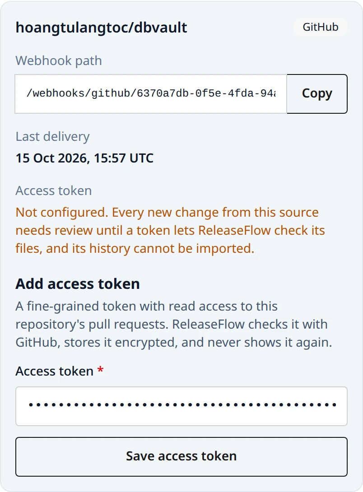

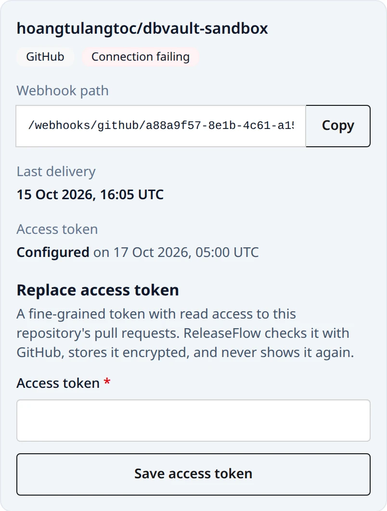

GitLab's changed files come from the merge request's diffs, at most ten pages of
a hundred. A diff GitLab reports as collapsed, too large, or truncated makes the
whole list unavailable rather than short, so a file that was never seen is never
declared safe.

Linear has no changed files at all, which is not the same as failing to list
them: instead of forcing review for ever, ReleaseFlow reads the issue's own title
and description for `breaking change`, `migration`, `security`, `auth`,
`credential`, `password`, and `encryption`, and each match becomes a
**Sensitive word** trigger that forces review. Linear's token is also what lets
ReleaseFlow read the issue back, so a change carries the issue's current wording
rather than whatever it said the instant it was completed.

## History import

Webhooks bring in the pull and merge requests merged after a source is
connected. To add the ones merged before, an administrator opens the **Source
sync** panel of the Change Inbox and chooses **Import last 90 days** for a
source with an access token, or calls the REST endpoints below. Only a source
whose provider keeps a history ReleaseFlow can read offers it; Linear and Jira
do not, and asking anyway answers `409 source_import_not_supported`. A background
worker reads the source's history 100 items per page — GitHub's closed pull
requests, most recently updated first, or GitLab's merged merge requests updated
after the window's start, least recently updated first — and records every one
merged in the last 90 days through the same processing as a webhook delivery:
its changed files are listed and, when AI is configured, it is classified once.
An item already recorded, by webhook or by an earlier import, is skipped, so
imports and webhooks never duplicate each other. Imported changes carry an
**Imported** badge.

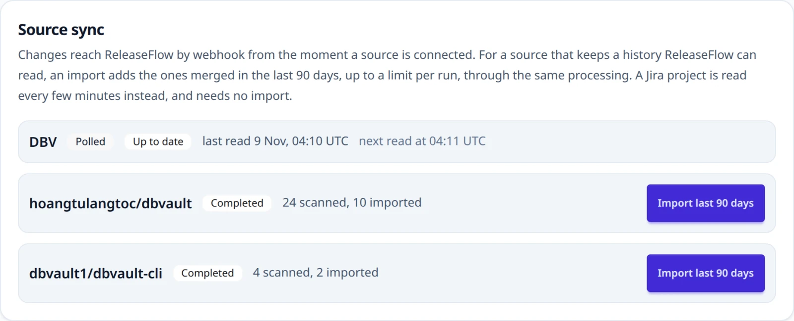

A GitHub import stops at the first pull request updated before its window, and
either import stops after 500 new changes as **Stopped at the limit** with its
position saved; **Resume** continues from there with a fresh count, and so does
resuming a failed import. When the provider rate-limits the import, it waits as
long as the provider asks (`Retry-After` or the rate-limit reset, at most an
hour); other temporary failures wait with growing delays. After five attempts,
or at once when the provider refuses the token, the import fails, and a refused
token marks the source as **Connection failing** until a new token is saved.
Only one import of a source runs at a time.

```text
GET  /api/projects/{projectId}/imports                              (every member)
POST /api/projects/{projectId}/sources/{sourceId}/imports           (administrator; 202)
POST /api/projects/{projectId}/sources/{sourceId}/imports/resume    (administrator; 202)
```

Each import reports `status` (`PENDING`, `RUNNING`, `RETRY_SCHEDULED`,
`COMPLETED`, `PARTIAL`, or `FAILED`), `scannedCount`, `importedCount`, the
window, `lastSyncAt`, `lastErrorCode`, and `canResumeImport`. A polled source
reports `polled` and `nextPollAt`, and its latest job is its latest poll. Errors are
`409 source_token_missing`, `409 source_sync_in_progress`,
`409 source_import_not_resumable`, and `404 source_not_found`. See
[ADR-0016](adr/0016-integration-sources-and-history-import.md).

See also [ADR-0017](adr/0017-gitlab-sources.md) for the GitLab source and
[ADR-0018](adr/0018-linear-sources.md) for the Linear source, which has no
history to import, and [ADR-0019](adr/0019-jira-sources-and-linked-context.md)
for Jira polling and linked issues.

## Source health

Each source's health is shown where people look: in the Change Inbox's **Source sync**
panel, on the overview beside its figures, on the Projects page, and on the source's own
page, which **Manage source** opens. The REST view of a source carries it as `health`.

- **Last delivery** — the last delivery that proved itself and was accepted. A delivery
  refused for its repository, or one that could not be read, does not count.
- **Refused for their signature** — how many deliveries to the source's path failed
  their proof since the webhook secret was last set (`signatureFailureCount`), and the
  time of the last one (`lastSignatureFailureAt`). A missing or wrong signature, a stale
  stamp, and another Linear workspace all count. Nothing else about a refused delivery is
  kept: not its body, its headers, the secret, or where it came from. The count starts
  again whenever the secret is set, so after a [rotation](#rotate-a-webhook-secret) it
  says how many deliveries the provider still signs with the old secret.
- **Quiet** — a connected source that delivers is quiet when nothing has arrived for
  longer than it usually goes. Its usual gap is the 90th percentile of the gaps between
  the changes it was delivered by webhook in the last 90 days, never less than an hour
  (`usualGapHours`); a source with fewer than ten such gaps has no rhythm yet and is never
  flagged. Each source is measured against itself, so a rarely used source is not flagged
  for being rare, and a dead webhook address, which silences every source behind it at
  once, shows on the busy ones. Silence is all ReleaseFlow can see of a dead address:
  nothing arrives at all.
- **Overdue** — a Jira source whose next read is more than one poll interval late. A
  poll that finds nothing is a success, so a Jira source is never quiet.

Health is evidence on a page. Nothing computes it on a schedule, nothing is sent
anywhere, and it never stops a source, a release, or a rule. ReleaseFlow has no inbound
rate limit, so counting is bounded instead: the first refused delivery on a source is
written at once and the rest are added up in memory and written about once a second, one
row update per source however many arrive. See [Operations](operations.md#deploying-to-production)
for limiting `/webhooks/**` at the proxy.

## Rotate a webhook secret

A source's webhook secret can be replaced without changing its path, from **Manage
source** or through REST. **The old secret stops working the moment the new one is
saved**: a secret is rotated because someone else may know it, and while two secrets
worked, whoever held the old one could still put a pull request of their choosing in the
Change Inbox. So update the provider straight after, and send again whatever it refused
in between.

```text
POST /api/projects/{projectId}/sources/{sourceId}/webhook-secret                    (administrator; 200, shown once)
PUT  /api/projects/{projectId}/sources/{sourceId}/webhook-secret {"webhookSecret"}  (administrator; 204)
```

`POST` generates the secret, for GitHub and GitLab, and returns it once with the webhook
path, in a `no-store` response; for a GitLab source with signed headers it also returns
`signingToken`. `PUT` stores one the provider made — Linear's signing secret, or a
signing token GitLab generated for a signed source, which must be `whsec_` followed by
Base64 (`400 source_signing_token_invalid` otherwise) — and never echoes it. A source
whose secret ReleaseFlow makes answers a `PUT` with `409 source_secret_generated`, Linear
answers a `POST` with `409 source_secret_pasted`, and Jira, which has no webhook, answers
both with `409 source_has_no_webhook`. Rotating calls no provider.

**GitHub.** In the repository's **Settings → Webhooks**, edit the hook, paste the new
secret into **Secret**, and select **Update webhook**; the payload URL does not change.
GitHub never sends a refused delivery again on its own: open the hook's **Recent
deliveries** and **Redeliver** each one refused since the rotation, which GitHub allows
for three days. A [history import](#history-import) also reads the gap, and adds nothing
twice.

**GitLab, signed headers.** Either send ReleaseFlow's token with GitLab's hooks API, the
URL and the token together in one request, as the page shows it:

```text
PUT https://gitlab.example.com/api/v4/projects/<project-id>/hooks/<hook-id>
PRIVATE-TOKEN: <a token that may edit the hook>
Content-Type: application/json

{"url": "https://releaseflow.example.com/webhooks/gitlab/<webhook-id>", "signing_token": "whsec_…"}
```

or select **Generate signing token** on the hook in GitLab and paste what GitLab shows
once on the source's page. ReleaseFlow never sends the request itself: it holds no token
that may edit a hook.

**GitLab, secret token header.** In the project's **Settings → Webhooks**, edit the hook,
paste the secret into **Secret token**, and save; through the hooks API, send `url` and
`token` in one request.

**GitLab, either mode.** GitLab clears a hook's secret token whenever its URL changes, a
security fix of its own ([gitlab-org/gitlab#382260](https://gitlab.com/gitlab-org/gitlab/-/issues/382260);
the warning in the form came with
[!139865](https://gitlab.com/gitlab-org/gitlab/-/merge_requests/139865)). Its signing
token behaved differently on the dbvault lab, where a URL-only edit through the hooks API
left it in place, but do not lean on the difference: whenever you change the URL — a new
tunnel address, say — enter the token again in the same save. A token cleared anyway can
only be replaced by rotating again, because ReleaseFlow showed it once. Then open the
hook's **Recent events** and **Resend Request** each event refused since; GitLab keeps
them for two days. GitLab disables a hook that fails four times in a row, so if it did,
enable it again.

**Linear.** Linear documents no way to regenerate a webhook's signing secret, so make a
new webhook instead: in **Settings → API → Webhooks**, create a second webhook with the
same URL and the **Issues** event, copy its signing secret from its detail page, paste it
on the source's page, and then delete the old webhook. Until then both webhooks send every
event; one copy verifies before the paste and the other after, and each issue is recorded
once, so nothing is missed. The copies that fail are counted as signature failures, and
Linear retries a refused delivery three times, the last about six hours later.

## Disconnect a source

An administrator disconnects a source from **Manage source → Review and disconnect**,
which first says what will happen, or through REST:

```text
POST /api/projects/{projectId}/sources/{sourceId}/disconnect   (administrator; 200)
```

- **Every change it recorded stays**, with its reviews, releases, notes, and evidence,
  and the Change Inbox still lists it.
- **Its webhook secret and access token are destroyed**, and so are its webhook identity
  and its schedule. Its webhook path then answers `401 webhook_signature_invalid`,
  exactly like a path that never existed, and records nothing.
- **Its imports and polls stop.** A queued import or poll ends as `source_disconnected`;
  one already running stops before its next page. A change still being processed is
  finished as if the source had no token, so its files are unavailable and it needs review.
- **Nothing else borrows it.** Linked issues, a note's compare and release links, the
  overview's next step, and a [GitHub Release action](automation.md#actions) count only
  connected sources. The confirmation page names the enabled rules whose GitHub Release
  action would fail; they stay enabled, and their action fails as
  `github_source_disconnected` until the repository is reconnected.

ReleaseFlow calls nothing at the provider. Delete the webhook there and revoke the token:
older copies of the encrypted values stay in the database's history and backups until
those expire, and they are useless without the master key, but the provider-side
revocation is what makes a leaked token harmless. Disconnecting a disconnected source,
setting its token or secret, or importing into it answers `409 source_disconnected`.

## Reconnect a source

A disconnected source comes back under its own ID, from **Reconnect source** on the
Projects page or through REST, so ReleaseFlow keeps recognising every change it recorded:
an import after the reconnect records only what is new, and a redelivered pull request is a
`duplicate`.

```text
POST /api/projects/{projectId}/sources/{sourceId}/reconnect {"token"?, "webhookSecret"?, "accountEmail"?}   (administrator; 200)
```

A reconnect never changes what the source is — its type, repository or project, instance,
workspace, and Project stay — so it takes only what connecting that type takes besides:

| Type | Body | What comes back |
| --- | --- | --- |
| GitHub | an optional `token` | A new webhook path and secret, **shown once** |
| GitLab | an optional `token`; for signed headers, optionally a `webhookSecret` GitLab generated | A new webhook path, and a secret shown once unless one was pasted |
| Linear | `webhookSecret` from a new Linear webhook, and `token` | A new webhook path; the team must still be in the same workspace |
| Jira | `accountEmail` and `token` | Nothing secret; the next read is one interval later |

The new webhook path means a hook nobody updated stays dead, so point the provider's hook
at the new path with the new secret. A missing credential answers
`400 source_credential_required` with the `field`; a reconnect of a connected source answers
`409 source_not_disconnected`. A reconnected Jira source reads, at its first poll, what was
completed while it was disconnected, at most 90 days back; for GitHub and GitLab, run a
[history import](#history-import) to pick up what merged meanwhile.

Connecting the same key again in the same Project is refused with
`409 source_reconnect_required`, because a second source would be a second identity and its
import would record every change again. Once a source is disconnected, a *different*
Project may connect the same repository, as a new source with its own record; the first
Project keeps its changes, and cannot reconnect while the other holds it
(`409 github_repository_already_connected` and the like). A renamed or moved repository is
a new source too: ReleaseFlow cannot prove two names are one repository, so its import
records the old name's pull requests again, as new changes, for the possible-duplicate
check and [exclusion](changes.md#excluding-a-change-from-releases) to handle. A renamed GitHub repository
announces itself: its deliveries are refused as `webhook_repository_mismatch`, so the old
source turns quiet. See [ADR-0042](adr/0042-source-lifecycle-and-health.md).

## What ReleaseFlow asks each provider

Connecting a GitHub or GitLab source makes no call at all; the repository is not
validated until a token is saved, and reconnecting one makes the same token check only
when a token is given. Disconnecting a source, rotating its webhook secret, counting
refused deliveries, and showing its health call no provider, and none of it sends
anything to an AI provider or DeepL. After that, every call happens outside the webhook
request, in a background worker, or when an administrator saves a token:

| Provider | Calls |
| --- | --- |
| GitHub | Confirms a token against the repository's pull requests; lists a merged pull request's changed files and, when the Project has a Jira or Linear source, up to 250 of its commit messages; reads closed pull requests for a history import; reads and creates releases for a [GitHub Release action](automation.md#actions) |
| GitLab | Confirms a token against the project; lists a merge request's diffs and, when the Project has a Jira or Linear source, its commit messages; reads merged merge requests for a history import |
| Linear | Confirms the API key and learns the team's workspace and key when the team is connected; confirms the key again, and that it still reaches the same workspace, when the team is reconnected; reads a completed issue back; reads the issues a code change mentions, and again when a release's review is requested |
| Jira | Confirms the project when it is connected, reconnected, or given a new token; searches for issues that moved into Done on every poll; reads the issues a code change mentions, and again when a release's review is requested |

Timeouts, API addresses, and polling intervals are listed in
[Configuration](configuration.md#sources).
