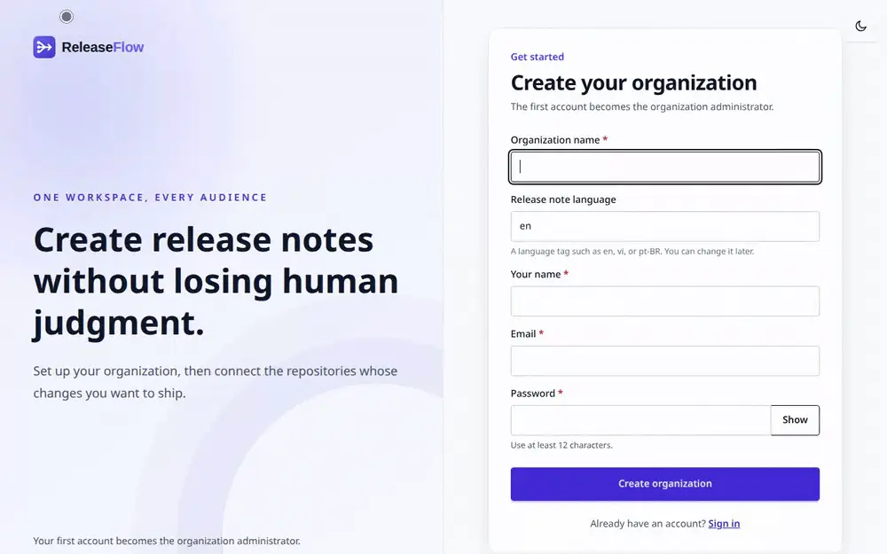
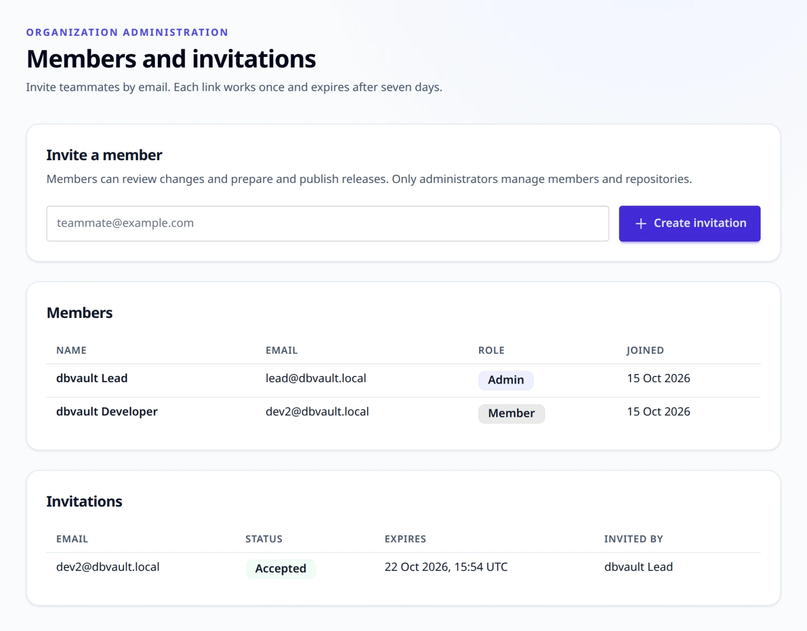
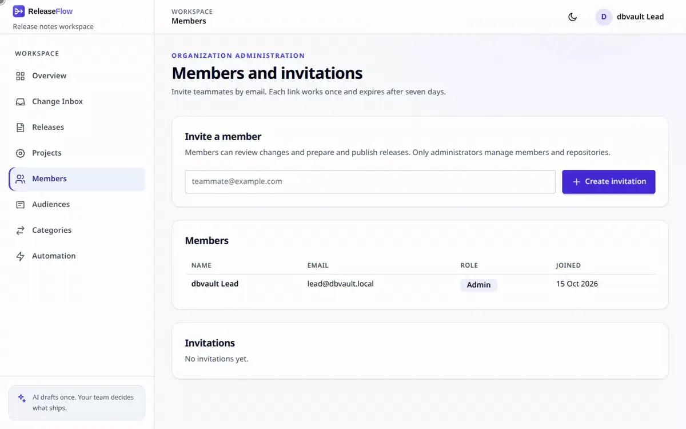
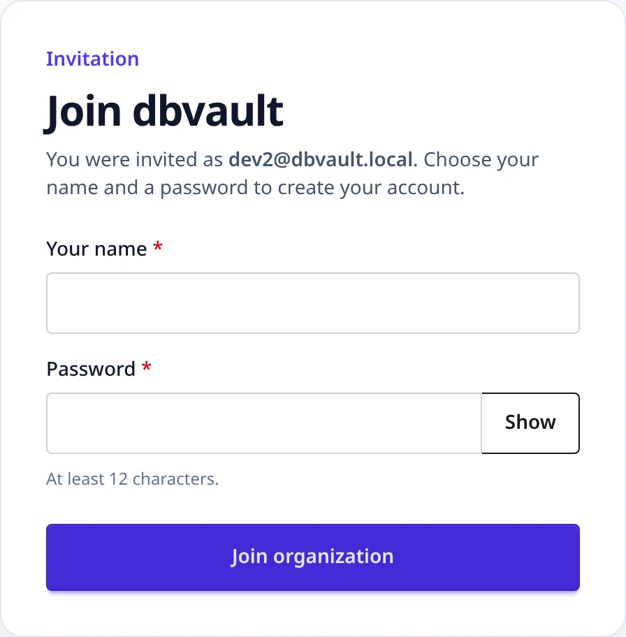
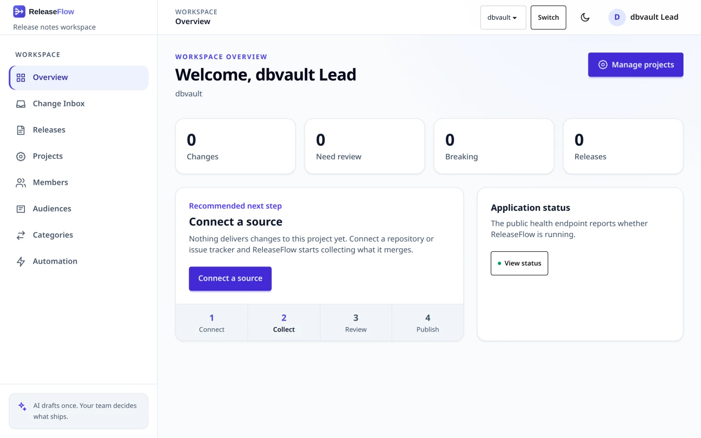
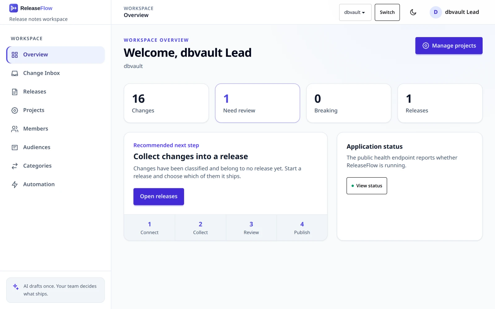
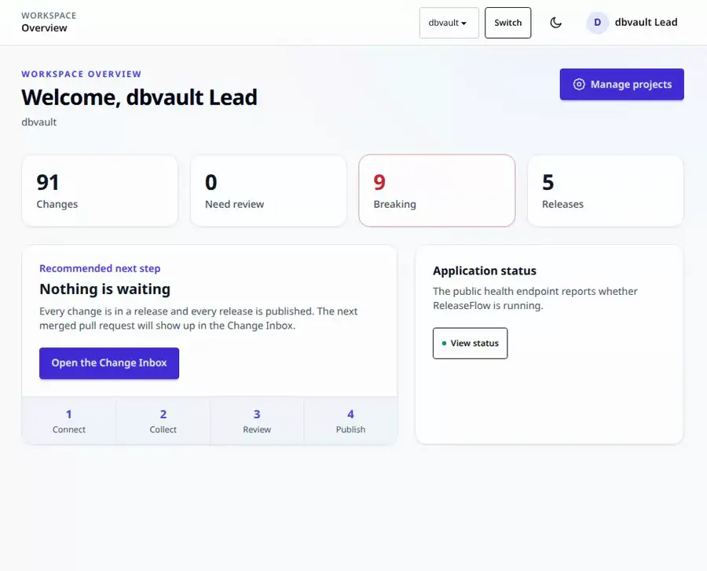
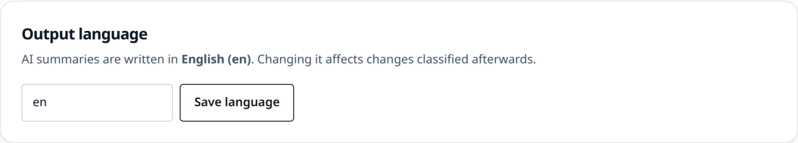

# Workspace

Registration, members and their roles, the overview a person lands on, and the two
languages ReleaseFlow keeps apart: the one a person reads the interface in, and the one
it writes in.

## Registration

Open `/register` to create an Organization and its first account, which is an
**administrator**. REST clients call `POST /api/registrations` with
`{"organizationName", "displayName", "email", "password", "outputLanguage"}` after
fetching a CSRF token (see [REST API](api.md#sessions-and-csrf)); `outputLanguage` is
optional and defaults to English. An email address belongs to one account across the
whole deployment, so registering it twice returns `409 email_already_registered`.
Registration also seeds the Organization's [category catalog](changes.md#categories),
its three preset [audiences](release-notes.md#audiences), and its public changelog
address.



A password has at least 12 characters and at most 72 UTF-8 bytes, the most BCrypt reads,
and is stored only as a BCrypt hash. The same rule applies when an invitation is accepted.

**Registration stays open.** Anybody who can reach `/register` or
`POST /api/registrations` can create another Organization on your deployment, and no
setting closes it. Each Organization is isolated from the others, but a deployment that
the internet can reach — which webhooks need — should refuse both paths at its reverse
proxy once your own Organization exists. See
[Deploying to production](operations.md#deploying-to-production).

## Members and invitations

An Organization has two roles. **Administrators** open **Members** to invite teammates
by email, and they alone can:

- connect sources, set their access tokens, and start history imports;
- add sensitive paths to a Project;
- manage the category catalog and decide what the AI proposes;
- manage audiences and choose the release note languages;
- change the output language and the public changelog address;
- write and run automation rules.

**Members** do the rest of the work: they create Projects, review changes, request AI
classification, decide possible duplicates, and prepare, approve, and publish releases.
They can read a Project's sources, imports, and sensitive paths, the category catalog,
and the release note languages, but not the Members, Audiences, or Automation pages.



An invitation link has the form `/accept-invite#token=…` and is shown once.
ReleaseFlow stores only a hash of it. The link expires after seven days (set
`RELEASEFLOW_INVITATION_TTL`, for example `P3D`, to change this), works once,
and can be reissued or revoked from the Members page. The invitee confirms the
organization, chooses a name and a password, and signs in as a member. Roles
cannot be changed and members cannot be removed yet.





REST clients use the same rules:

```text
GET    /api/members                         (administrator)
GET    /api/invitations                     (administrator)
POST   /api/invitations {"email"}           (administrator; 201, returns acceptancePath once)
POST   /api/invitations/{id}/reissue        (administrator)
DELETE /api/invitations/{id}                (administrator)
POST   /api/public/invitations/inspect {"token"}
POST   /api/public/invitations/accept  {"token", "displayName", "password"}
```

The public endpoints need a CSRF token from `GET /api/csrf`. Every unusable
token returns `400 invitation_invalid`. Other errors are `409
invitation_already_pending`, `409 invitation_email_unavailable` (the email
already has an account), `404 invitation_not_found`, and `403 access_denied`
for members calling administrator endpoints.

## Workspace overview

Signing in opens an overview of one Project: how many changes it has, how many
need review, how many are breaking, and how many releases it has — each a link to
the page that can act on it. Beside them is the **one** next step that is
unfinished, in a fixed order: create a project, connect a source, wait for the
first change, collect changes into a release, finish a review, publish an approved
release, continue a draft, or nothing waiting. A workspace with an open draft and
no changes at all is still waiting for its first change, because there is nothing
to put in the draft.





The header and mobile navigation switch between Projects. ReleaseFlow remembers the
last one in the `releaseflow_project` cookie, so a page reached without `?project=`
opens on it rather than on whichever Project happens to be first. A resource URL's
`projectId` wins over a query and the query wins over the cookie. Switching from a
change or release page keeps that capability; switching from a release detail opens the
selected Project's release list, and switching from an Organization administration page
opens the selected Project's overview. The cookie is `HttpOnly` and carries no
authority: the Project is still looked up against your Organization, so a query or
cookie naming somebody else's is ignored or refused by the page that owns the request.

The mobile navigation is a keyboard-operated disclosure: focus moves into it when it
opens, `Escape` closes it, and focus returns to its trigger. Server validation associates
each field error with its control and focuses the first invalid field. Disclosures and
controls keep a 44 px touch target; operations that cancel work, invalidate a secret, or
archive a rule show their effect before the final submit.

ReleaseFlow's full wordmark follows the selected light or dark interface theme on the
workspace and account pages. Public changelog headers keep the compact mark beside the
Organization name so the Organization remains the primary identity.

A mistyped address answers a browser with a page rather than raw JSON, and one
your role does not reach says so without showing any of it. A form sent after its
session ended returns you to sign in, and one older than your latest sign-in is called
out of date; neither saved anything. A REST client, and anything under `/api`, keeps
the `application/problem+json` it had. An address that names something your
Organization does not have — a Project, a release, a rule — answers with the not-found
page and a line saying what was missing.

What a saved form did is said once, after the redirect, in a toast you dismiss
yourself; reloading the page does not say it again. Messages come in four kinds —
success, info, warning, and error — each with its own colour and icon. The browser
never stops a form with a bubble of its own: the server checks every field, writes
each error under the field it is about in your language, and, on a form of more than
one field, sums them up above it. A required field is marked with `*`.

## Interface language

Each person reads ReleaseFlow in English or Vietnamese. The language is picked
per request, in this order:

1. a `?lang=` query parameter on a GET, such as `/login?lang=vi`;
2. the `releaseflow_lang` cookie;
3. the language saved on the account (`app_users.ui_locale`);
4. `Accept-Language`, narrowed from a region to a language, so `vi-VN` asks
   for `vi`;
5. the first entry of `RELEASEFLOW_UI_LANGUAGES` (default `en,vi`).

A step that names a language this deployment does not ship falls through to the
next one. A supported `?lang=` is written to the cookie, so a link can open
ReleaseFlow in a language and the pages after it stay in it; the account's choice
is left alone, and an unsupported value changes nothing. On a public changelog
page, which is cached publicly, `?lang=` changes that page only and sets no
cookie. The picker sits in the user menu; choosing a language saves it on the
account and writes the cookie, which outranks the account, so the change shows at
once. The cookie is `HttpOnly`, lasts a year, and is `Secure` when the request
was.



The account step reads the language a session started with, not the account as it
is now. A choice made in another browser, or through the API, reaches a session
that was already signed in only when it signs in again; until then that session
keeps its own cookie or, without one, the language it began with.

```text
GET /api/me/ui-locale                  (any member)
PUT /api/me/ui-locale {"uiLocale"}     (the same member)
```

Both return `{uiLocale, supported}`. `uiLocale` is null when the browser decides,
which is also what a new account does and what sending `null` returns to. A
language this deployment does not ship returns `400 ui_locale_invalid`.

Public changelog pages follow the same order, minus the account step: reading a
changelog still creates no session. They declare `Vary: Accept-Language, Cookie`,
because the note inside them is the same for everybody and the chrome is not. The
RSS feed is one shared document and stays English.

Page copy, form messages, and the `title` and `detail` of every
`application/problem+json` response are written in this language. **The `code` of
an error never changes**, so a caller matching on it is unaffected. Recorded
evidence is not interface text and stays as it was recorded: a stored AI failure,
a classification reason, and a provider's own name read the same in every
language.

This is not the language of anything ReleaseFlow writes. Release notes and AI
summaries follow the Organization's output language and its release note
languages, below, whichever language the person approving them was reading in.

## Output language

Each Organization writes its AI summaries in one output language, a language
tag such as `en`, `vi`, or `pt-BR`. It is chosen at registration
(`outputLanguage`, English by default) and shown on the Projects page, where
administrators can change it. Changes affect only changes classified
afterwards.



```text
GET /api/organization/output-language                     (any member)
PUT /api/organization/output-language {"outputLanguage"}  (administrator)
```

Both return `{outputLanguage, displayName, supported}`. Tags are canonicalized
(`vi_VN` becomes `vi-VN`); any tag whose language is an ISO 639 code is
accepted, and an invalid one returns `400 output_language_invalid`.
`RELEASEFLOW_OUTPUT_LANGUAGES` (default `en,vi`) lists the suggestions offered
in the forms.
