# Thay đổi và review

Mỗi pull request đã merge, merge request đã merge và issue đã hoàn thành đều trở thành một
**thay đổi**. Quy tắc phân loại nó, AI có thể tóm tắt nó, và một người review những gì quy tắc
và AI không tự quyết được.

## Xử lý {#processing}

Một thay đổi vừa được ghi lại trước tiên hiện là **Đang xử lý**. Trong khoảng một giây, một
worker chạy nền hỏi nhà cung cấp của thay đổi, bên ngoài mọi giao dịch cơ sở dữ liệu, xem có gì
bổ sung được — dùng chính access token của nguồn — rồi phân loại nó:

- GitHub liệt kê các tệp thay đổi của pull request, tối đa năm trang, mỗi trang một trăm, nên
  pull request có từ 500 tệp trở lên sẽ không có danh sách dùng được;
- GitLab liệt kê các diff của merge request, tối đa mười trang, mỗi trang một trăm (xem
  [Access token](sources.md#access-tokens));
- Linear đọc lại issue, nên thay đổi mang nội dung hiện tại của issue; issue không có tệp;
- Jira không bổ sung gì, vì lượt đọc theo lịch vừa đọc issue ngay trước đó.

Khi Project có nguồn Jira, một thay đổi từ GitHub hoặc GitLab còn được kiểm tra xem có nhắc tới
issue Jira nào không (xem [Issue Jira liên kết](sources.md#linked-jira-issues)).

Hết thời gian chờ, lỗi mạng, bị giới hạn tốc độ hoặc lỗi phía server sẽ được thử lại tối đa ba
lần, chờ 2 rồi 4 giây. Nếu vẫn không liệt kê được tệp, nếu token thiếu hoặc bị từ chối, hoặc nếu
danh sách quá dài, thay đổi vẫn được phân loại nhưng kèm trigger review **Không lấy được danh
sách tệp thay đổi**. Một thay đổi đang xử lý không review được, không gửi cho AI được và không
thêm vào release được. Công việc vẫn còn sau khi khởi động lại, và một việc đang do worker đã
dừng giữ sẽ được worker khác tiếp quản sau mười phút.

## Quy tắc phân loại {#classification-rules}

Việc phân loại dùng các quy tắc cố định:

- một type Conventional Commit ở đầu tiêu đề pull request (`feat`, `fix`, `perf`, `docs`,
  `refactor`, `chore`, `ci`, `build`, `test`, có thể kèm scope) chọn Feature, Fix, Performance,
  Documentation hoặc Maintenance (xem [Category](#categories) để biết cách một quy tắc chọn
  category trong danh mục);
- khi tiêu đề không có type, những nhãn quen thuộc như `enhancement`, `bug`, `documentation`
  hoặc `dependencies` sẽ chọn category, trừ khi các nhãn mâu thuẫn nhau;
- khi mọi tệp thay đổi đều nằm trong `docs/` hoặc có đuôi `.md`, `.adoc` hoặc `.rst`, thay đổi
  là Documentation, bất kể tiêu đề nói gì;
- dấu `!` sau type trong tiêu đề, nhãn `breaking-change`, hoặc footer `BREAKING CHANGE:` trong
  mô tả đánh dấu thay đổi là phá vỡ tương thích;
- nhãn `security`, `security-fix`, `security fix` hoặc `vulnerability`, viết hoa hay thường
  đều được, hoặc một mã CVE như `CVE-2026-12345` trong tiêu đề, mô tả hay một nhãn, đánh dấu
  thay đổi là **thay đổi bảo mật**;
- mọi trường hợp khác là Unknown.

Bảo mật là một cờ nằm cạnh category, giống phá vỡ tương thích, không bao giờ là một category
riêng: một bản sửa lỗi bảo mật vẫn là Fix ở mọi nơi dùng category, và release note liệt kê nó
trong mục 🔒 Bảo mật (xem [Mỗi audience đọc gì](release-notes.md#what-each-audience-reads)).
Các từ như `auth`, `password` hay `encryption` tự chúng không đánh dấu thay đổi là bảo mật;
chúng vẫn là bằng chứng [đường dẫn nhạy cảm](#sensitive-paths) hoặc từ nhạy cảm. Một thay đổi
được ghi nhận trước khi có cờ bảo mật không phải là thay đổi bảo mật cho tới khi một người đánh
dấu nó.

Thay đổi phá vỡ tương thích, thay đổi bảo mật và thay đổi Unknown luôn cần review, và mọi thay
đổi có trigger review cũng vậy:

| Trigger | Khi nào |
| --- | --- |
| Tệp nhạy cảm | Một tệp thay đổi, hoặc đường dẫn cũ của một tệp được đổi tên, khớp với một mẫu sensitive path |
| Không lấy được danh sách tệp thay đổi | Không liệt kê được các tệp |
| Từ nhạy cảm | Nguồn không có tệp (Linear, Jira), và tiêu đề hoặc mô tả có chứa `breaking change`, `migration`, `security`, `auth`, `credential`, `password` hoặc `encryption` |
| Danh sách issue liên kết chưa đầy đủ | Không đọc được commit, hoặc Jira không cho xem một issue mà thay đổi có nhắc tới |
| Phân loại bằng AI thất bại | Lời gọi AI thất bại hoặc câu trả lời không dùng được |
| Không đủ ngữ cảnh | [Điểm ngữ cảnh](#review-signals) thấp hơn ngưỡng |
| Có thể trùng với một thay đổi trước đó | Thay đổi trông giống một thay đổi trước đó (xem [Tín hiệu review](#review-signals)) |
| AI đề xuất một category mới | Không có category nào trong danh mục phù hợp (xem [Category](#categories)) |
| Đã chỉnh loại bước chuyển đổi | Loại bước chuyển đổi AI trả về không khớp với bước đó, nên ReleaseFlow đã chỉnh lại (xem [Phân loại bằng AI](#ai-classification-and-summaries)) |

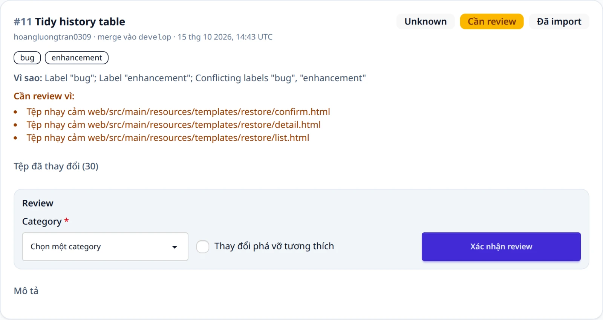

Mỗi thay đổi giữ lại các quy tắc đã khớp, các `reviewTriggers` có kiểu và `changedFiles` của
nó, và hộp thay đổi hiển thị chúng. Một lần review quyết định thay đổi có trigger nhưng vẫn giữ
trigger lại làm hồ sơ.

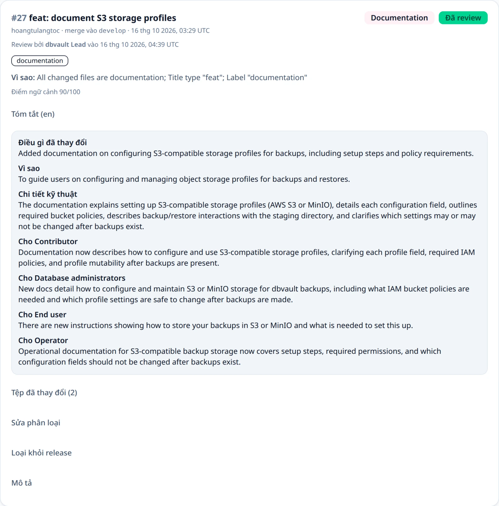

### Sensitive path {#sensitive-paths}

Sensitive path là các mẫu glob của JDK. Danh sách mặc định gồm các thư mục `security` và
`auth`, các tệp có tên dạng `*Security*`, `*Auth*`, `*Credential*` hoặc `*Password*`, migration
cơ sở dữ liệu và `*.sql`, `pom.xml`, `package.json`, `package-lock.json`,
`.github/workflows/`, `Dockerfile`, `application*.properties` và `*.env*`. Một mẫu bắt đầu
bằng `**/` cũng khớp ở thư mục gốc của repository. Thay danh sách này bằng
`RELEASEFLOW_SENSITIVE_PATHS`, các mẫu cách nhau bởi dấu phẩy (không hỗ trợ nhóm ngoặc nhọn như
`{a,b}`). Một mẫu không hợp lệ hoặc một danh sách rỗng sẽ khiến ứng dụng không khởi động, nên
quy tắc này không thể vô tình bị tắt.

Một Project có thể thêm mẫu của riêng nó vào danh sách nền này, ví dụ `**/billing/**`, nhưng
không bao giờ bỏ được mẫu nào trong đó. Mở **Sensitive path** trên thẻ của Project, hoặc gọi
`GET /api/projects/{projectId}/sensitive-paths`, trả về `baseline`, `additions` của Project,
danh sách `effective`, và người thay đổi gần nhất. Mọi thành viên đọc được; chỉ quản trị viên
thay đổi được, mỗi dòng một mẫu trên trang, hoặc gọi
`PUT /api/projects/{projectId}/sensitive-paths` với `{"additions": [...]}`. Các mẫu được cắt
khoảng trắng, và dòng trống cùng mẫu lặp lại bị bỏ đi. Một Project thêm được tối đa 100 mẫu, mỗi
mẫu tối đa 256 ký tự; một mẫu không biên dịch được, hoặc quá nhiều hay quá dài, trả về
`400 invalid_sensitive_paths`. Mẫu mới áp dụng cho những thay đổi được phân loại sau đó, kể cả
khi thử lại bằng AI; những thay đổi đã phân loại giữ nguyên trigger của chúng. Xem
[ADR-0014](adr/0014-project-sensitive-paths.md).

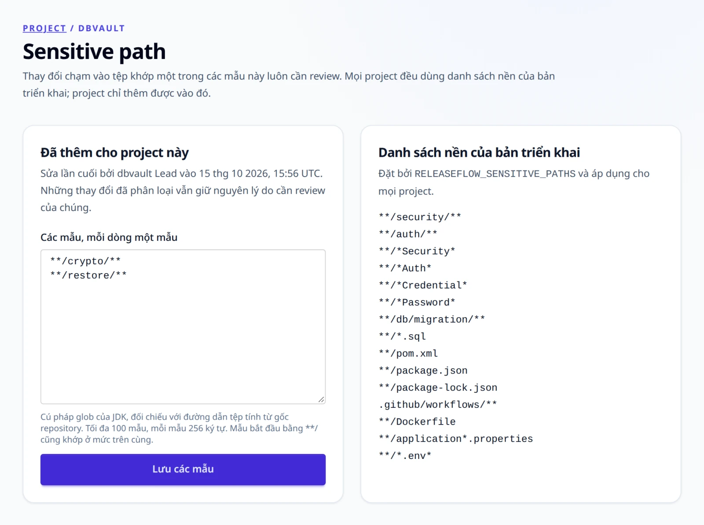

## Hộp thay đổi {#change-inbox}

Mở `/changes` để xem hộp thay đổi (Change Inbox) của một Project, hoặc gọi
`GET /api/projects/{projectId}/changes`. Cả hai đều nhận `category` (một mã category như
`feature` hoặc `security`, không phân biệt hoa thường), `status` (`needs-review`; `classified`
cho những thay đổi được quy tắc quyết định mà không cần người; `reviewed`), và
`context=insufficient` (xem [Tín hiệu review](#review-signals)). Một giá trị không phải mã hay
trạng thái hợp lệ trả về `400 invalid_change_filter`, và Project của Organization khác trả về
`404 project_not_found`. Mỗi thay đổi trả về mã `category` cùng `categoryName` và
`categoryGroup`, đúng như lúc nó được phân loại.

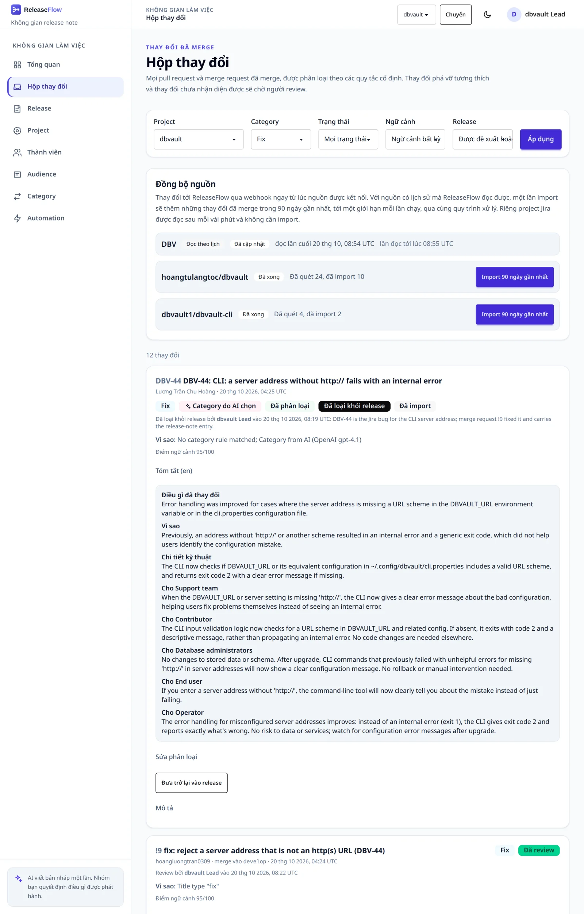

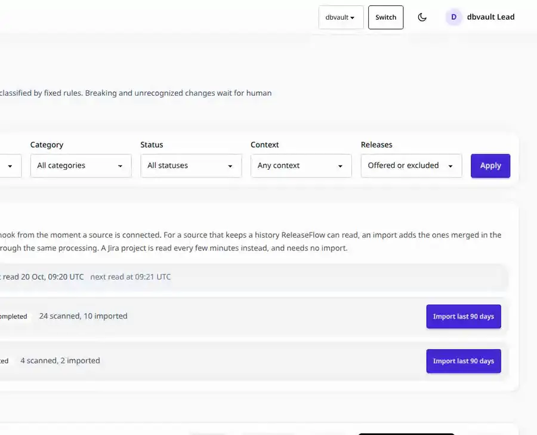

## Phân loại và tóm tắt bằng AI {#ai-classification-and-summaries}

AI không bắt buộc. Để bật nó, chọn một nhà cung cấp và cung cấp key cùng model trước khi khởi
động ứng dụng:

```bash
export RELEASEFLOW_AI_PROVIDER=anthropic          # or openai, deepseek
export RELEASEFLOW_ANTHROPIC_API_KEY='replace-with-an-api-key'
export RELEASEFLOW_ANTHROPIC_MODEL='replace-with-a-model-id'   # from the provider's model list
```

OpenAI và DeepSeek hoạt động giống vậy với các biến của riêng chúng. Không có model mặc định;
chọn một model hỗ trợ đầu ra JSON có cấu trúc. Ứng dụng không khởi động được khi cấu hình chưa
đầy đủ; mọi biến và mọi bước kiểm tra được liệt kê trong [Cấu hình](configuration.md#ai). Khi
không có nhà cung cấp nào, thay đổi chỉ được phân loại bằng quy tắc.

Khi có nhà cung cấp, worker xử lý thay đổi hỏi AI **một lần** cho mỗi thay đổi mới, sau khi đã
biết các tệp thay đổi của nó. Nó gửi tiêu đề, nhãn, nhánh đích, tối đa 4000 ký tự của mô tả,
và cho biết đó là code đã merge (pull request hoặc merge request) hay một issue mà tracker đã
hoàn tất (Linear, Jira); kèm theo ngôn ngữ đầu ra của Organization, các
[category](#categories) đang hoạt động của Organization, category mà quy tắc đã chọn (nếu có),
các issue Jira mà thay đổi nhắc tới dưới dạng bằng chứng không tin cậy, mã và ý định truyền đạt
của từng [audience](release-notes.md#audiences), và [ngữ cảnh Project](#project-context). Nó
không gửi tác giả, và request tới OpenAI đặt `store: false`. Câu trả lời gồm một mã category trong
danh mục (hoặc đề xuất một category mới khi không có cái nào phù hợp), một cờ phá vỡ tương thích,
một cờ bảo mật (thay đổi có làm khác một thuộc tính bảo mật, hay sửa hoặc gây ra một lỗ hổng
không), việc có nên để người review hay không, một **bản tóm tắt trung lập**, và một **narrative** cho
từng audience, tất cả viết bằng ngôn ngữ đầu ra. Bản tóm tắt trung lập gồm: thay đổi gì (một
câu), vì sao, chi tiết kỹ thuật, bước chuyển đổi kèm loại của nó, và giới hạn: những gì thay đổi
cố ý chưa làm. Narrative của mỗi audience có mức liên quan (`none`, `brief` hoặc `full`), một dòng
tiêu đề và phần nội dung; release note bỏ qua thay đổi có mức `none` với audience của nó, trừ khi
thay đổi đó phá vỡ tương thích (xem [Mỗi audience đọc gì](release-notes.md#what-each-audience-reads)).
Narrative nào thiếu hoặc rỗng thì đơn giản là bỏ qua.

Một **dependency update**, tức thay đổi có tác giả là `dependabot[bot]` hoặc `renovate[bot]`,
hoặc có head branch bắt đầu bằng `dependabot/` hay `renovate/`, được gửi cho AI mà không kèm
những gì nó trích từ upstream: các phần tử `<details>` và `<blockquote>`, blockquote Markdown, và
các mục "Release notes", "Changelog", "Commits" đều bị bỏ, chỉ còn lại thứ được nâng phiên bản
và từ phiên bản nào lên phiên bản nào. Bản thân thay đổi vẫn giữ nguyên mô tả. Nó chỉ phá vỡ
tương thích, hoặc có bước chuyển đổi, khi chính lời của nó nói vậy; AI chỉ được dặn điều này
với một dependency update, nên thay đổi khác mà AI không chắc vẫn bị đánh dấu phá vỡ tương thích
và được đưa đi review.

AI được yêu cầu chỉ nói điều có trong bằng chứng, ở mọi trường: không nêu hậu quả mà thay đổi
không mô tả (crash, ngừng dịch vụ, không khởi động được), không nêu vị trí trong sản phẩm mà
thay đổi hay ngữ cảnh Project không nhắc tới, không lấy changelog của một dependency được trích
lại để nói như thay đổi của chính dự án này, không nêu tệp hay code cho một tracker issue mà nội
dung của nó không nhắc tới, và không bình luận về những gì bằng chứng còn thiếu, chỗ đó để trống.

Một bước chuyển đổi có loại:

| Loại | Ý nghĩa |
| --- | --- |
| `REQUIRED` | Bản cài đặt hiện có ngừng hoạt động, hoặc mất một lớp bảo vệ, cho tới khi làm bước này |
| `CONDITIONAL` | Chỉ một số bản cài đặt cần, và bước này nói rõ là bản nào |
| `RECOMMENDED` | Nên làm, nhưng không làm cũng không hỏng gì |
| `NONE` | Không có bước nào |
| `UNSPECIFIED` | Bước được ghi trước khi có loại, hoặc bởi bên gọi không nêu loại; không bao giờ được coi là bắt buộc |

Loại không khớp với bước sẽ được chỉnh lại chứ không bị loại bỏ, vì mỗi thay đổi chỉ được hỏi
AI một lần: `none` mà có bước thì thành `recommended`, loại khác mà không có bước thì thành
`none`, còn bước không có loại thì là `UNSPECIFIED`. Thay đổi đó khi ấy có trigger review
**Đã chỉnh loại bước chuyển đổi**, để một người kiểm lại bước này. Bước do AI viết mà chỉ nói
rằng không cần làm gì, như "No immediate action is required" hay "No migration required", sẽ
bị bỏ trước, nên loại là `NONE`; bước vẫn yêu cầu điều gì đó ("No action is required unless you
enable verification", "Rename the setting; no further action is required") thì được giữ.

Giới hạn chỉ là những gì chính nội dung của thay đổi nói rằng nó cố ý chưa làm. Câu mà AI viết
vào đó để nói về dữ liệu đầu vào, như "Rollback steps are not provided" hay "The version is not
specified", sẽ bị bỏ, và câu chỉ nói phạm vi của thay đổi, như "This does not affect the CLI"
hay "It only affects the CI environment", cũng vậy, vì mức liên quan của từng đối tượng đọc đã
cho biết thay đổi quan trọng với ai. Giới hạn như "Certificate validation is enforced only for
MongoDB" được giữ, và trường giới hạn bị thiếu thì coi là trống. Mọi request đều dùng
cùng một temperature, là `0` trừ khi bản triển khai đặt `RELEASEFLOW_AI_TEMPERATURE`, để cùng
một thay đổi dao động ít nhất trong khả năng của model (xem [Cấu hình](configuration.md#ai)).

Hộp thay đổi hiển thị bản tóm tắt và các narrative dưới mỗi thay đổi, mỗi narrative kèm mức liên
quan và dòng tiêu đề, và API thay đổi trả về chúng dưới dạng `neutralSummary`,
`audienceNarratives` (nội dung narrative của từng audience, theo mã audience) và
`audienceNarrativeDetails` (mỗi mã audience một object có `relevance`, `headline` và `body`),
kèm `contentLanguage` và `aiProvider`. Một bản tóm tắt do người viết trên trang release không bao
giờ bị câu trả lời AI sau đó thay thế.

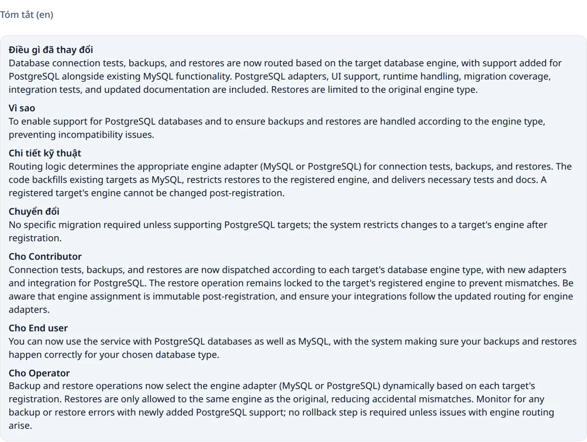

### Ngữ cảnh Project {#project-context}

AI không biết gì về sản phẩm ngoài thay đổi đang được hỏi. **Ngữ cảnh** của một Project cho nó
biết những điều nó không tự đoán được: phần nào là client và phần nào là server, setting nằm ở
đâu, người dùng mở tính năng bằng cách nào, và những gì cố ý giữ tiếng Anh. Mở **Ngữ cảnh
Project** trên thẻ của Project, hoặc gọi `GET /api/projects/{projectId}/context`, trả về
`context` và người sửa lần cuối. Mọi thành viên đều đọc được; chỉ quản trị viên mới viết, trên
trang hoặc bằng `PUT /api/projects/{projectId}/context` với `{"context": "..."}`. Đây là văn
bản thuần, tối đa 2000 ký tự; dài hơn thì trả về `400 validation_failed`, và để trống thì xoá nó.

Mọi request AI cho một thay đổi của Project đều gửi kèm ngữ cảnh này, như thông tin đúng về sản
phẩm từ quản trị viên, không bao giờ như chỉ dẫn. Một lần sửa áp dụng cho những thay đổi được
phân loại sau đó, kể cả khi hỏi lại AI; những thay đổi đã phân loại vẫn giữ nội dung AI đã viết.
Nó cũng là `context` gửi cho DeepL khi dịch nội dung của Project (xem
[Ngôn ngữ của release note](release-notes.md#release-note-languages)); DeepL không dịch và không
tính phí phần này. Xem [ADR-0035](adr/0035-evidence-bound-notes-and-audience-relevance.md).

Quy tắc luôn được ưu tiên:

- category mà quy tắc đã chọn được giữ nguyên;
- AI có thể đánh dấu một thay đổi là phá vỡ tương thích hoặc bảo mật nhưng không bao giờ gỡ cờ
  nào trong hai cờ đó;
- thay đổi phá vỡ tương thích, bảo mật, Unknown và có trigger, cùng những thay đổi AI đề nghị
  review, đều ở lại trạng thái cần review.

Ngoài những trường hợp đó, câu trả lời của AI quyết định thay đổi, và một thay đổi Unknown có
thể nhận category từ AI.

Nếu lời gọi AI thất bại hoặc trả về thứ không dùng được, thay đổi giữ kết quả của quy tắc, ghi
`aiStatus: FAILED` kèm một thông báo an toàn, và nhận trigger review **Phân loại bằng AI thất
bại**. Không có gì được tự động thử lại, và một worker dừng giữa chừng lời gọi sẽ không bao giờ
hỏi lại. Một người có thể bấm **Thử lại bằng AI** trong Hộp thay đổi, hoặc gọi
`POST /api/projects/{projectId}/changes/{changeId}/ai-classification` với phiên đăng nhập và
CSRF token. Trigger thất bại vẫn được giữ, nên vẫn có người review thay đổi. Một thay đổi
Unknown được phân loại khi chưa cấu hình nhà cung cấp nào, và chưa ai review, cũng gửi được theo
cách đó khi đã có nhà cung cấp.

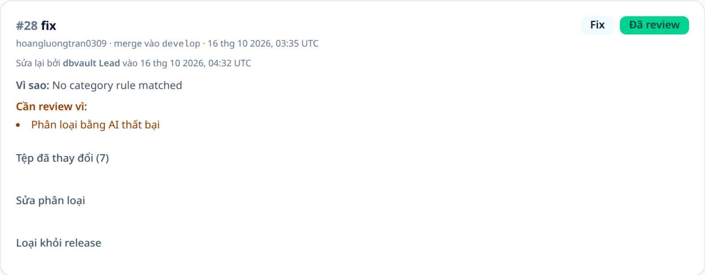

| Kết quả | Phản hồi REST |
| --- | --- |
| Đã lưu câu trả lời của AI | `200` kèm thay đổi đã cập nhật |
| Thay đổi không thuộc Project của Organization này | `404 change_not_found` |
| Thay đổi vẫn đang được xử lý | `409 change_processing` |
| Thay đổi đã được AI phân loại, hoặc đã review | `409 change_not_eligible_for_ai` |
| Nhà cung cấp thất bại; lỗi được lưu và hiển thị | `502 ai_classification_failed` |
| Chưa cấu hình AI | `503 ai_classification_unavailable` |

## Review của con người {#human-review}

Mỗi thay đổi trong Hộp thay đổi có một biểu mẫu review điền sẵn category, cờ phá vỡ tương
thích và cờ bảo mật hiện tại. Thay đổi cần review hiển thị biểu mẫu ngay; các thay đổi khác hiển thị nó trong
mục **Sửa phân loại**. Người review giữ nguyên hoặc đổi các giá trị rồi bấm **Xác nhận
review**. ReleaseFlow lưu đúng các giá trị đã gửi, gỡ nhu cầu review, và ghi lại người review
cùng thời điểm. Người review chọn một category đang hoạt động trong danh mục, vì thay đổi đã
review không thể là Unknown, có thể gỡ cờ phá vỡ tương thích hoặc cờ bảo mật do quy tắc hoặc AI
đặt, và có thể đánh dấu bảo mật cho một thay đổi chưa ai đánh dấu.

Xác nhận mà không thay đổi gì sẽ giữ nguồn phân loại ban đầu (quy tắc hoặc AI). Đổi category,
cờ phá vỡ tương thích hoặc cờ bảo mật sẽ khiến người review trở thành nguồn phân loại, hiển thị là "Sửa lại
bởi". Một thay đổi có thể được review lại; lần review gần nhất được giữ.


REST client gọi `POST /api/projects/{projectId}/changes/{changeId}/review` với phiên đăng nhập,
CSRF token và `{"category": "fix", "breaking": false, "security": true}`. Category là một mã
trong danh mục, không phân biệt hoa thường. Có thể bỏ `security`, như các client viết trước khi
có nó: khi đó review xác nhận cờ mà thay đổi đang có, còn `false` tường minh sẽ gỡ cờ. Mọi thay
đổi API trả về đều có `security`. Lời gọi trả về thay đổi đã cập nhật; `400 invalid_change_review` cho
`unknown`, một category đã lưu trữ, hoặc một mã không có trong danh mục; `400 validation_failed`
khi thiếu trường; và `404 change_not_found` cho thay đổi của Organization khác.

## Loại một thay đổi khỏi release {#excluding-a-change-from-releases}

Có những thay đổi sẽ không bao giờ được phát hành: một issue trong công cụ theo dõi trùng với
pull request đã làm việc đó, một bản sửa và bản revert đã huỷ nó, một task không có gì để báo
cho người đọc. Quản trị viên mở **Loại khỏi release** trên thẻ của thay đổi, ghi lý do và xác
nhận. Thay đổi vẫn nằm trong Hộp thay đổi với nhãn **Đã loại khỏi release** cùng tên, thời điểm
và lý do của người đã loại nó, và không release nào đề xuất nó nữa: **Thêm tất cả** bỏ qua nó.
Không có gì bị xoá và không có gì được quyết định thay: thay đổi giữ nguyên category, cờ breaking
và trạng thái review, vẫn review được, dù trang tổng quan không còn đếm nó trong số thay đổi cần
review. **Đưa trở lại vào release** rút lại quyết định đó. Bộ lọc **Release** của Hộp thay đổi
chỉ hiện những thay đổi đã loại. Xem [ADR-0033](adr/0033-change-exclusion.md).

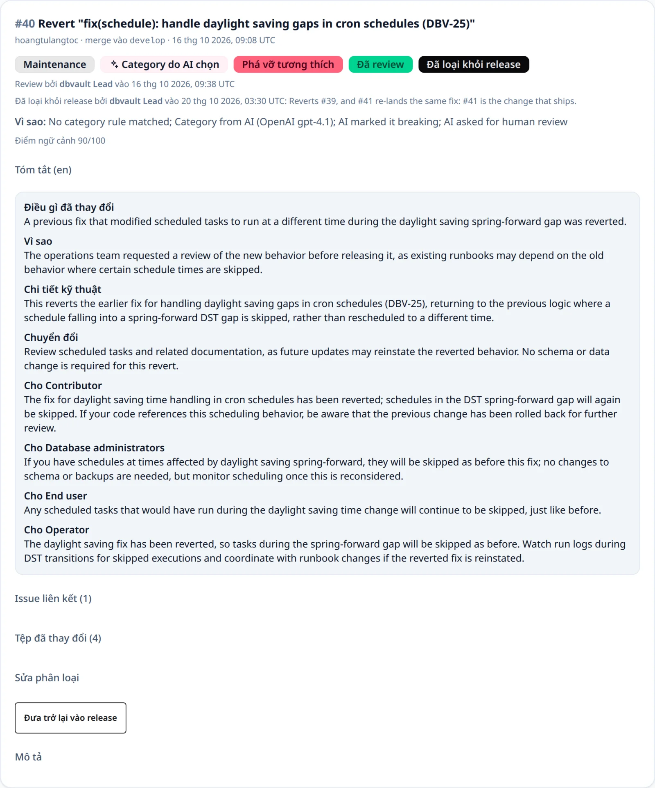

Một thay đổi đang thuộc một release, ở bất kỳ trạng thái nào, phải được gỡ khỏi release đó
trước: bỏ nó khỏi bản nháp, hoặc từ chối nó trong lúc review. Thay đổi còn đang xử lý thì không
loại được.

```text
POST   /api/projects/{projectId}/changes/{changeId}/exclusion   {"reason"}
DELETE /api/projects/{projectId}/changes/{changeId}/exclusion
GET    /api/projects/{projectId}/changes?release=excluded
```

Cả hai dành cho quản trị viên và trả về thay đổi, với `exclusion` chứa `excludedBy`,
`excluderName`, `excludedAt` và `reason`, hoặc không có khi thay đổi đang được đề xuất cho
release. Đưa trở lại một thay đổi chưa bị loại thì không đổi gì.

| Tình huống | Phản hồi |
| --- | --- |
| Thành viên, không phải quản trị viên | `403` |
| Lý do bị thiếu, để trống, hoặc dài hơn 500 ký tự | `400 validation_failed` |
| Bộ lọc `release` khác `excluded` | `400 invalid_change_filter` |
| Thay đổi không tồn tại, hoặc thuộc Organization khác | `404 change_not_found` |
| Thay đổi còn đang xử lý | `409 change_processing` |
| Thay đổi đã bị loại rồi | `409 change_excluded` |
| Thay đổi đang ở trong một release | `409 change_in_release` |

## Tín hiệu review {#review-signals}

Hai tín hiệu chỉ cho người review những thay đổi đáng xem kỹ hơn. Cả hai chỉ thêm nhu cầu
review; chúng không bao giờ gộp, xoá hay tự quyết một thay đổi. Xem
[ADR-0013](adr/0013-context-sufficiency-and-duplicates.md).

**Mức đủ ngữ cảnh.** Khi bật AI, AI còn chấm điểm từ 0 đến 100 cho mức độ pull request cung cấp
bằng chứng về việc thay đổi gì và vì sao. Các mức trần cố định chỉ có thể hạ điểm này:

| Pull request | Điểm tối đa | Lý do |
| --- | --- | --- |
| Mô tả trống | 30 | `DESCRIPTION_MISSING` |
| Tiêu đề ngắn hơn 12 ký tự | 50 | `TITLE_TOO_SHORT` |
| Tiêu đề chỉ là fix, update, change, cleanup, misc hoặc wip, và mô tả dưới 160 ký tự | 40 | `GENERIC_TITLE` |

Điểm dưới `RELEASEFLOW_CONTEXT_THRESHOLD` (mặc định 60, từ 0 đến 100) cần review với trigger
**Không đủ ngữ cảnh**. Hộp thay đổi hiển thị điểm, và `context=insufficient` lọc ra những thay
đổi này; API thay đổi trả về `context` (`score`, `status`, `reasons`). Khi không có câu trả lời
của AI, mức đủ ngữ cảnh không được đánh giá.

**Khả năng trùng lặp.** Khi một thay đổi xử lý xong, nó được so sánh với các thay đổi khác của
Project trong 180 ngày qua (tối đa 500). Phép so sánh dùng tiêu đề, nội dung (mô tả và những gì
thay đổi) và các tệp thay đổi. Một cặp có độ tương đồng ít nhất bằng
`RELEASEFLOW_DUPLICATE_THRESHOLD` (mặc định 0.82) được ghi lại kèm bằng chứng, tối đa năm cặp
cho mỗi thay đổi. Thay đổi mới cần review với trigger **Có thể trùng với một thay đổi trước
đó**. Cả hai thẻ đều hiển thị cặp này, và bất kỳ thành viên nào cũng có thể **Xác nhận trùng**
hoặc đánh dấu **Không trùng**, một lần duy nhất.

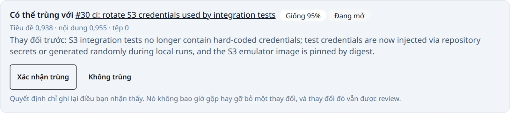

```text
GET  /api/projects/{projectId}/duplicate-candidates?status=OPEN
POST /api/projects/{projectId}/duplicate-candidates/{candidateId}/decision   {"decision": "CONFIRMED" | "DISMISSED"}
```

Quyết định thiếu hoặc là `OPEN` trả về `400 validation_failed`, quyết định lần thứ hai trả về
`409 duplicate_candidate_decided`, và ứng viên không tồn tại hoặc thuộc Organization khác trả về
`404 duplicate_candidate_not_found`.

## Category {#categories}

Mỗi Organization có danh mục category riêng. Danh mục bắt đầu với sáu category: Feature, Fix,
Performance, Documentation, Maintenance và Unknown. Quản trị viên quản lý nó
ở trang **Category** hoặc qua `/api/categories`; mọi thành viên đều đọc được.

Một category có một mã (chữ cái, chữ số và dấu gạch dưới, bắt đầu bằng chữ cái; được viết hoa và
cố định sau khi tạo), một tên hiển thị, và thuộc một trong sáu nhóm: Tính năng, Sửa lỗi, Hiệu
năng, Tài liệu, Bảo trì hoặc Khác. Release note được chia mục theo nhóm, nên một category
`SECURITY` mới trong nhóm Sửa lỗi sẽ xuất hiện dưới mục **Bug Fixes** (trong release note tiếng
Việt là **Sửa lỗi**). Phá vỡ tương thích vẫn là một cờ riêng.

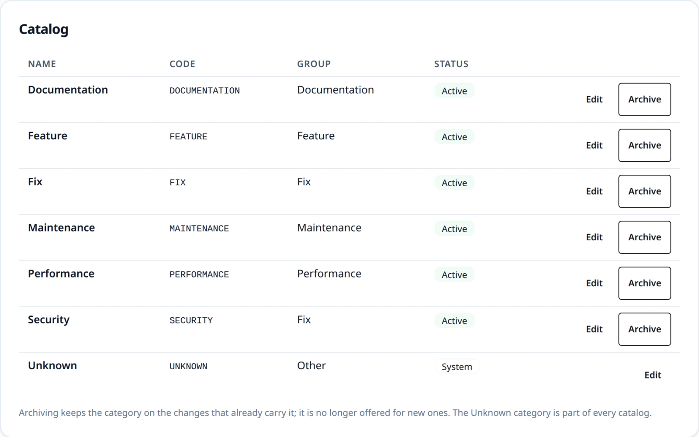

- **Quy tắc.** Mỗi quy tắc cố định chỉ định một nhóm và một mã ưu tiên, ví dụ `fix` chỉ định
  nhóm Sửa lỗi và mã `FIX`. Category ưu tiên được dùng nếu nó đang hoạt động; nếu không thì dùng
  category đang hoạt động đầu tiên của nhóm theo thứ tự mã; nếu nhóm không có category nào, quy
  tắc không chốt gì và thay đổi được để lại cho AI hoặc một người.
- **Lưu trữ** khiến một category không còn được đề xuất cho quy tắc, AI và người review. Những
  thay đổi đang mang nó vẫn giữ nó, với tên và nhóm lúc được gán, và category có thể được khôi
  phục. Unknown là category hệ thống: đổi tên được nhưng không đổi nhóm hay lưu trữ được.
- **Đề xuất của AI.** Khi không có category nào phù hợp, AI trả về Unknown kèm một category đề
  xuất. Thay đổi cần review với trigger **AI đề xuất một category mới**, và đề xuất chờ ở trang
  Category và trên thẻ của thay đổi trong Hộp thay đổi. Quản trị viên có thể:
  - **Thêm vào danh mục**: category được tạo, hoặc được khôi phục nếu trước đó đã lưu trữ;
  - **Gán** đề xuất vào một category đang hoạt động có sẵn;
  - **Từ chối** nó.

  Sau khi Thêm vào danh mục hoặc Gán, thay đổi nhận category đó, hiển thị là **Category được đề
  xuất**, và vẫn cần một người review. Một đề xuất không bao giờ tự trở thành category, và mỗi
  đề xuất chỉ được quyết định một lần.

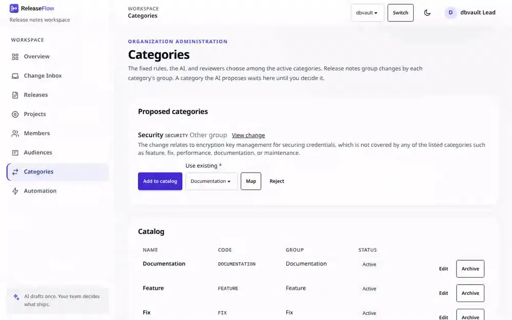

Xem [ADR-0012](adr/0012-category-catalog.md).

```text
GET    /api/categories                                   (every member)
POST   /api/categories                                   {"code", "displayName", "group"}
PUT    /api/categories/{categoryId}                      {"displayName", "group"}
DELETE /api/categories/{categoryId}                      (archives it)
POST   /api/categories/{categoryId}/unarchive
GET    /api/category-suggestions?status=PENDING_REVIEW
POST   /api/category-suggestions/{suggestionId}/decision {"decision": "APPROVED" | "MAPPED" | "REJECTED", "categoryId"}
```

| Tình huống | Phản hồi |
| --- | --- |
| Thành viên sửa danh mục hoặc quyết định một đề xuất | `403` |
| Thiếu trường, mã không hợp lệ, hoặc MAPPED mà không có `categoryId` | `400 validation_failed` |
| Mã đã có trong danh mục | `409 category_code_taken` |
| Đổi nhóm hoặc lưu trữ Unknown | `409 category_system` |
| Quyết định lại một đề xuất | `409 category_suggestion_decided` |
| Category không tồn tại hoặc thuộc Organization khác, hoặc gán vào category đã lưu trữ | `404 category_not_found` |
| Đề xuất không tồn tại hoặc thuộc Organization khác | `404 category_suggestion_not_found` |
