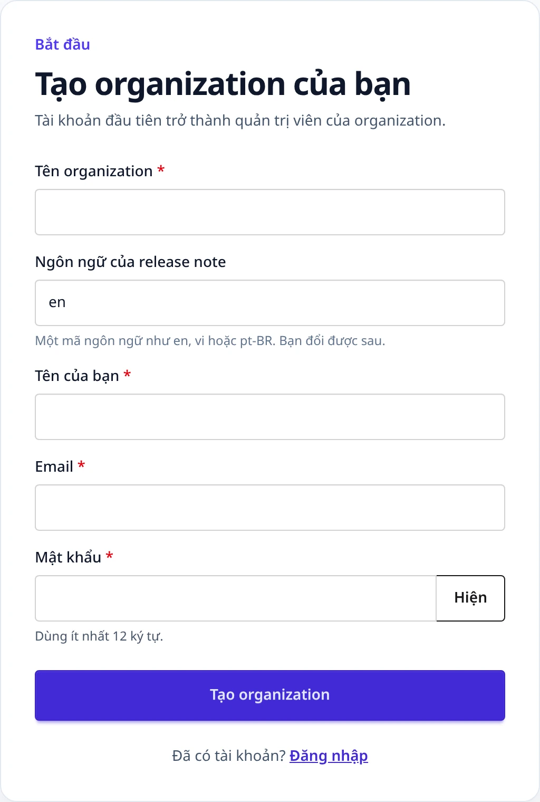
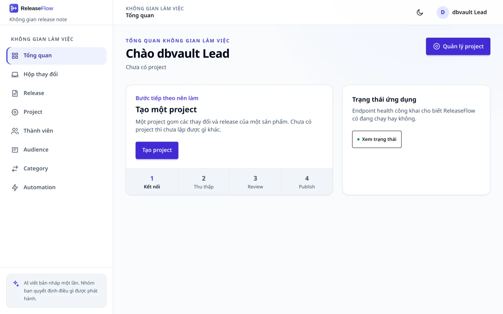

# Bắt đầu

Có ba cách chạy ReleaseFlow. [Quickstart](#quickstart) chạy một phiên bản đã phát hành mà
không phải build gì; [chạy từ mã nguồn](#run-from-source) và
[demo stack](#run-the-demo-stack) chạy chính bản checkout bạn đang đọc.

## Quickstart {#quickstart}

Cách nhanh nhất để thử một phiên bản đã phát hành: image đã publish và PostgreSQL trên cùng
một máy, không phải build gì và không cần clone repository. Mỗi bản phát hành đều đính kèm
bộ quickstart này, nên cách này chỉ dùng được từ bản phát hành đầu tiên trở đi; trước đó,
dùng [demo stack](#run-the-demo-stack) hoặc [chạy từ mã nguồn](#run-from-source).
[Trang Releases](https://github.com/hoangluongtran0309/ReleaseFlow/releases) cho biết đã có
bản phát hành nào chưa.

Bạn cần Docker Engine hoặc Docker Desktop với Compose v2, và `openssl`, trên Linux hoặc macOS.
Trên Windows, chạy nó trong WSL 2. Image chỉ có bản amd64, nên máy Apple silicon chạy nó qua
giả lập; bật tuỳ chọn Rosetta của Docker Desktop nếu nó khởi động chậm.

```bash
mkdir releaseflow && cd releaseflow
base=https://github.com/hoangluongtran0309/ReleaseFlow/releases/latest/download
curl -fsSL --remote-name-all "$base/compose.yaml" "$base/quickstart.sh" "$base/SHA256SUMS"
sha256sum --check --ignore-missing SHA256SUMS   # macOS: shasum -a 256 --check --ignore-missing SHA256SUMS
bash quickstart.sh
```

Sau đó mở `http://localhost:8080/register` để tạo quản trị viên đầu tiên. Muốn dùng cổng
khác, chọn nó ngay từ lần chạy đầu: `RELEASEFLOW_HTTP_PORT=18080 bash quickstart.sh`.

Script làm những việc sau:

- kiểm tra Docker, một Compose v2 có thể chờ service healthy, và daemon có kết nối được
  không; thiếu thứ nào thì dừng lại và chỉ cách khắc phục. Script không cài gì, không xin
  quyền nâng cao và không hỏi gì;
- ở lần chạy đầu, ghi file `.env` bên cạnh nó với mật khẩu cơ sở dữ liệu và master key mã hoá
  credential mới tạo, chỉ mình bạn đọc được, và không in ra cái nào;
- khởi động ứng dụng và PostgreSQL rồi chờ tới khi ứng dụng healthy. Ứng dụng chỉ lắng nghe
  trên `127.0.0.1`, còn cơ sở dữ liệu hoàn toàn không mở ra ngoài.

**Giữ lại `.env`.** Cơ sở dữ liệu đã được tạo với mật khẩu trong đó, và key trong đó mã hoá
mọi webhook secret và access token đã lưu. Các lần chạy sau giữ nguyên `.env`, và bỏ qua mọi
biến `RELEASEFLOW_*` hoặc `COMPOSE_*` trong shell của bạn, nên `.env` là nơi cấu hình duy
nhất. Nếu cơ sở dữ liệu còn mà `.env` đã mất, script từ chối khởi động thay vì tạo ra secret
không mở được dữ liệu cũ: đặt lại file cũ vào chỗ cũ, hoặc xoá dữ liệu bằng
`docker volume rm releaseflow-quickstart-postgres-data`.

Để bật phân loại bằng AI, bỏ comment `RELEASEFLOW_AI_PROVIDER` cùng key và model của nhà cung
cấp đã chọn trong `.env`, rồi chạy lại `bash quickstart.sh`. Dịch thuật và email dùng cùng
các biến với demo stack, liệt kê trong [`.env.example`](../.env.example) và trong
[Cấu hình](configuration.md). Trong cùng thư mục:

```bash
docker compose ps                # what is running
docker compose logs -f app       # the application's log
docker compose down              # stop; the data stays
docker compose down --volumes    # stop and delete the database for good
```

Để nâng cấp, tải `compose.yaml`, `quickstart.sh` và `SHA256SUMS` của bản phát hành mới hơn
vào cùng thư mục, giữ lại `.env`, kiểm tra checksum, rồi chạy lại script. Cơ sở dữ liệu được
migrate tiến lên; sau đó đừng quay lại dùng `compose.yaml` cũ hơn.

Bộ quickstart dành cho một máy, không phải cho production: TLS, sao lưu và lưu trữ secret là
phần việc của một hệ thống triển khai thật, và [Triển khai production](operations.md#deploying-to-production)
liệt kê những gì cần làm. Xem [ADR-0031](adr/0031-quickstart-bundle.md).

## Chạy từ mã nguồn {#run-from-source}

Bạn cần JDK 21 (`./mvnw` tìm nó qua `JAVA_HOME`, hoặc `javac` trên `PATH`) và một cơ sở dữ
liệu PostgreSQL riêng. Maven và Node.js đi kèm bản build: Maven Wrapper tự tải Maven, và
bản build tự tải một phiên bản Node.js cố định vào `node/` ở lần dùng đầu tiên.

```bash
export RELEASEFLOW_DB_URL=jdbc:postgresql://localhost:5432/releaseflow
export RELEASEFLOW_DB_USERNAME=releaseflow
export RELEASEFLOW_DB_PASSWORD='replace-with-a-local-secret'
export RELEASEFLOW_CREDENTIAL_MASTER_KEY="$(openssl rand -base64 32)"   # keep this value
./mvnw spring-boot:run
```

Mở `http://localhost:8080/register` để tạo Organization đầu tiên và quản trị viên của nó.
Flyway tạo schema khi khởi động. Mọi thứ khác — AI, dịch thuật, email, thời gian chờ khi gọi
nhà cung cấp, địa chỉ changelog công khai — đều không bắt buộc và được liệt kê trong
[Cấu hình](configuration.md).



## Chạy demo stack {#run-the-demo-stack}

`docker-compose.demo.yml` build image từ bản checkout này và chạy nó cùng PostgreSQL 17,
Prometheus và Grafana, chỉ để đánh giá trên máy cục bộ:

```bash
cp .env.example .env
# Replace every REPLACE_ME value. Generate the master key with:
#   openssl rand -base64 32
docker compose -f docker-compose.demo.yml up --build
```

Ứng dụng chạy ở `http://127.0.0.1:8080`, Grafana ở `http://127.0.0.1:3000`, và Prometheus ở
`http://127.0.0.1:9090`. Xem [Vận hành](operations.md).



## Bước tiếp theo {#next-steps}

Khi đã đăng nhập bằng quản trị viên đầu tiên:

1. [Mời những người](workspace.md#members-and-invitations) sẽ review thay đổi.
2. Tạo một Project và [kết nối một nguồn](sources.md#connect-a-source), rồi thêm webhook mà
   nó hiển thị vào repository, hoặc để Jira được đọc theo lịch.
3. Merge một pull request, hoặc hoàn thành một issue, và xem nó xuất hiện trong
   [Hộp thay đổi](changes.md#change-inbox).
4. Gom thay đổi vào một [release](release-notes.md#releases), review và duyệt nó, rồi
   [publish](release-notes.md#publishing) các release note của nó.
5. Thêm một [quy tắc automation](automation.md#rules) để lần sau ReleaseFlow tự gửi giúp bạn.

## Xử lý sự cố {#troubleshooting}

Ứng dụng từ chối khởi động thay vì chạy khi cấu hình còn thiếu, và nói lý do ở dòng
`Caused by:` cuối cùng trong log.

| Bạn thấy gì | Nghĩa là gì |
| --- | --- |
| `Could not resolve placeholder 'RELEASEFLOW_CREDENTIAL_MASTER_KEY'` | Master key chưa được đặt. Tạo một key bằng `openssl rand -base64 32` và giữ lại nó |
| `Credential master key must decode to exactly 32 bytes.` | Key không phải Base64 của 32 byte; `openssl rand -base64 32` tạo đúng loại key này |
| `RELEASEFLOW_AI_PROVIDER=openai needs RELEASEFLOW_OPENAI_API_KEY and RELEASEFLOW_OPENAI_MODEL.` | Đã chọn nhà cung cấp nhưng thiếu key hoặc model. Đặt cả hai, hoặc bỏ đặt nhà cung cấp. Xem [AI](configuration.md#ai) |
| Mọi webhook trả về `401 webhook_signature_invalid`, và log ghi `Could not decrypt the webhook secret of source …` | Ứng dụng đang chạy với một master key khác với key đã dùng khi lưu secret. Đặt lại key ban đầu. Xem [Sao lưu](operations.md#deploying-to-production) |
| Một lời gọi REST trả về `403 access_denied` ngay sau khi đăng nhập | Đăng nhập đã thay CSRF token. Lấy token mới từ `GET /api/csrf`. Xem [Phiên đăng nhập và CSRF](api.md#sessions-and-csrf) |
| Sau một proxy HTTPS, đăng nhập redirect về `http://` | Ứng dụng không đọc được header của proxy. Đặt `SERVER_FORWARD_HEADERS_STRATEGY=native`. Xem [Triển khai production](operations.md#deploying-to-production) |
| Các lần gửi của một nhà cung cấp bị từ chối | Bảng phản hồi của từng nguồn nêu nguyên nhân: [GitHub](sources.md#receive-github-webhooks), [GitLab](sources.md#receive-gitlab-webhooks), [Linear](sources.md#receive-linear-webhooks) |
