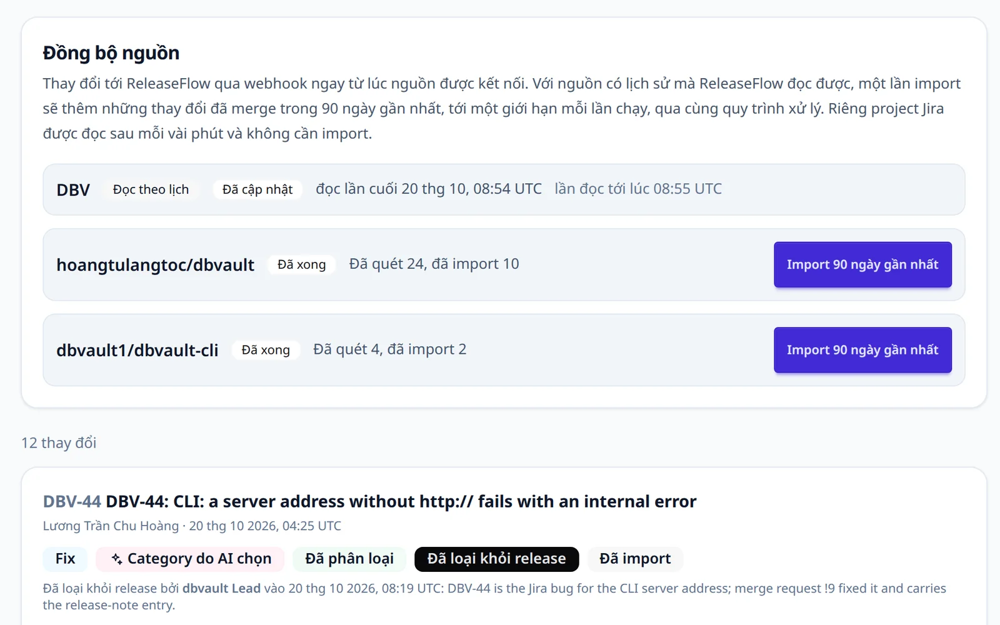

# Giới thiệu

Từ các pull request đã merge và issue đã hoàn thành, ReleaseFlow tạo ra release note được
một người review, viết riêng cho từng audience và gửi đến đúng nơi họ đọc.

Release note thường được viết tay vào ngày phát hành: ai đó đọc từng pull request đã merge,
đoán xem cái nào quan trọng, rồi viết một bản duy nhất — quá kỹ thuật với người dùng và quá
mơ hồ với người vận hành. ReleaseFlow thu thập thay đổi ngay khi chúng được merge, phân loại
chúng, để AI soạn bản tóm tắt, và luôn để một người quyết định những gì được phát hành.

ReleaseFlow dành cho những nhóm phát hành phần mềm tới nhiều kiểu người đọc — người vận hành
phần mềm, người xây dựng trên nó, và người sử dụng nó — và muốn các release note ấy được
viết từ cùng một bộ dữ kiện đã review, thay vì viết tay lại ba lần.

## Một thay đổi đi qua ReleaseFlow thế nào {#how-a-change-moves-through-it}

1. **Thu thập.** Pull request đã merge từ GitHub, merge request đã merge từ GitLab, và issue
   đã hoàn thành từ Linear và Jira được nhận qua webhook có chữ ký hoặc qua poll định kỳ.
   GitHub và GitLab còn import được 90 ngày gần nhất. Xem [Nguồn](sources.md).
2. **Phân loại.** Các quy tắc giải thích được xếp mỗi thay đổi vào một category. AI (tùy
   chọn; OpenAI, Anthropic hoặc DeepSeek) viết bản tóm tắt trung lập và đề xuất category,
   nhưng quy tắc luôn được ưu tiên, và thay đổi phá vỡ tương thích, bảo mật, không nhận diện
   được, hoặc chạm vào tệp nhạy cảm luôn chờ một người review. Xem
   [Thay đổi và review](changes.md).
3. **Review.** Một release đi từ nháp, qua quyết định cho từng thay đổi, đến khi được duyệt.
   Những thay đổi thiếu ngữ cảnh, hoặc trông giống thay đổi trước đó, được đánh dấu kèm bằng
   chứng. Xem [Release](release-notes.md#releases).
4. **Viết.** Mỗi audience (người vận hành, người đóng góp, người dùng cuối, hoặc audience
   của riêng bạn) có một release note, viết từ một template Mustache, với tối đa năm ngôn
   ngữ do DeepL dịch, thay đổi bảo mật nằm trong một mục riêng, và phần cuối có thể liên kết
   trang so sánh với release trước. Xem [Audience](release-notes.md#audiences).
5. **Publish.** Release note sau khi publish không thay đổi nữa, rồi được các quy tắc
   automation gửi tới GitHub Releases, Slack, email, Notion, Confluence, Microsoft Teams,
   Zendesk, hoặc một changelog công khai có RSS feed. Xem [Automation](automation.md).

Mỗi bước đều được ghi lại, nên một release note đã publish luôn cho biết ai đã review những
gì có trong nó.

## Bạn cần chạy những gì {#what-you-run}

ReleaseFlow tự triển khai trên hạ tầng của bạn: một ứng dụng Java 21 / Spring Boot và một
cơ sở dữ liệu PostgreSQL, với giao diện tiếng Anh hoặc tiếng Việt. Mọi thứ ngoài hai thành
phần đó — AI, dịch thuật, email, và từng kênh gửi — đều không bắt buộc và được bật bằng
[cấu hình](configuration.md).

Những công cụ như [release-drafter](https://github.com/release-drafter/release-drafter),
[git-cliff](https://github.com/orhun/git-cliff) và
[semantic-release](https://github.com/semantic-release/semantic-release) tạo một changelog
từ commit hoặc nhãn của pull request, ngay trong repository hoặc CI của bạn. Chúng dễ áp dụng
hơn, và nếu bạn chỉ cần một changelog kỹ thuật thì cứ dùng một trong số đó. ReleaseFlow dành
cho bước tiếp theo, và cái giá là một server cùng một cơ sở dữ liệu phải vận hành.

## Đọc tiếp ở đâu {#where-to-go-next}

| Nếu bạn muốn | Đọc |
| --- | --- |
| Chạy thử trên máy của mình | [Bắt đầu](getting-started.md) |
| Tạo Organization và mời mọi người | [Workspace](workspace.md) |
| Kết nối GitHub, GitLab, Linear hoặc Jira | [Nguồn](sources.md) |
| Hiểu cách thay đổi được phân loại và review | [Thay đổi và review](changes.md) |
| Viết, duyệt và publish một release | [Release note](release-notes.md) |
| Gửi release note tới công cụ khác | [Automation](automation.md) |
| Viết script cho nó | [REST API](api.md) |
| Vận hành và theo dõi nó | [Cấu hình](configuration.md) và [Vận hành](operations.md) |
| Xem nó được xây dựng thế nào và vì sao | [Kiến trúc](architecture.md) và [các quyết định kiến trúc](adr/README.md) |
