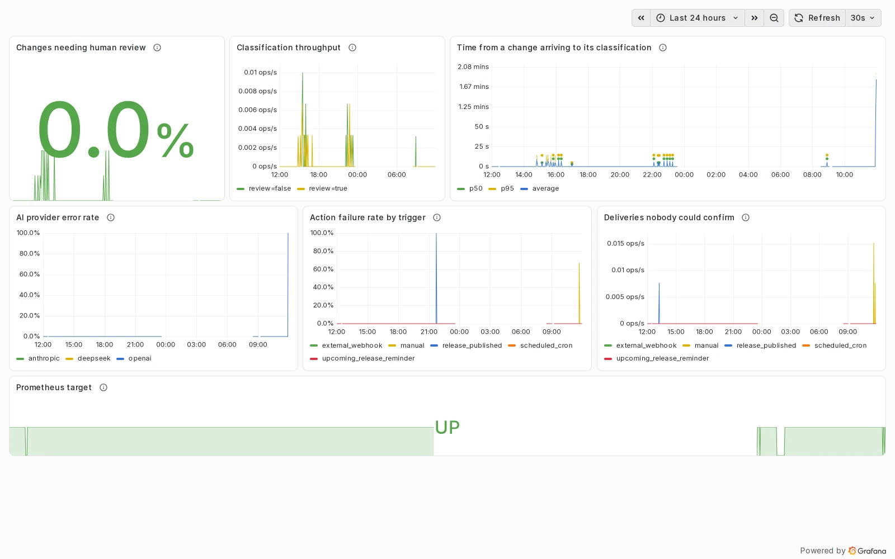

# Vận hành

Chạy ReleaseFlow, theo dõi nó, và cài đặt một phiên bản đã phát hành. Mọi biến được liệt kê
trong [Cấu hình](configuration.md).

## Chạy bằng Docker Compose {#run-with-docker-compose}

`docker-compose.demo.yml` build image của ứng dụng từ bản checkout này và chạy nó cùng
PostgreSQL 17, Prometheus và Grafana để đánh giá trên máy cục bộ; đây không phải một hệ thống
triển khai production. [Chạy demo stack](getting-started.md#run-the-demo-stack) hướng dẫn cách
khởi động nó, còn [Quickstart](getting-started.md#quickstart) chạy một phiên bản đã phát hành
mà không phải build.

Compose từ chối khởi động cho tới khi `RELEASEFLOW_DB_PASSWORD`,
`RELEASEFLOW_CREDENTIAL_MASTER_KEY` và `RELEASEFLOW_GRAFANA_PASSWORD` được đặt. Ứng dụng lắng
nghe trên `http://127.0.0.1:8080` (đổi bằng `RELEASEFLOW_HTTP_PORT`), dashboard vận hành trên
`http://127.0.0.1:3000` và Prometheus trên `http://127.0.0.1:9090`. Cổng cơ sở dữ liệu và cổng
quản trị không được mở ra ngoài. Container chạy với UID `65534`, và health check của nó gọi cổng
quản trị. `docker compose -f docker-compose.demo.yml down --volumes` xoá dữ liệu demo.

## Health và số liệu {#health-and-metrics}

Actuator trả lời trên cổng riêng của nó — mặc định là 8081 trên loopback, đặt bằng
`RELEASEFLOW_MANAGEMENT_PORT` và `RELEASEFLOW_MANAGEMENT_ADDRESS` — và chỉ phục vụ đúng hai thứ
ở đó: `GET /actuator/health`, không kèm chi tiết từng thành phần, và `GET /actuator/prometheus`.
Mọi thứ khác đều bị từ chối, và cổng của ứng dụng không phục vụ thứ nào trong số đó. Giữ cổng này
ở chế độ riêng tư; nó không phải endpoint của sản phẩm.

Bốn số liệu trả lời các câu hỏi vận hành, và mọi label đều lấy từ một tập hữu hạn:

| Số liệu | Label | Trả lời câu hỏi gì |
| --- | --- | --- |
| `releaseflow_classification_completed_total` | `needs_human_review` | Bao nhiêu thay đổi đã được phân loại, và bao nhiêu trong số đó vẫn cần một người |
| `releaseflow_classification_collect_to_complete_seconds` | — | Một thay đổi chờ bao lâu từ lúc đến tới lúc được phân loại |
| `releaseflow_classification_provider_requests_total` | `provider`, `outcome` | AI từ chối hoặc trả về thứ không đọc được thường xuyên tới mức nào |
| `releaseflow_automation_action_executions_total` | `trigger`, `outcome` | Các lần gửi kết thúc ra sao, với không rõ kết quả được tách riêng khỏi thất bại |

**Không label nào mang Organization, Project, release, quy tắc, lần chạy, action, model, tham
chiếu bên ngoài hay nội dung lỗi.** Số liệu là góc nhìn trên toàn hệ thống triển khai; một câu hỏi
về riêng một Organization là tính năng của sản phẩm, không phải một label. Mọi chuỗi số liệu đều
tồn tại từ lúc khởi động với giá trị 0, nên một panel hiển thị 0 thay vì "no data".

Demo stack tạo sẵn dashboard *ReleaseFlow Operations* trong Grafana với bảy panel: thay đổi cần
người review, thông lượng phân loại, thời gian từ lúc một thay đổi đến tới lúc được phân loại, tỉ
lệ lỗi của nhà cung cấp AI, tỉ lệ action thất bại theo trigger, các lần gửi không ai xác nhận
được, và Prometheus có kết nối được tới ứng dụng hay không. Prometheus giữ lịch sử bảy ngày. Cảnh
báo, lưu trữ bền vững, chính sách lưu giữ dữ liệu và kiểm soát truy cập là phần việc của một hệ
thống triển khai thật. Xem [ADR-0026](adr/0026-deployment-observability.md).



## Container image {#container-image}

`Dockerfile` build JAR trong một stage JDK rồi chép nó vào một image Temurin 21 JRE chạy với
UID/GID `65534`; health check của nó gọi cổng quản trị. Build riêng image bằng `docker build .`.
Image đọc cùng các biến môi trường `RELEASEFLOW_*` như `./mvnw spring-boot:run`, và cần một cơ
sở dữ liệu PostgreSQL mà nó kết nối được. Phục vụ nó sau HTTPS, đặt
`RELEASEFLOW_SESSION_COOKIE_SECURE=true` và đặt `RELEASEFLOW_PUBLIC_BASE_URL` là địa chỉ công
khai.

## Triển khai production {#deploying-to-production}

Quickstart và demo stack chạy trên một máy để đánh giá. Một hệ thống mà người khác dựa vào cần
những thứ dưới đây, và ReleaseFlow không tự cung cấp thứ nào trong số đó.

**HTTPS và reverse proxy.** Kết thúc TLS ở một reverse proxy đặt trước cổng của ứng dụng và đặt:

```bash
RELEASEFLOW_PUBLIC_BASE_URL=https://releaseflow.example.com
RELEASEFLOW_SESSION_COOKIE_SECURE=true
SERVER_FORWARD_HEADERS_STRATEGY=native
```

Biến cuối cùng là cấu hình của chính Spring Boot: nó cho ứng dụng đọc `X-Forwarded-Proto` và
`X-Forwarded-Host` của proxy. Thiếu nó, sau một proxy kết thúc TLS, các redirect như redirect
tới trang đăng nhập sẽ trỏ về `http://`, và cookie ngôn ngữ giao diện cùng cookie ghi nhớ
Project không được đánh dấu `Secure`. Tomcat nhúng chỉ chấp nhận các header này từ địa chỉ nội
bộ và loopback; proxy đặt ở nơi khác được khai báo bằng `SERVER_TOMCAT_REMOTEIP_INTERNAL_PROXIES`.
Cả hai file Compose đều không chuyển tiếp các biến này, nên nếu dựa trên một file Compose, thêm
chúng vào `environment` của service `app`.

**Những gì internet truy cập được.** Nhà cung cấp cần `/webhooks/`, và người đọc ẩn danh cần
`/changelog/` nếu bạn publish changelog công khai. Người trong nhóm cần phần còn lại, phần này có
thể nằm sau VPN hoặc danh sách IP cho phép. Sau khi Organization của bạn đã được tạo, chặn
`/register` và `POST /api/registrations` ở proxy, vì [đăng ký luôn mở](workspace.md#registration).
Không bao giờ định tuyến cổng quản trị qua proxy.

**Đăng nhập.** ReleaseFlow không giới hạn số lần đăng nhập sai, nên giới hạn tần suất
`POST /login` ở proxy. Phiên đăng nhập nằm trong bộ nhớ của ứng dụng: khởi động lại sẽ đăng xuất
mọi người.

**Một instance.** Các worker nền nhận việc bằng `FOR UPDATE SKIP LOCKED` và được viết để chạy
trong mọi instance ([ADR-0008](adr/0008-durable-change-processing.md)), nhưng phiên đăng nhập
không được chia sẻ giữa các instance và CI không chạy nhiều hơn một instance. Chỉ chạy một
instance, trừ khi bạn đã tự kiểm thử nhiều instance sau sticky session.

**Cơ sở dữ liệu.** Mọi bài test và cả hai stack Compose đều chạy PostgreSQL 17. Cấp cho
ReleaseFlow một cơ sở dữ liệu riêng, do chính user mà nó kết nối sở hữu: Flyway tạo bảng,
ràng buộc và trigger khi ứng dụng khởi động.

**Sao lưu.** Sao lưu cơ sở dữ liệu cùng với `RELEASEFLOW_CREDENTIAL_MASTER_KEY`, và cất chúng ở
hai nơi khác nhau. Một cơ sở dữ liệu được khôi phục mà thiếu key vẫn khởi động được, nhưng mọi
secret đã lưu đều không đọc được. Access token và secret của action có thể nhập lại; webhook
secret của một nguồn thì không, vì hiện chưa thay được nguồn, nên mọi lần gửi tới nguồn đó đều bị
từ chối với `401 webhook_signature_invalid` và log ghi
`Could not decrypt the webhook secret of source …`. Khôi phục toàn bộ bản dump vào một cơ sở dữ
liệu trống:

```bash
pg_dump --format=custom --file=releaseflow.dump releaseflow
createdb restored && pg_restore --dbname=restored --no-owner releaseflow.dump
```

`pg_restore` tạo các trigger đóng băng release đã publish sau khi đã nạp xong dữ liệu. Chỉ khôi
phục dữ liệu vào một cơ sở dữ liệu mà ứng dụng đã migrate sẵn sẽ bị chính các trigger đó từ chối
với mọi release đã qua bước nháp.

**Nâng cấp.** Một phiên bản mới hơn migrate schema lên khi khởi động, và không migration nào có
thể hoàn tác. Sao lưu trước; quay lại nghĩa là khôi phục bản sao lưu đó với phiên bản cũ, không
bao giờ chạy phiên bản cũ trên cơ sở dữ liệu đã được migrate.

## Artifact đã phát hành {#published-artifacts}

Đây là các bản phát hành của chính ReleaseFlow, khác với những release mà nó viết release note,
được liệt kê trên [trang Releases](https://github.com/hoangluongtran0309/ReleaseFlow/releases).
Phần này mô tả những gì workflow `Release` publish cho mỗi tag.

Một bản phát hành là một tag, và tag chính là phiên bản: `pom.xml` chỉ giữ giá trị giữ chỗ
`0.0.0-SNAPSHOT` trong `${revision}`, và workflow `Release` build commit được tag với
`-Drevision=<version>`. Push `v<version>` sẽ chạy workflow đó; workflow từ chối một tag không
phải tổ tiên của `main`, hoặc một tag mà `CHANGELOG.md` không có mục kèm ngày tương ứng — nên một
tag nhầm sẽ thất bại thay vì được phát hành. Sau đó nó chạy lại toàn bộ bộ test, kiểm tra JAR có
mang đúng phiên bản, build và quét image, rồi publish:

- `releaseflow-<version>.jar`, JAR chạy được;
- `releaseflow-<version>-sbom.cdx.json`, SBOM CycloneDX của image, liệt kê cùng lúc các phụ thuộc
  Java và các gói của base image;
- `compose.yaml` và `quickstart.sh`, bộ [Quickstart](getting-started.md#quickstart), với image
  được ghim theo digest mà bản phát hành này đã push;
- `SHA256SUMS`, `LICENSE` và `NOTICE`;
- image trên GHCR, gắn tag `<version>`, `<major>.<minor>`, `<major>` và `latest`;
- một provenance attestation cho image, JAR và bộ quickstart;
- một GitHub release với nội dung là mục `CHANGELOG.md` của phiên bản, theo sau là digest của
  image, các lệnh quickstart, và cách kiểm tra các tệp tải về.

Một tag `v<version>-rc.<n>` trên `release/<version>` hoặc `hotfix/<version>` publish một release
candidate theo cùng cách, được đánh dấu là pre-release, với image chỉ gắn tag
`<version>-rc.<n>` để không có gì đang theo `latest` bị chuyển sang nó. Workflow cũng có thể được
chạy bằng tay cho một tag đã có sẵn.

Để phát hành một phiên bản, xem [Releasing](../CONTRIBUTING.md#releasing): hai lệnh,
`scripts/release.sh start <version>` và, sau khi pull request của nó được merge,
`scripts/release.sh finish <version>`.

Kiểm tra những gì bạn đã tải về:

```bash
sha256sum --check SHA256SUMS
gh attestation verify releaseflow-<version>.jar \
    --repo hoangluongtran0309/ReleaseFlow
```

Ghim một hệ thống triển khai theo digest thay vì theo một tag có thể thay đổi:

```bash
docker pull ghcr.io/hoangluongtran0309/releaseflow@sha256:<digest>
```
