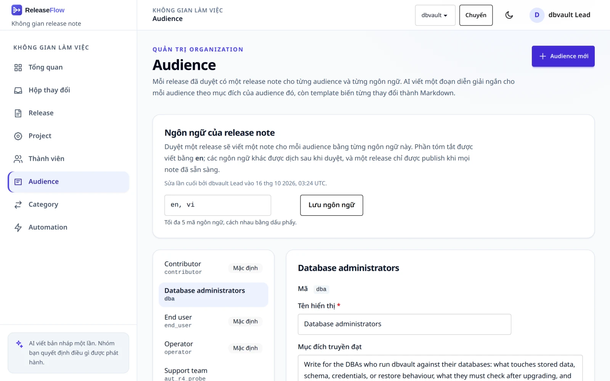
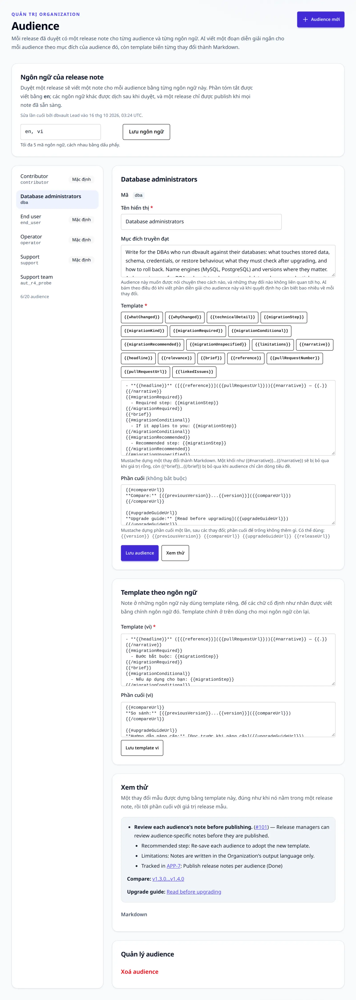
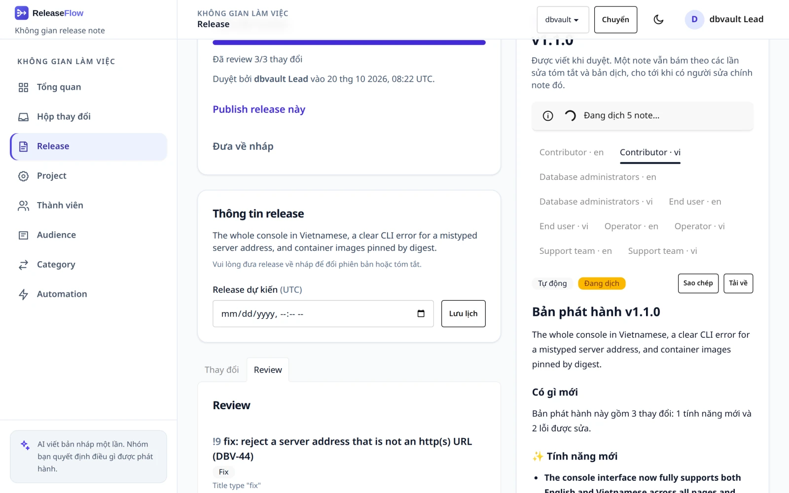
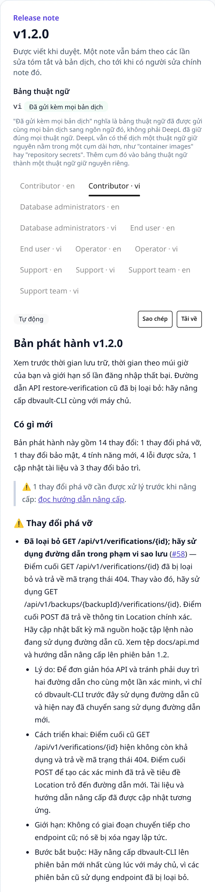
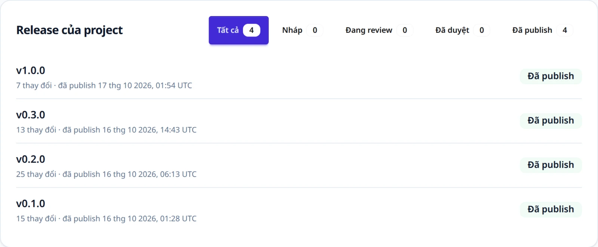
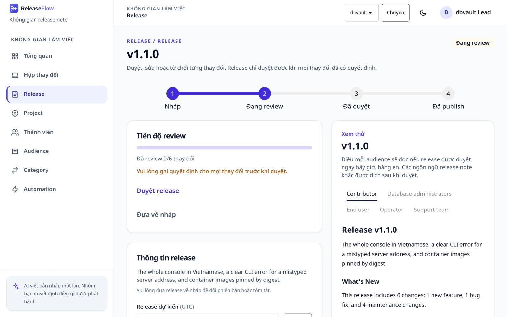
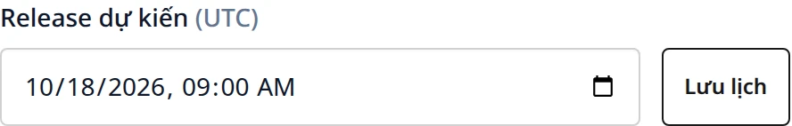
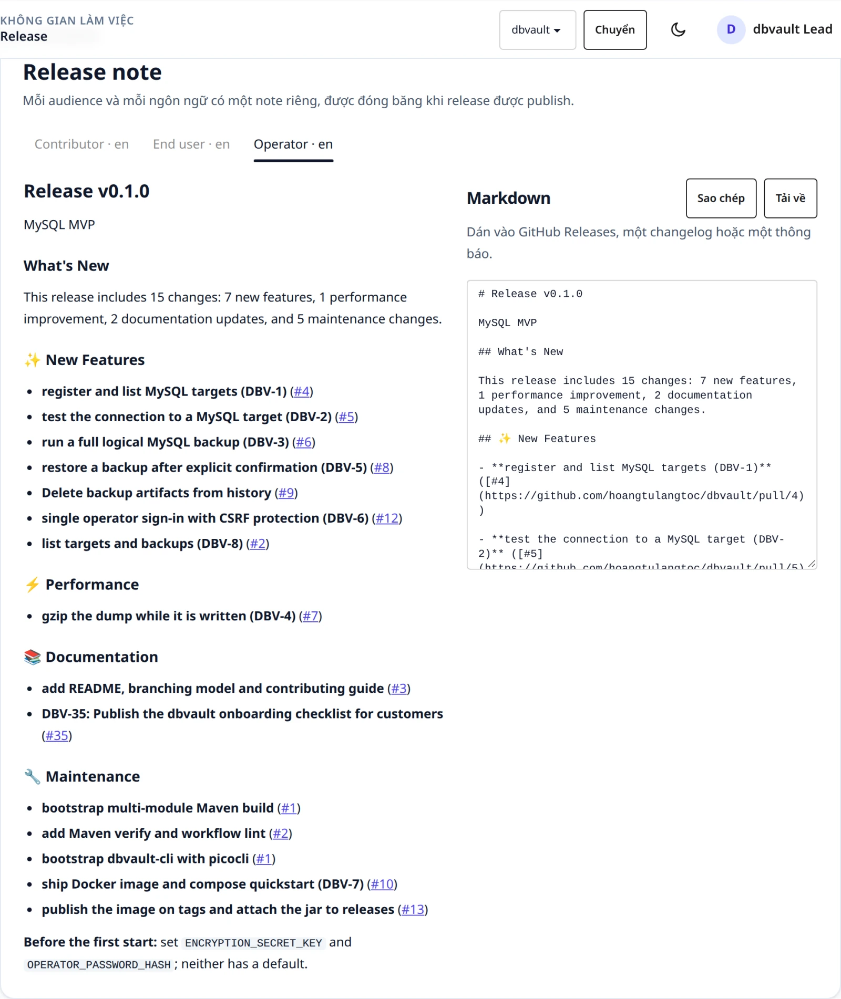
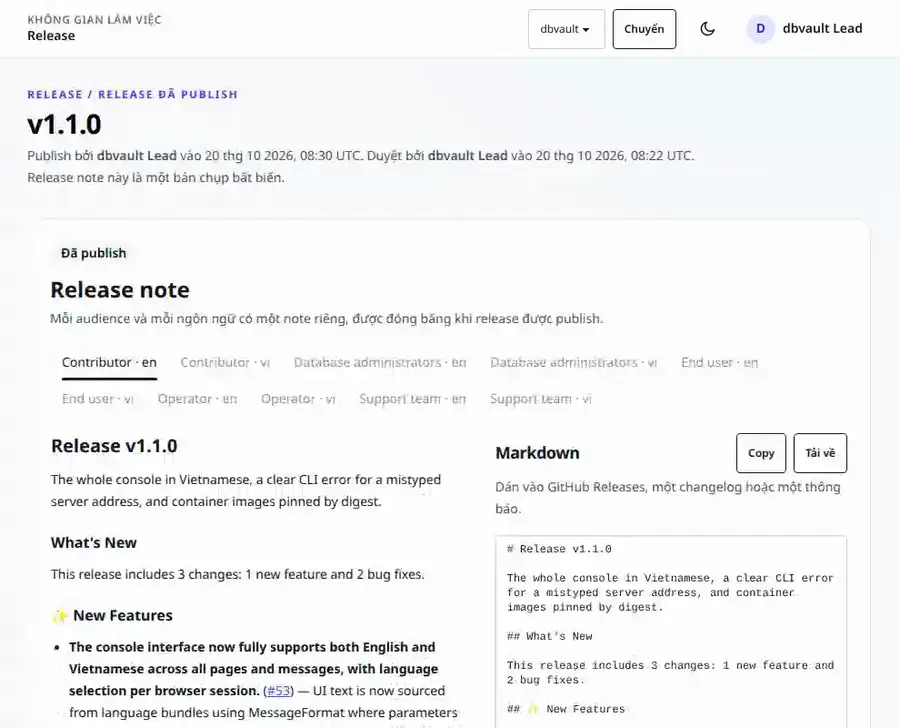

# Release note

Một release gom các thay đổi đã review. Khi release được duyệt, ReleaseFlow viết một release
note cho mỗi audience ở mỗi ngôn ngữ release note; khi release được publish, các release note
đó được cố định lại.

## Audience {#audiences}

Mỗi release đã duyệt có một release note cho mỗi **audience**. Quản trị viên quản lý audience ở
trang **Audience** hoặc qua `/api/audiences`. Mỗi Organization bắt đầu với ba audience mẫu,
được đặt tên theo ngôn ngữ đầu ra của nó (tiếng Anh hoặc tiếng Việt):

| Mã | Viết cho | Template |
| --- | --- | --- |
| `operator` | rủi ro vận hành, cách rollback, những gì cần theo dõi | thay đổi gì kèm liên kết pull request và narrative, rồi vì sao, chi tiết và bước migrate |
| `contributor` | chi tiết triển khai và thay đổi mã nguồn | như operator, nhưng là chi tiết triển khai thay cho chi tiết chung |
| `end_user` | ngôn ngữ dễ hiểu, những gì người dùng nhận thấy | chỉ thay đổi gì và narrative |



Một audience có một **mã** (chữ thường, chữ số và dấu gạch dưới, bắt đầu bằng chữ cái; cố định
sau khi tạo), một **tên hiển thị**, một **ý định truyền đạt** mà AI làm theo khi viết narrative
cho audience đó, và một **template**. Template là
[Mustache](https://mustache.github.io/mustache.5.html) và dựng một thay đổi thành Markdown với
các biến `whatChanged`, `whyChanged`, `technicalDetail`, `migrationStep`, `narrative`,
`reference`, `pullRequestNumber`, `pullRequestUrl` và `linkedIssues` — một danh sách mà mỗi phần
tử có `key`, `title`, `type`, `status` và `url`, được escape như mọi văn bản khác lấy từ công cụ
theo dõi issue, đúng như khi được đọc lúc thay đổi được ghi nhận
([Issue Jira liên kết](sources.md#linked-jira-issues)). `reference` là cách nguồn của thay đổi
gọi tên nó: `#12` cho pull request GitHub,
`!12` cho merge request GitLab, và key của issue, như `APP-12` hay `ENG-12`, cho Jira và Linear;
`pullRequestNumber` là con số trần, bất kể nguồn nào. Một section như
`{{#narrative}} — {{.}}{{/narrative}}` biến mất khi giá trị rỗng. **Xem thử** dựng một thay đổi
mẫu. Template được kiểm tra khi lưu: nó phải biên dịch được, chỉ dùng các biến trên, và dùng
`{{narrative}}` thay vì gọi tên một audience khác.

Các template chi tiết đi kèm liên kết một thay đổi bằng `[{{reference}}]({{pullRequestUrl}})`.



Một Organization giữ từ 1 đến 20 audience. Audience không xoá được khi còn thứ gì đó nhắc tới
nó: một release note, một hành động của quy tắc automation, hoặc lịch sử chạy automation. Quy
tắc đang bật hay đã tắt có thể được đổi sang audience khác trước. Quy tắc đã lưu trữ thì không
sửa được, và lịch sử chạy giữ audience mà nó đã giao tới, nên cả hai giữ audience đó mãi mãi;
lời từ chối nói rõ thứ nào đang giữ nó. Một audience mẫu có thể được đặt lại về phiên bản đi
kèm, theo ngôn ngữ đầu ra hiện tại. Xem [ADR-0011](adr/0011-audience-release-notes.md).

Mọi endpoint audience chỉ dành cho quản trị viên:

```text
GET    /api/audiences
POST   /api/audiences                          {"code", "displayName", "communicationIntent", "templateBody"}
GET    /api/audiences/{audienceId}
PUT    /api/audiences/{audienceId}             {"displayName", "communicationIntent", "templateBody"}
PUT    /api/audiences/{audienceId}/templates/{language}   {"templateBody"}
DELETE /api/audiences/{audienceId}
POST   /api/audiences/{audienceId}/reset-to-preset
POST   /api/audiences/preview                  {"templateBody"} -> {"markdown", "html"}
```

| Tình huống | Phản hồi |
| --- | --- |
| Thành viên, không phải quản trị viên | `403` |
| Thiếu trường, hoặc mã không khớp `[a-z][a-z0-9_]*` | `400 validation_failed` |
| Template không biên dịch được hoặc dùng biến không tồn tại | `400 template_invalid` |
| Template gọi tới `narratives.<code>` | `400 template_narratives_path` |
| Mã đã được dùng | `409 audience_code_taken` |
| Organization đã có 20 audience | `409 audience_limit` |
| Xoá audience cuối cùng | `409 audience_last` |
| Xoá một audience đã có release note, đang được hành động của một quy tắc automation giao tới (bật, tắt hay đã lưu trữ), hoặc có trong lịch sử chạy | `409 audience_in_use`; `detail` nói rõ lý do nào |
| Đặt lại một audience do nhóm của bạn tự tạo | `409 audience_not_preset` |
| Template cho một ngôn ngữ không nằm trong các ngôn ngữ release note | `400 template_language_not_targeted` |
| Audience không tồn tại hoặc thuộc Organization khác | `404 audience_not_found` |

## Ngôn ngữ release note {#release-note-languages}

Mặc định mọi release note được viết bằng ngôn ngữ đầu ra của Organization. Quản trị viên có thể
chọn tối đa năm **ngôn ngữ release note** ở đầu trang Audience, hoặc gọi
`PUT /api/organization/release-languages` với `{"targetLanguages": ["en", "vi"]}`; mọi thành
viên đọc được chúng bằng `GET`. Tag được chuẩn hoá và bỏ phần lặp; danh sách rỗng, nhiều hơn năm
ngôn ngữ, hoặc tag không hợp lệ trả về `400 invalid_release_languages`. Khi đó duyệt một
release sẽ viết một release note cho mỗi audience và mỗi ngôn ngữ, nên ba audience bằng tiếng
Anh và tiếng Việt cho ra sáu release note.

Mỗi audience có template riêng cho từng ngôn ngữ release note mà ngôn ngữ đầu ra không bao phủ,
được tạo khi thêm ngôn ngữ hoặc thêm audience: một audience mẫu bắt đầu từ template đi kèm của
nó bằng ngôn ngữ đó, với các nhãn đã dịch, còn mọi audience khác bắt đầu từ bản sao template
chính của nó. Sửa chúng trong mục **Template theo ngôn ngữ** trên trang của audience, hoặc gọi
`PUT /api/audiences/{audienceId}/templates/{language}`. Đặt lại một audience mẫu cũng đặt lại
các template này.

Bản tóm tắt và narrative của một thay đổi được viết bằng ngôn ngữ mà AI (hoặc người viết) đã
dùng. Với một release note bằng ngôn ngữ khác, chúng được dịch bằng
[DeepL](https://developers.deepl.com/docs) sau khi duyệt, không bao giờ trong lúc duyệt:

```sh
export RELEASEFLOW_TRANSLATION_PROVIDER=deepl   # the default is disabled
export RELEASEFLOW_DEEPL_API_KEY=...            # a key ending in :fx uses the free API
# RELEASEFLOW_DEEPL_BASE_URL overrides the host chosen from the key.
```

Các bản dịch được xếp hàng theo từng thay đổi và từng ngôn ngữ, và một worker chạy nền gửi chúng
tới DeepL theo lô. Văn bản đã dịch được cache cho Organization, nên cùng một văn bản không bao
giờ bị gửi hai lần, và một bản tóm tắt không đổi sẽ không bao giờ bị dịch lại, kể cả khi release
quay về nháp rồi được duyệt lại. Bị giới hạn tốc độ, lỗi phía server hoặc lỗi mạng được thử lại
tối đa năm lần với khoảng chờ tăng dần; mọi lỗi khác là lỗi cuối cùng. Tiêu đề pull request dùng
thay cho bản tóm tắt bị thiếu thì không được dịch.

**Tóm tắt** của chính release, dòng nằm dưới tiêu đề của release note, cũng được dịch theo cách
đó. Tóm tắt do người viết, bằng ngôn ngữ đầu ra của Organization, nên release note bằng ngôn
ngữ đó in nguyên văn, còn release note bằng mọi ngôn ngữ khác chờ bản dịch như nội dung của một
thay đổi. Bản dịch không bao giờ thay thứ người đã gõ: release vẫn giữ tóm tắt của nó, chỉ có
release note bằng ngôn ngữ khác đọc văn bản đã dịch. Release không có tóm tắt thì không có gì
để dịch.

Cho tới khi có đủ bản dịch, release note hiển thị văn bản chưa dịch và ở trạng thái **Đang
dịch**; trang release tự cập nhật khi bản dịch về tới. Một release note dịch thất bại, hoặc cần
dịch trong khi nhà cung cấp dịch đang tắt, ở trạng thái **Chưa dịch**. **Chạy lại bản dịch** sẽ
chạy lại những bản dịch thất bại, và sửa tay một release note như vậy sẽ khiến nó sẵn sàng.
Release chỉ được publish khi mọi release note đều sẵn sàng: nếu không, publish trả về
`409 translations_not_ready`, và cơ sở dữ liệu cũng từ chối. Sửa một bản tóm tắt sau khi duyệt
sẽ dịch văn bản mới. Xem [ADR-0015](adr/0015-multilingual-release-notes.md).





```text
GET  /api/organization/release-languages
PUT  /api/organization/release-languages                               {"targetLanguages"}
POST /api/projects/{projectId}/releases/{releaseId}/translations/retry
```

## Release {#releases}

Mở **Release** để chuẩn bị các release của một Project. Trang này tạo release với một phiên bản
(tối đa 50 ký tự), một bản tóm tắt không bắt buộc, và một thời điểm phát hành dự kiến theo UTC
không bắt buộc, đồng thời liệt kê các release của Project kèm bộ lọc theo trạng thái và số
lượng. Một Project có thể chuẩn bị nhiều release cùng lúc, và mỗi thay đổi thuộc về tối đa một
release.



Một release đi qua bốn bước, hiển thị ở đầu trang của nó:

1. **Nháp.** Thêm những thay đổi đã xử lý xong, từng cái một hoặc bằng **Thêm tất cả**. Thay đổi
   còn cần review vẫn thêm được; phần review của release sẽ quyết định nó. Thay đổi mà quản trị
   viên đã [loại khỏi release](changes.md#excluding-a-change-from-releases) không được đề xuất. Sửa phiên bản và bản
   tóm tắt, bỏ bớt thay đổi, rồi bấm **Yêu cầu review**, việc này cần ít nhất một thay đổi.
2. **Đang review.** Danh sách thay đổi được cố định, chỉ trừ việc từ chối. Trên tab **Review**,
   mỗi thay đổi nhận một quyết định: **Duyệt đúng như hiển thị** xác nhận category và cờ phá vỡ
   tương thích của nó, **Sửa phân loại** sửa lại chúng, và **Từ chối** bỏ thay đổi khỏi release
   để nó dùng được cho release khác. Duyệt và sửa đều ghi người review lên chính thay đổi, giống
   hệt một lần review trong Hộp thay đổi, kèm ghi chú không bắt buộc. Thay đổi Unknown bắt buộc
   phải sửa. **Duyệt release** dùng được khi mọi thay đổi đã có quyết định.
3. **Đã duyệt.** Người duyệt và thời điểm được ghi lại, và một release note được viết từ
   template cho mỗi audience ở mỗi ngôn ngữ release note (xem
   [Ngôn ngữ release note](#release-note-languages)). Kiểm tra tab của từng release note, sửa
   Markdown của một release note nếu cần (release note đó chuyển thành **Thủ công** và không còn
   theo template nữa), rồi chọn **Publish release này**.
4. **Đã publish.** Xem [Publish](#publishing).



Mọi thành viên đều làm được mọi bước, nên một người có thể tự chuẩn bị, review, duyệt và
publish cùng một release. ReleaseFlow ghi lại ai đã review từng thay đổi, ai đã duyệt và ai đã
publish, nhưng không yêu cầu hai người khác nhau.

Trước khi publish, một release có thể được đặt lịch hoặc bỏ lịch, đưa về nháp (từ trạng thái
đang review hoặc đã duyệt; việc này xoá các quyết định và lần duyệt nhưng không xoá các lần
review trên thay đổi của nó), hoặc bị huỷ bỏ (các thay đổi của nó lại dùng được). Đưa về nháp
cũng xoá các release note; duyệt lại sẽ viết release note mới.



Trước khi duyệt, phần xem trước cho thấy release note của mỗi audience sẽ viết gì. Một release
note bắt đầu bằng tiêu đề và bản tóm tắt của release và phần tổng quan **Có gì mới** kèm số
lượng, cảnh báo về thay đổi phá vỡ tương thích, rồi liệt kê thay đổi phá vỡ tương thích trước,
sau đó là tính năng, sửa lỗi, hiệu năng, tài liệu và bảo trì. Mỗi thay đổi được template của
audience viết ra từ bản tóm tắt trung lập và narrative của audience đó; khi không có bản tóm
tắt, tiêu đề pull request được dùng thay, sau khi bỏ tiền tố Conventional Commit. Các nhãn là
tiếng Anh hoặc tiếng Việt, theo ngôn ngữ đầu ra.



Trong lúc review và sau khi duyệt, **Sửa tóm tắt** trên tab Review cho phép một người viết hoặc
sửa bản tóm tắt của một thay đổi và narrative của từng audience. Việc này dùng được dù AI đã
viết hay chưa. Thay đổi ghi lại người đã viết, và các release note của một release đã duyệt mà
vẫn theo template sẽ được dựng lại. Release note phản ánh các thay đổi tại thời điểm duyệt: để
lấy một phân loại được sửa sau đó trong Hộp thay đổi, đưa release về nháp rồi duyệt lại. Xem
[ADR-0010](adr/0010-release-review-lifecycle.md) và
[ADR-0011](adr/0011-audience-release-notes.md).

REST client tuân theo cùng các quy tắc:

```text
GET    /api/projects/{projectId}/releases
POST   /api/projects/{projectId}/releases                                {"version", "summary", "plannedReleaseAt"}
GET    /api/projects/{projectId}/releases/{releaseId}
PUT    /api/projects/{projectId}/releases/{releaseId}                    {"version", "summary"}
DELETE /api/projects/{projectId}/releases/{releaseId}
PUT    /api/projects/{projectId}/releases/{releaseId}/schedule           {"plannedReleaseAt"} (null clears it)
GET    /api/projects/{projectId}/releases/{releaseId}/available-changes
POST   /api/projects/{projectId}/releases/{releaseId}/changes            {"changeIds": [...]} or {"allAvailable": true}
DELETE /api/projects/{projectId}/releases/{releaseId}/changes/{changeId} (remove, or reject during review)
POST   /api/projects/{projectId}/releases/{releaseId}/request-review
PUT    /api/projects/{projectId}/releases/{releaseId}/changes/{changeId}/decision
                                                                         {"action": "APPROVE" | "EDIT", "category", "breaking", "note"}
POST   /api/projects/{projectId}/releases/{releaseId}/approve
POST   /api/projects/{projectId}/releases/{releaseId}/return-to-draft
POST   /api/projects/{projectId}/releases/{releaseId}/publish
POST   /api/projects/{projectId}/releases/{releaseId}/translations/retry
PUT    /api/projects/{projectId}/releases/{releaseId}/changes/{changeId}/summary
                                                                         {"whatChanged", "whyChanged", "technicalDetail", "migrationStep", "narratives": {"<code>": "..."}}
GET    /api/projects/{projectId}/releases/{releaseId}/note-previews
GET    /api/projects/{projectId}/releases/{releaseId}/notes
PUT    /api/projects/{projectId}/releases/{releaseId}/notes/{noteId}     {"content"}
GET    /api/projects/{projectId}/releases/{releaseId}/notes/{noteId}/download
GET    /api/projects/{projectId}/release-assignments
```

`plannedReleaseAt` là một thời điểm ISO-8601 như `2026-10-01T09:00:00Z`; giá trị không kèm độ
lệch múi giờ được hiểu là UTC. Một release trả về `changes`, `decisions` (`changeId`, `action`,
`reviewerName`, `note`, `decidedAt`), `reviewedCount`, `plannedReleaseAt`, `approvedAt`,
`approverName`, và `notes` (`id`, `audienceCode`, `audienceName`, `language`, `content`,
`autoRerender`, `lastEditorName`, `updatedAt`, và `translationStatus`: `READY`, `PENDING` hoặc
`FAILED`). Tệp tải về có kiểu `text/markdown`, tên là
`<version>-<audience code>-<language>.md`. `release-assignments` liệt kê release (theo ID,
phiên bản và trạng thái) mà mỗi thay đổi của Project thuộc về. Các lỗi:

| Tình huống | Phản hồi |
| --- | --- |
| Thao tác không phù hợp với trạng thái của release | `409 release_status_conflict` |
| Yêu cầu review hoặc duyệt khi không có thay đổi nào | `409 release_empty` |
| Duyệt trước khi mọi thay đổi có quyết định | `409 release_review_incomplete` |
| Gửi `APPROVE` với phân loại khác phân loại hiện tại của thay đổi | `409 classification_changed` |
| `unknown` hoặc một category không được hỗ trợ trong quyết định | `400 invalid_change_review` |
| `APPROVE` một thay đổi Unknown, dù có nêu category nào: approve giữ nguyên phân loại hiện tại, nên thay đổi Unknown phải dùng `EDIT` kèm một category | `400 invalid_change_review` |
| Thời điểm phát hành dự kiến không đọc được hoặc đã qua | `400 invalid_release_schedule` |
| Thay đổi đang xử lý hoặc đã thuộc một release khác | `409 change_not_releasable` |
| Thay đổi đã bị loại khỏi release | `409 change_excluded` |
| Phiên bản đã được dùng trong Project này | `409 release_version_taken` |
| Sửa bản tóm tắt hoặc release note ở trạng thái không cho phép | `409 release_status_conflict` |
| Template của audience không dựng được lúc duyệt | `409 release_note_render_failed` |
| Publish một release đã duyệt nhưng không có release note | `409 release_notes_missing` |
| Publish khi một release note vẫn đang dịch hoặc không dịch được | `409 translations_not_ready` |
| Bản tóm tắt hoặc release note rỗng, hoặc một trường vượt giới hạn | `400 validation_failed` |
| Thay đổi không tồn tại hoặc thuộc Organization khác | `404 change_not_found` |
| Release không tồn tại hoặc thuộc Organization khác | `404 release_not_found` |
| Release note không tồn tại trong release này | `404 release_note_not_found` |

## Publish {#publishing}

Trên trang của một release đã duyệt, mở **Publish release này**. Publish sẽ cố định release note
của mọi audience, cùng với người publish và thời điểm publish. Sau đó trang chỉ còn để đọc. Nó
hiển thị người đã duyệt và người đã publish release, và có một tab cho mỗi audience và ngôn ngữ
với release note đã dựng, Markdown của nó, nút **Sao chép**, và liên kết **Tải về** để dùng cho
GitHub Releases hoặc một changelog. Tệp tải về có tên `<version>-<audience>-<language>.md`.



Một release đã publish không sửa, đặt lịch, review, huỷ bỏ, gỡ publish hay đổi nội dung được, và
các release note của nó cũng vậy. Các thay đổi của nó vẫn sửa được trong Hộp thay đổi, nhưng
release note đã publish giữ nguyên những gì đã publish. Trigger của PostgreSQL bảo đảm điều này
kể cả khi chạy SQL trực tiếp. Xem
[ADR-0005](adr/0005-immutable-release-note-snapshots.md) và
[ADR-0011](adr/0011-audience-release-notes.md).

REST client gọi `POST /api/projects/{projectId}/releases/{releaseId}/publish`. Lời gọi trả về
release với `status`, `publishedAt`, `publisherName` và `notes`. Trước khi publish, `preview`
nhóm các thay đổi hiện có của release vào các section của release note; sau khi publish,
`preview` rỗng và các release note nằm trong `notes`. `markdown` là null, trừ release được publish
trước Flyway `V13`. Publish một release
chưa duyệt trả về `409 release_status_conflict`; mọi thao tác trên một release đã publish trả về
`409 release_published`.
