# Nguồn

Một Project thu thập thay đổi từ một hoặc nhiều nguồn: repository GitHub, project GitLab,
team Linear và project Jira Cloud. GitHub, GitLab và Linear gửi webhook có chữ ký; Jira được
đọc theo lịch. Mỗi thay đổi chỉ được ghi một lần, theo nguồn của nó và ID mà chính nguồn đó
đặt cho nó, dù nó đến qua webhook, qua lượt đọc theo lịch hay qua
[import lịch sử](#history-import).

## Kết nối một nguồn {#connect-a-source}

Quản trị viên kết nối nguồn ở trang **Project**, hoặc qua REST:

```text
GET  /api/projects/{projectId}/sources                       (every member)
POST /api/projects/{projectId}/sources                       (administrator; 201)
PUT  /api/projects/{projectId}/sources/{sourceId}/token      (administrator; 204)
```

Body của `POST` tuỳ theo loại nguồn:

| Loại | Body | Kết quả trả về |
| --- | --- | --- |
| GitHub | `{"type": "GITHUB", "owner", "repository"}` | Đường dẫn webhook và một signing secret, **chỉ hiện một lần** |
| GitLab | `{"type": "GITLAB", "apiBaseUrl", "projectPath", "webhookAuthMode"}` | Đường dẫn webhook và một signing secret, **chỉ hiện một lần**; với header có chữ ký, kèm `signingToken`, cũng là secret đó ở dạng signing token của GitLab nhận |
| Linear | `{"type": "LINEAR", "teamId", "webhookSecret", "apiToken"}` | Đường dẫn webhook; Linear tự tạo secret, nên bạn nhập nó vào và không có gì bí mật được trả về |
| Jira | `{"type": "JIRA", "siteUrl", "projectKey", "accountEmail", "apiToken"}` | Không có gì bí mật; Jira không dùng webhook |

Lưu secret được trả về ngay lập tức: nó được lưu mã hoá bằng AES-256-GCM và không bao giờ hiện
lại. Tên chủ repository, tên repository và đường dẫn project GitLab được chuẩn hoá về chữ
thường. Trong một Organization, mỗi repository hoặc project chỉ kết nối được với một Project,
nhưng các Organization khác nhau có thể kết nối cùng một repository, và cùng một tên trên hai
nhà cung cấp là hai nguồn riêng biệt. Một nguồn có thể được
[ngắt kết nối](#disconnect-a-source) và [kết nối lại](#reconnect-a-source), và webhook secret của
nó có thể được [đổi](#rotate-a-webhook-secret) mà không đổi đường dẫn.

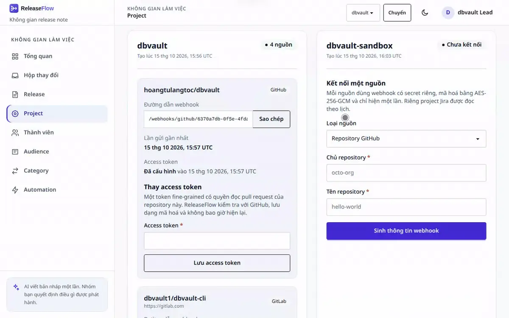

Nguồn không tồn tại trả về `404 source_not_found`, và nguồn đã được kết nối trả về
`409 github_repository_already_connected`, `409 gitlab_project_already_connected`,
`409 linear_team_already_connected` hoặc `409 jira_project_already_connected`. Nguồn mà chính
Project đó đang giữ ở trạng thái ngắt kết nối trả về `409 source_reconnect_required`: kết nối lại
nó thay vì kết nối mới, như vậy các thay đổi được giữ nguyên. Thành viên gọi endpoint dành cho quản
trị viên nhận `403`.

## Nhận webhook từ GitHub {#receive-github-webhooks}

Trong repository GitHub, mở **Settings → Webhooks → Add webhook** và nhập:

- **Payload URL**: địa chỉ công khai của ReleaseFlow, nối thêm đường dẫn webhook hiển thị cho
  Project, ví dụ `https://releaseflow.example.com/webhooks/github/<webhook-id>`;
- **Content type**: `application/json`;
- **Secret**: signing secret đã lưu khi kết nối repository;
- **Events**: *Let me select individual events* → *Pull requests*.

`POST /webhooks/github/{webhookId}` không cần phiên đăng nhập hay CSRF token. ReleaseFlow
kiểm tra `X-Hub-Signature-256` bằng chính secret của kết nối đó trước khi đọc payload, và lấy
Organization cùng Project từ kết nối, không bao giờ từ payload. Các phản hồi:

| Lần gửi | Phản hồi |
| --- | --- |
| Lớn hơn 1 MiB | `413` `webhook_payload_too_large` |
| Webhook ID không tồn tại, thiếu chữ ký hoặc chữ ký sai | `401` `webhook_signature_invalid` |
| `repository.full_name` không phải repository đã cấu hình | `422` `webhook_repository_mismatch` |
| Lần gửi đã xác minh nhưng JSON không hợp lệ, thiếu `X-GitHub-Event`, hoặc là pull request đã merge nhưng thiếu trường hay thiếu `X-GitHub-Delivery` | `400` `webhook_payload_malformed` |
| `ping` | `200` `{"outcome":"pong"}` |
| Pull request đã merge (`closed` với `merged: true`) | `200` `recorded`, hoặc `duplicate` nếu đã ghi trước đó |
| Mọi sự kiện hoặc hành động khác | `200` `ignored` |

Mỗi pull request đã merge chỉ được lưu một lần cho mỗi repository, nên GitHub gửi lại cũng
không sao, và hai repository của cùng một Project đều có thể có pull request #12. Trang Project
hiển thị thời điểm của lần gửi được chấp nhận gần nhất; thời điểm này xuất hiện ngay khi GitHub
gửi `ping` đầu tiên, và Change Inbox cùng trang tổng quan cũng hiển thị nó, kèm
[tình trạng](#source-health) của nguồn.

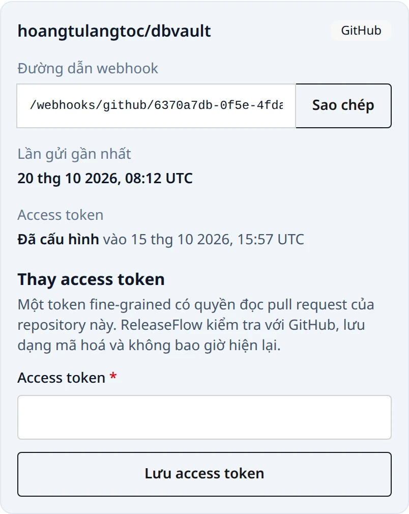

Để thử endpoint trên máy mà không cần GitHub, ký đúng chuỗi byte bạn gửi đi:

```bash
WEBHOOK_PATH=/webhooks/github/replace-with-the-webhook-id
WEBHOOK_SECRET='replace-with-the-saved-secret'
BODY='{"zen":"Keep it logically awesome.","repository":{"full_name":"owner/repository"}}'
SIGNATURE="sha256=$(printf '%s' "$BODY" | openssl dgst -sha256 -hmac "$WEBHOOK_SECRET" | awk '{print $NF}')"
curl -sS -X POST "http://localhost:8080$WEBHOOK_PATH" \
  -H 'Content-Type: application/json' \
  -H 'X-GitHub-Event: ping' \
  -H "X-GitHub-Delivery: $(uuidgen)" \
  -H "X-Hub-Signature-256: $SIGNATURE" \
  --data-binary "$BODY"
```

## Nhận webhook từ GitLab {#receive-gitlab-webhooks}

Trong project GitLab, mở **Settings → Webhooks → Add new webhook** và nhập:

- **URL**: địa chỉ công khai của ReleaseFlow, nối thêm đường dẫn webhook hiển thị cho nguồn, ví
  dụ `https://releaseflow.example.com/webhooks/gitlab/<webhook-id>`;
- với **header có chữ ký** (mặc định): **signing token** hiển thị khi kết nối project, dán vào
  trường **Signing token** của GitLab (`signing_token` trong hooks API), và để trống **Secret
  token**;
- với **header secret token**: secret đã lưu, dán vào **Secret token**;
- **Trigger**: *Merge request events*.

GitLab xoá secret token của hook mỗi khi URL của nó thay đổi, nên mỗi lần sửa URL, nhập lại token
trong cùng lần lưu, hoặc gửi `url` và token cùng nhau qua hooks API (xem
[Đổi webhook secret](#rotate-a-webhook-secret)).

Signing token là secret được viết theo dạng mà Standard Webhooks, và do đó GitLab, yêu cầu:
`whsec_` theo sau là Base64 chuẩn, có padding, của 32 byte của secret. Bản thân secret là
Base64url không padding của cùng các byte đó, dạng mà GitLab từ chối khi dùng làm signing token.
Cả hai chỉ hiện một lần, trên trang và trong trường `signingToken` của response kết nối nguồn.
Để viết signing token từ một secret đã lưu:

```bash
printf 'whsec_%s\n' "$(printf '%s=' "$WEBHOOK_SECRET" | tr '_-' '/+' | base64 -d | base64 -w0)"
```

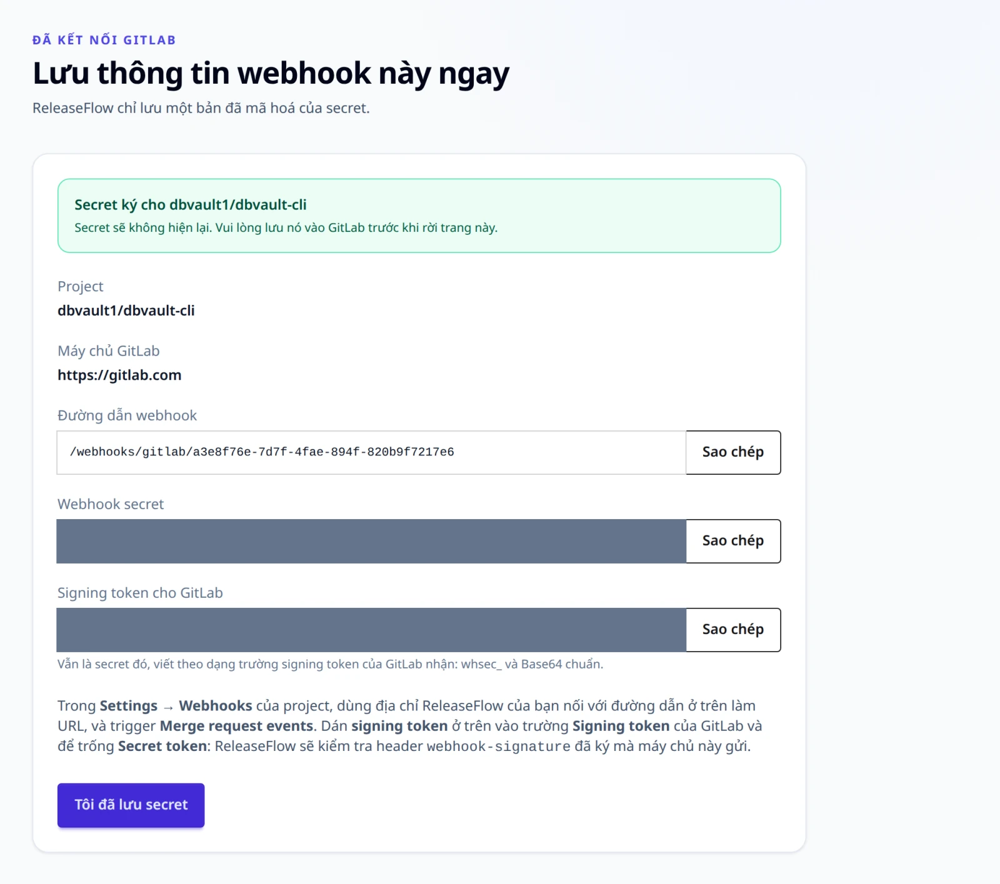

`POST /webhooks/gitlab/{webhookId}` không cần phiên đăng nhập hay CSRF token, và ReleaseFlow
xác minh lần gửi bằng chính secret của nguồn đó trước khi đọc payload. Cách kiểm tra nào được
áp dụng là do bạn chọn khi kết nối nguồn:

- **Header có chữ ký (Standard Webhooks)**, mặc định: phải có đủ `webhook-id`,
  `webhook-timestamp` và `webhook-signature`; chữ ký phải là `v1,` theo sau là HMAC-SHA256
  dạng Base64 của `id.timestamp.body` với secret — chỉ cần một trong nhiều ứng viên cách nhau
  bởi dấu cách khớp là đủ — và timestamp phải lệch không quá năm phút so với đồng hồ của
  ReleaseFlow.
- **Header secret token**: `X-Gitlab-Token` phải bằng đúng secret.

Organization và Project lấy từ nguồn, không bao giờ từ payload:

| Lần gửi | Phản hồi |
| --- | --- |
| Lớn hơn 1 MiB | `413` `webhook_payload_too_large` |
| Webhook ID không tồn tại, nguồn thuộc loại khác, thiếu, quá hạn hoặc sai bằng chứng | `401` `webhook_signature_invalid` |
| `project.path_with_namespace` không phải project đã kết nối | `422` `webhook_repository_mismatch` |
| Lần gửi đã xác minh nhưng JSON không hợp lệ, hoặc merge request đã merge nhưng thiếu trường | `400` `webhook_payload_malformed` |
| Merge request đã merge (`object_kind: merge_request` với `action: merge`) | `200` `recorded`, hoặc `duplicate` nếu đã ghi trước đó |
| Mọi sự kiện hoặc hành động khác | `200` `ignored` |

Mỗi merge request chỉ được lưu một lần cho mỗi nguồn, nên gửi lại cũng không sao. GitLab chỉ
đặt định danh cho lần gửi khi dùng chế độ ký, nên một thay đổi ghi lại `X-Gitlab-Event-UUID`
khi nó là GUID, và không ghi gì trong trường hợp còn lại.

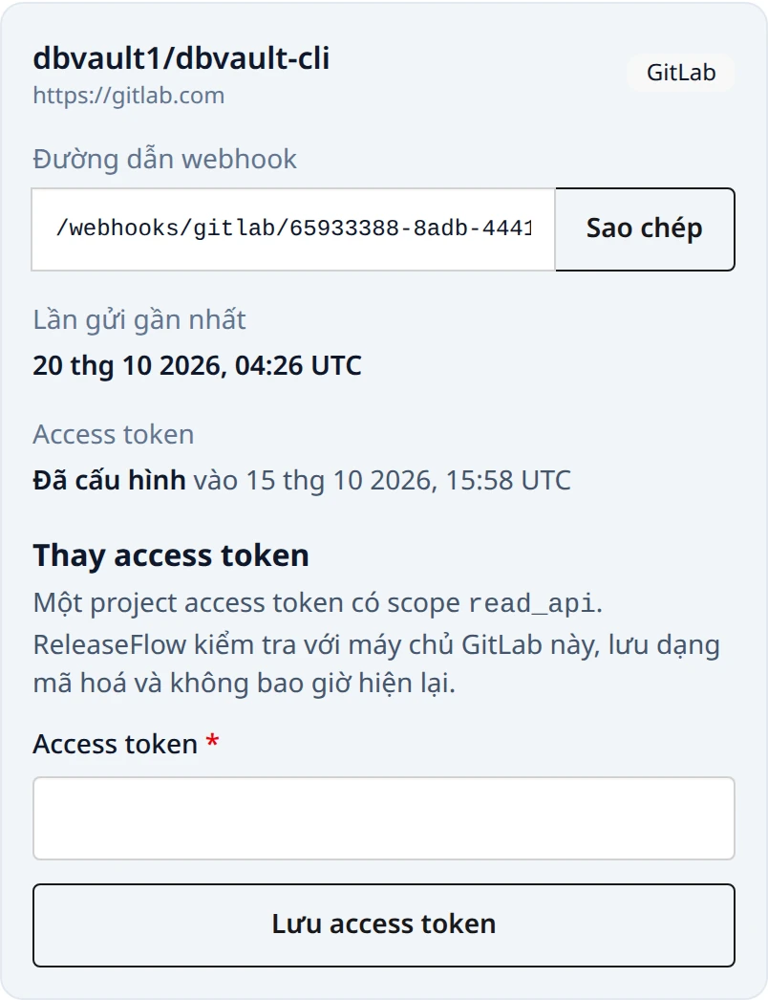

Chỉ kết nối được những instance có tên trong `RELEASEFLOW_GITLAB_ALLOWED_HOSTS` (mặc định
`gitlab.com`). Mỗi mục là `host` hoặc `host:port`, nghĩa là HTTPS, hoặc một origin đầy đủ như
`http://gitlab.internal:8080`; ghi rõ scheme là cách duy nhất để chấp nhận một instance truy
cập không qua TLS. URL có thông tin đăng nhập, query hoặc fragment bị từ chối với
`400 gitlab_base_url_invalid`, và mọi host khác bị từ chối với `400 gitlab_host_not_allowed`.
ReleaseFlow không bao giờ đi theo chuyển hướng từ một instance GitLab.

Để thử endpoint trên máy mà không cần GitLab, ký đúng chuỗi byte bạn gửi đi:

```bash
WEBHOOK_PATH=/webhooks/gitlab/replace-with-the-webhook-id
SIGNING_TOKEN='whsec_replace-with-the-signing-token'
BODY='{"object_kind":"push"}'
DELIVERY_ID="$(uuidgen)"
TIMESTAMP="$(date +%s)"
SIGNATURE="v1,$(printf '%s' "$DELIVERY_ID.$TIMESTAMP.$BODY" \
  | openssl dgst -sha256 -mac HMAC -macopt "hexkey:$(printf '%s' "${SIGNING_TOKEN#whsec_}" \
      | base64 -d | xxd -p -c 256)" -binary | base64)"
curl -sS -X POST "http://localhost:8080$WEBHOOK_PATH" \
  -H 'Content-Type: application/json' \
  -H "webhook-id: $DELIVERY_ID" \
  -H "webhook-timestamp: $TIMESTAMP" \
  -H "webhook-signature: $SIGNATURE" \
  --data-binary "$BODY"
```

## Nhận webhook từ Linear {#receive-linear-webhooks}

Linear tự tạo signing secret, nên tạo webhook bên Linear trước: trong
**Settings → API → Webhooks**, đặt URL là địa chỉ ReleaseFlow của bạn nối thêm đường dẫn
ReleaseFlow hiển thị cho nguồn, và bật sự kiện **Issues**. Sao chép secret Linear hiển thị
rồi dán nó, cùng một API key, khi kết nối team trong ReleaseFlow.

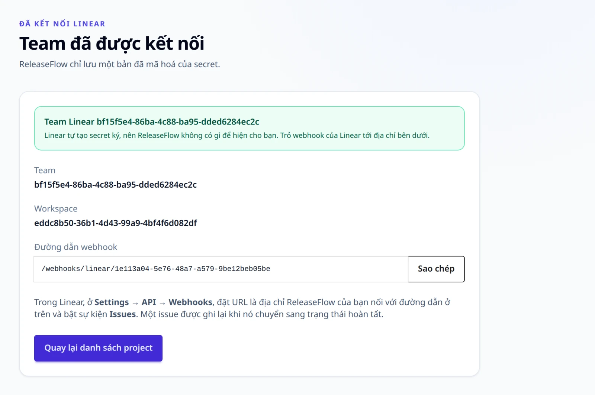

`POST /webhooks/linear/{webhookId}` không cần phiên đăng nhập hay CSRF token. Một lần gửi tự
chứng minh bằng bốn điều, tất cả đều phải đúng:

- có header `Linear-Delivery`;
- `createdAt` lệch không quá `RELEASEFLOW_LINEAR_WEBHOOK_CLOCK_SKEW` (60 giây) so với đồng hồ
  của ReleaseFlow, ở dạng ISO-8601 hoặc số giây hay mili giây tính từ epoch;
- `organizationId` bằng đúng workspace mà team thuộc về, thông tin ReleaseFlow biết được khi
  kết nối team;
- `Linear-Signature` chứa HMAC-SHA256 dạng hex của body thô.

| Lần gửi | Phản hồi |
| --- | --- |
| Lớn hơn 1 MiB | `413` `webhook_payload_too_large` |
| Webhook ID không tồn tại, nguồn thuộc loại khác, thiếu header, dấu thời gian quá hạn, workspace khác, hoặc chữ ký sai | `401` `webhook_signature_invalid` |
| Body không phải một JSON object, kể cả khi chữ ký đúng: dấu thời gian và workspace được đọc từ body, nên lần gửi đó không bao giờ được xác minh | `401` `webhook_signature_invalid` |
| Issue của một team khác team đã kết nối | `422` `webhook_repository_mismatch` |
| Lần gửi đã xác minh nhưng issue thiếu trường | `400` `webhook_payload_malformed` |
| Issue vừa chuyển sang trạng thái hoàn thành | `200` `recorded`, hoặc `duplicate` nếu đã ghi trước đó |
| Mọi sự kiện, hành động hoặc thay đổi trạng thái khác | `200` `ignored` |

Một issue chỉ được tính khi nó thật sự chuyển sang hoàn thành: `type` là `Issue`, `action` là
`update`, `updatedFrom` có chứa trạng thái, trạng thái mới là `completed` và trạng thái cũ thì
không. Sửa một issue đã hoàn thành từ trước không thay đổi gì.

Linear không đặt cho lần gửi một định danh mà ReleaseFlow có thể ghi lại dưới dạng GUID, nên
thay đổi từ Linear không có delivery ID. Mỗi issue vẫn chỉ được lưu một lần cho mỗi nguồn,
theo UUID của nó, nên gửi lại cũng không sao.

## Đọc Jira theo lịch {#poll-jira}

Phía Jira không cần cấu hình gì. Kết nối một project Jira Cloud bằng site của nó
(`https://your-site.atlassian.net`), project key (`APP`), email của tài khoản ReleaseFlow dùng
để đăng nhập, và một
[Atlassian API token](https://id.atlassian.com/manage-profile/security/api-tokens) của tài
khoản đó, có quyền xem project. ReleaseFlow nhờ Jira xác nhận các thông tin này trước khi lưu
bất cứ thứ gì, và trả về `400 jira_site_invalid` cho site không phải địa chỉ HTTPS
`atlassian.net` không kèm cổng, thông tin đăng nhập, query hay fragment;
`400 jira_token_rejected` khi Jira từ chối tài khoản và token; và `503 jira_unavailable` khi
không kết nối được Jira.

Từ đó trở đi, ReleaseFlow đọc project sau mỗi `RELEASEFLOW_JIRA_POLL_INTERVAL` (năm phút). Mỗi
lượt đọc lấy các issue thuộc nhóm trạng thái Done được cập nhật kể từ lượt đọc trước, lùi lại
thêm `RELEASEFLOW_JIRA_POLL_OVERLAP` (mười phút) để không sót issue nào ở ranh giới, và ghi
lại một lần mỗi issue được giải quyết trong khoảng đó. Issue được giải quyết trước khi kết nối
project sẽ không bao giờ được đọc. Một thay đổi từ Jira:

- được đánh số theo key — `APP-123` là `#123` — và có tiêu đề `APP-123: summary`, với người
  báo cáo là tác giả và `{site}/browse/APP-123` là liên kết;
- không có tệp thay đổi, nên được kiểm tra bằng cùng cách quét từ nhạy cảm như một issue
  Linear;
- bắt đầu bằng key, nên quy tắc tiêu đề Conventional Commit không bao giờ khớp với nó: khi không
  có AI, một thay đổi từ Jira là Unknown và cần review.

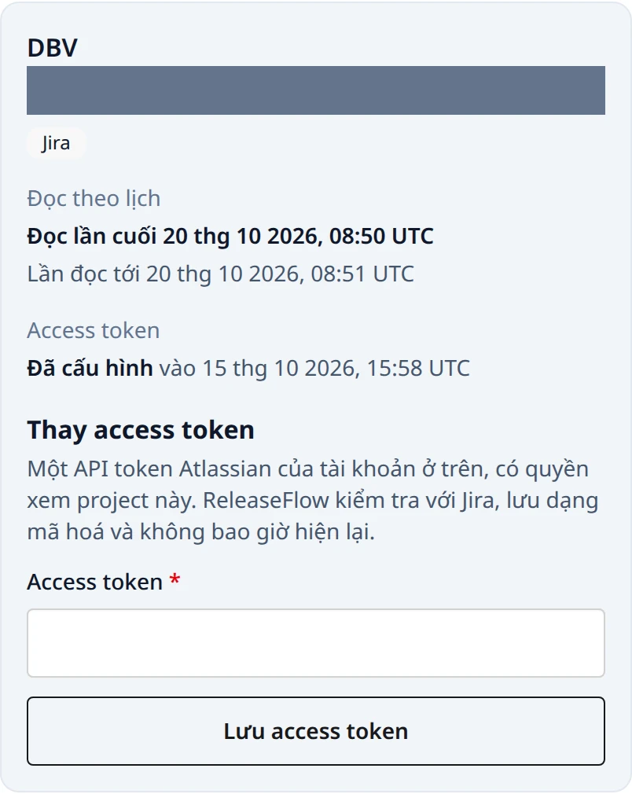

Một lượt đọc thất bại vẫn giữ nguyên vị trí và thử lại, và nguồn hiển thị **Kết nối đang lỗi**
cho tới khi có một lượt thành công. Một lỗi mà Jira có thể tự vượt qua, như giới hạn tốc độ hay
sự cố, được thử lại tối đa năm lần, sau khoảng chờ Jira yêu cầu (tối đa một giờ) hoặc sau 2, 4,
8 … giây (tối đa năm phút). Một lượt đọc vẫn thất bại, hoặc bị Jira từ chối thẳng, chẳng hạn
token bị từ chối, sẽ đặt lượt đọc kế tiếp sau **15 phút** chứ không theo
`RELEASEFLOW_JIRA_POLL_INTERVAL`. Khoảng chờ này cố định trong ReleaseFlow, không cấu hình được,
và việc lưu token mới hay khởi động lại đều không kéo lượt đọc đã đặt về sớm hơn. Hộp thay đổi
hiển thị lượt đọc gần nhất và lượt đọc tiếp theo của mỗi project Jira; project Jira không có
import lịch sử.

### Issue liên kết {#linked-issues}

Khi một Project có nguồn Jira hoặc nguồn Linear kèm token, mỗi thay đổi từ GitHub hoặc GitLab
được kiểm tra xem có nhắc tới issue nào không: key của project Jira, như `APP-12`, và định danh
của team Linear, như `OPS-7`, so khớp không phân biệt hoa thường. Việc kiểm tra xét tiêu đề, mô
tả, nhánh đích, nhánh nguồn (nhánh mà pull request hoặc merge request xuất phát) và tối đa 250
commit message của thay đổi. Tối đa mười key của mỗi công cụ theo dõi được đọc, mỗi key từ đúng
công cụ của nó, và hiển thị trong mục **Issue liên kết** của thay đổi, được đưa cho AI như bằng
chứng không tin cậy, và dùng được trong template của audience:

```mustache
{{#linkedIssues}} [{{key}}]({{url}}) {{title}} ({{type}}{{#status}}, {{status}}{{/status}}){{/linkedIssues}}
```

Thế nào là có nhắc tới tuỳ vào vị trí của key:

| Vị trí | Được tính | Không được tính |
| --- | --- | --- |
| Nhánh nguồn | `feature/APP-47-retention-preview`, `APP-47/preview`, `bugfix/app-47_restore` | `release/2026-APP-47x`, `APP-047` |
| Mô tả, commit message | `Spec: APP-12-quartz`: key theo sau là dấu gạch nối và một từ viết thường | `APP-12-3`, `APP-12-Q`, và `ISO-8601-compliant`, vì tiền tố của nó không phải công cụ theo dõi nào của Project |
| Tiêu đề, nhánh đích | `APP-3` đứng riêng | `feature/APP-3-export`: key theo sau là dấu gạch nối |

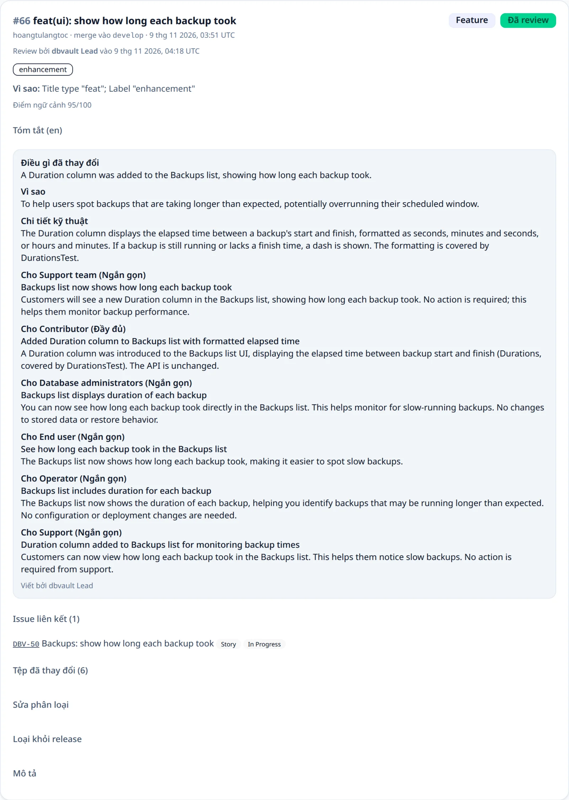

Key của một team Linear được đọc khi kết nối team và được giữ lại; team kết nối trước 1.2.0 được
đọc key ở thay đổi đầu tiên được kiểm tra sau đó. Team không đọc được key thì không liên kết gì,
và thay đổi nói rõ điều đó. Issue của một team Linear khác không được liên kết.

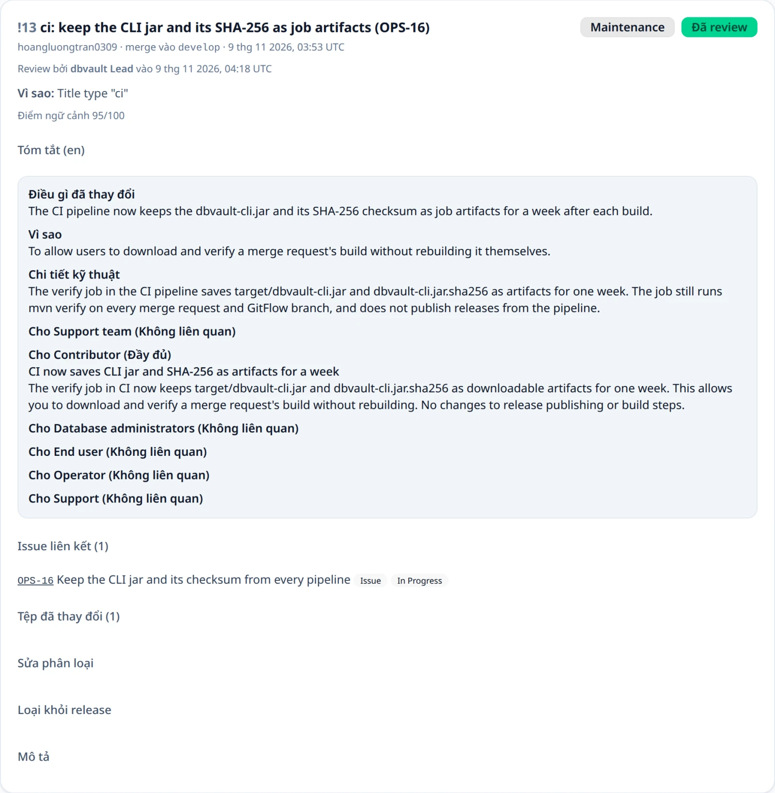

Issue được đọc lúc thay đổi được ghi nhận, và thay đổi giữ đúng những gì đọc được khi đó. Một
release đọc lại các issue của các thay đổi trong nó khi yêu cầu review, nên note hiển thị từng
trạng thái tại thời điểm review (xem
[Issue liên kết lúc review](release-notes.md#linked-issues-at-review)). Chúng là bằng chứng về
việc thay đổi đã trỏ tới đâu, không phải góc nhìn trực tiếp vào công cụ theo dõi issue.

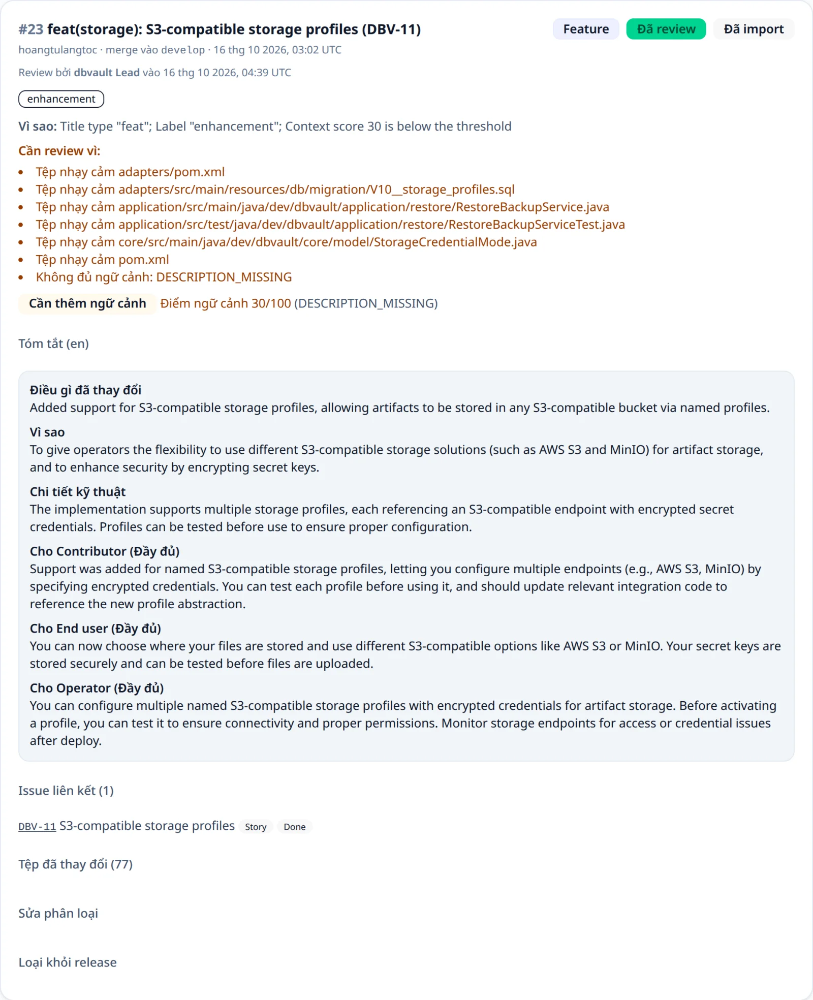

Commit message chỉ được dùng để tìm key; chúng không bao giờ được lưu lại. Khi không đọc được
commit, hoặc Jira hay Linear không cho xem một issue mà thay đổi có nhắc tới, thay đổi được thử
lại rồi đánh dấu **Danh sách issue liên kết chưa đầy đủ**, khiến nó bắt buộc phải review.

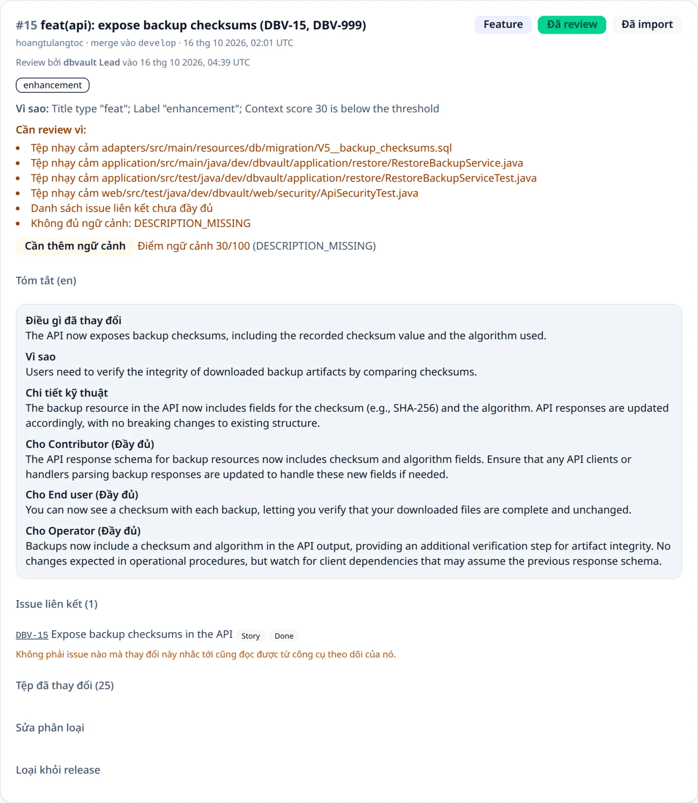

## Access token {#access-tokens}

Có access token, ReleaseFlow liệt kê được các tệp mà mỗi pull request hoặc merge request đã
merge chạm vào, nhờ vậy thay đổi vào tệp nhạy cảm luôn được review. Không có token, mọi thay đổi
mới từ GitHub hoặc GitLab đều cần review, vì không loại trừ được điều gì. Linear và Jira cần
token ngay từ lúc kết nối.

Với GitHub, tạo một fine-grained personal access token chỉ giới hạn trong repository, với quyền
**Pull requests: Read-only** (token kiểu classic cần `repo` cho repository private). Với GitLab,
tạo một project access token với scope `read_api`. Với Linear, tạo một API key đọc được team —
key này bắt buộc khi kết nối team, vì việc xác nhận nó cũng là cách ReleaseFlow biết workspace.
Với Jira, API token cũng bắt buộc, và thuộc về email tài khoản của nguồn; token mới từ một tài
khoản khác đi kèm email của tài khoản đó, trong `accountEmail`, và cả hai được xác nhận cùng lúc.
Quản trị viên nhập token dưới nguồn tương ứng trong thẻ của Project trên trang Project, hoặc
gọi:

```text
PUT /api/projects/{projectId}/sources/{sourceId}/token {"token", "accountEmail"?}   (administrator; 204)
```

ReleaseFlow trước hết nhờ nhà cung cấp xác nhận token — GitHub với các pull request của
repository, GitLab với project, Linear với team (chỉ chấp nhận khi key vẫn truy cập đúng
workspace cũ), Jira với project — rồi mới lưu nó dưới dạng mã hoá bằng AES-256-GCM. Token không
bao giờ được trả về; nguồn chỉ báo `accessTokenConfigured` và `accessTokenUpdatedAt`. Gửi token
mới sẽ thay token cũ, và đó là cách đổi token: nguồn, đường dẫn và secret giữ nguyên, và token cũ
không bao giờ được dùng nữa sau khi token mới được lưu, dù một lời gọi đang chạy vẫn hoàn tất với
nó. ReleaseFlow không thu hồi được token, nên thu hồi token cũ ở phía nhà cung cấp sau khi lưu token
mới. Không có gì nhắc việc đổi token. Nguồn đã ngắt kết nối không nhận token và trả lời
`409 source_disconnected`. Các lỗi là `400 github_token_rejected`, `400 gitlab_token_rejected`,
`400 linear_token_rejected` hoặc `400 jira_token_rejected` khi nhà cung cấp từ chối token;
`503 github_unavailable`, `503 gitlab_unavailable` hoặc `503 jira_unavailable` khi không kết nối
được; `404 source_not_found`; và `403` với thành viên.

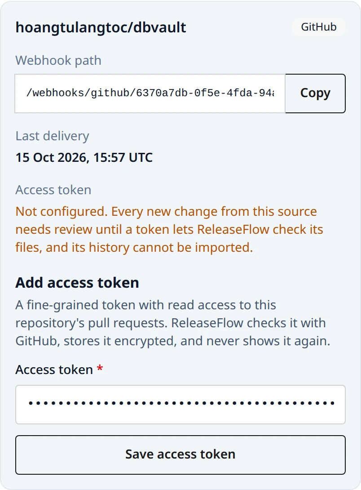

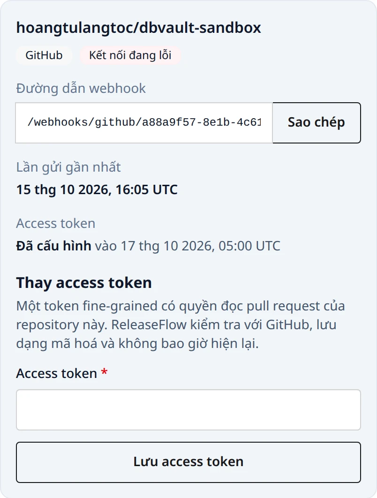

Danh sách tệp thay đổi của GitLab lấy từ các diff của merge request, tối đa mười trang, mỗi
trang một trăm. Một diff mà GitLab báo là bị thu gọn, quá lớn hoặc bị cắt khiến cả danh sách
được coi là không có, chứ không phải là danh sách ngắn hơn, nhờ vậy một tệp chưa từng được thấy
sẽ không bao giờ bị coi là an toàn.

Linear hoàn toàn không có tệp thay đổi, và điều đó khác với việc không liệt kê được tệp: thay vì
bắt review mãi mãi, ReleaseFlow đọc tiêu đề và mô tả của chính issue để tìm `breaking change`,
`migration`, `security`, `auth`, `credential`, `password` và `encryption`, và mỗi lần khớp trở
thành một trigger **Từ nhạy cảm** bắt buộc phải review. Token của Linear cũng là thứ cho phép
ReleaseFlow đọc lại issue, nên thay đổi mang nội dung hiện tại của issue chứ không phải nội
dung ngay lúc nó vừa hoàn thành.

## Import lịch sử {#history-import}

Webhook chỉ mang về những pull request và merge request được merge sau khi nguồn được kết nối.
Để thêm những cái đã merge trước đó, quản trị viên mở bảng **Đồng bộ nguồn** trong Hộp thay đổi
và chọn **Import 90 ngày gần nhất** cho một nguồn đã có access token, hoặc gọi các endpoint
REST bên dưới. Chỉ những nguồn có nhà cung cấp lưu lịch sử mà ReleaseFlow đọc được mới có tuỳ
chọn này; Linear và Jira thì không, và cố yêu cầu sẽ nhận `409 source_import_not_supported`.
Một worker chạy nền đọc lịch sử của nguồn, mỗi trang 100 mục — với GitHub là các pull request
đã đóng, cập nhật gần nhất trước; với GitLab là các merge request đã merge được cập nhật sau
thời điểm bắt đầu khoảng thời gian, cập nhật cũ nhất trước — và ghi lại mọi mục được merge
trong 90 ngày qua qua cùng quy trình xử lý như một lần gửi webhook: tệp thay đổi được liệt kê
và, khi đã cấu hình AI, thay đổi được phân loại một lần. Mục nào đã được ghi trước đó, qua
webhook hay qua một lần import trước, sẽ được bỏ qua, nên import và webhook không bao giờ tạo
bản trùng của nhau. Thay đổi được import mang nhãn **Đã import**.

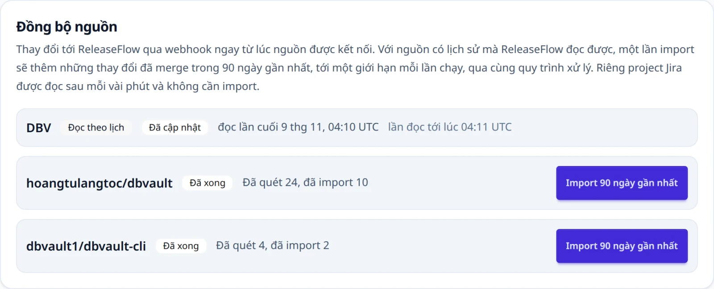

Import từ GitHub dừng ở pull request đầu tiên được cập nhật trước khoảng thời gian của nó, và cả
hai loại import đều dừng sau 500 thay đổi mới với trạng thái **Dừng ở giới hạn**, vị trí được
lưu lại; **Chạy tiếp** sẽ tiếp tục từ đó với bộ đếm mới, và chạy tiếp một lần import thất bại
cũng vậy. Khi nhà cung cấp giới hạn tốc độ, lần import chờ đúng thời gian nhà cung cấp yêu cầu
(`Retry-After` hoặc thời điểm reset giới hạn, tối đa một giờ); các lỗi tạm thời khác thì chờ
với khoảng chờ tăng dần. Sau năm lần thử, hoặc ngay lập tức khi nhà cung cấp từ chối token,
lần import thất bại, và token bị từ chối khiến nguồn hiện **Kết nối đang lỗi** cho tới khi lưu
token mới. Mỗi nguồn chỉ chạy một lần import tại một thời điểm.

```text
GET  /api/projects/{projectId}/imports                              (every member)
POST /api/projects/{projectId}/sources/{sourceId}/imports           (administrator; 202)
POST /api/projects/{projectId}/sources/{sourceId}/imports/resume    (administrator; 202)
```

Mỗi lần import báo `status` (`PENDING`, `RUNNING`, `RETRY_SCHEDULED`, `COMPLETED`, `PARTIAL`
hoặc `FAILED`), `scannedCount`, `importedCount`, khoảng thời gian, `lastSyncAt`,
`lastErrorCode` và `canResumeImport`. Nguồn đọc theo lịch báo `polled` và `nextPollAt`, và job
gần nhất của nó là lượt đọc gần nhất. Các lỗi là `409 source_token_missing`,
`409 source_sync_in_progress`, `409 source_import_not_resumable` và `404 source_not_found`. Xem
[ADR-0016](adr/0016-integration-sources-and-history-import.md).

Xem thêm [ADR-0017](adr/0017-gitlab-sources.md) về nguồn GitLab,
[ADR-0018](adr/0018-linear-sources.md) về nguồn Linear, vốn không có lịch sử để import, và
[ADR-0019](adr/0019-jira-sources-and-linked-context.md) về việc đọc Jira theo lịch và issue
liên kết.

## Tình trạng của nguồn {#source-health}

Tình trạng của mỗi nguồn được hiện ở những nơi mọi người hay xem: bảng **Đồng bộ nguồn** của
Change Inbox, trang tổng quan bên cạnh các con số, trang Projects, và trang riêng của nguồn, mở
bằng **Quản lý nguồn**. Trong REST, view của một nguồn mang nó trong trường `health`.

- **Lần gửi cuối** — lần gửi gần nhất đã tự chứng minh và được chấp nhận. Lần gửi bị từ chối vì
  repository, hoặc không đọc được, không được tính.
- **Bị từ chối vì chữ ký** — số lần gửi tới đường dẫn của nguồn không qua được bước chứng minh kể
  từ khi webhook secret được đặt lần cuối (`signatureFailureCount`), và thời điểm của lần cuối
  (`lastSignatureFailureAt`). Chữ ký thiếu hoặc sai, mốc thời gian quá cũ, và một workspace Linear
  khác đều được tính. Không có gì khác về lần gửi bị từ chối được giữ lại: không body, không
  header, không secret, không nơi gửi. Số đếm bắt đầu lại mỗi khi secret được đặt, nên sau khi
  [đổi secret](#rotate-a-webhook-secret) nó cho biết nhà cung cấp còn ký bằng secret cũ bao nhiêu
  lần.
- **Im lặng** — một nguồn đang kết nối và nhận webhook được coi là im lặng khi không có gì đến
  trong khoảng thời gian dài hơn mức thường lệ của nó. Khoảng thường lệ là phân vị thứ 90 của các
  khoảng cách giữa những thay đổi nó nhận qua webhook trong 90 ngày gần nhất, không bao giờ dưới
  một giờ (`usualGapHours`); nguồn có ít hơn mười khoảng cách như vậy chưa có nhịp và không bao
  giờ bị đánh dấu. Mỗi nguồn được so với chính nó, nên nguồn ít dùng không bị đánh dấu chỉ vì ít
  dùng, còn một địa chỉ webhook chết, vốn làm mọi nguồn phía sau nó im lặng cùng lúc, sẽ lộ ra ở
  những nguồn bận rộn. Với một địa chỉ chết, sự im lặng là tất cả những gì ReleaseFlow thấy được:
  không có gì đến cả.
- **Quá hạn** — một nguồn Jira có lần đọc tiếp theo đã trễ hơn một chu kỳ đọc. Một lần đọc không
  tìm thấy gì vẫn là thành công, nên nguồn Jira không bao giờ bị coi là im lặng.

Tình trạng là bằng chứng trên một trang. Không có gì tính nó theo lịch, không có gì được gửi đi,
và nó không bao giờ dừng một nguồn, một release hay một quy tắc. ReleaseFlow không giới hạn tần
suất yêu cầu đến, nên việc đếm được giới hạn theo cách khác: lần gửi bị từ chối đầu tiên của một
nguồn được ghi ngay, các lần sau được cộng dồn trong bộ nhớ và ghi khoảng mỗi giây một lần, một
lần cập nhật dòng cho mỗi nguồn dù có bao nhiêu lần gửi. Xem
[Vận hành](operations.md#deploying-to-production) để giới hạn `/webhooks/**` ở proxy.

## Đổi webhook secret {#rotate-a-webhook-secret}

Webhook secret của một nguồn có thể được thay mà không đổi đường dẫn, từ **Quản lý nguồn** hoặc
qua REST. **Secret cũ ngừng hoạt động ngay khi secret mới được lưu**: secret được đổi vì có thể
người khác đã biết nó, và trong lúc cả hai secret cùng dùng được, người giữ secret cũ vẫn có thể
đưa một pull request tuỳ ý vào Change Inbox. Vì vậy cập nhật phía nhà cung cấp ngay sau đó, và
gửi lại những gì nó bị từ chối trong khoảng giữa.

```text
POST /api/projects/{projectId}/sources/{sourceId}/webhook-secret                    (administrator; 200, chỉ hiện một lần)
PUT  /api/projects/{projectId}/sources/{sourceId}/webhook-secret {"webhookSecret"}  (administrator; 204)
```

`POST` sinh secret, cho GitHub và GitLab, và trả về nó một lần cùng đường dẫn webhook, trong một
response `no-store`; với nguồn GitLab dùng header có chữ ký, nó trả về thêm `signingToken`. `PUT`
lưu secret do nhà cung cấp tạo — signing secret của Linear, hoặc signing token mà GitLab sinh cho
một nguồn có chữ ký, phải là `whsec_` theo sau là Base64 (nếu không thì
`400 source_signing_token_invalid`) — và không bao giờ trả lại nó. Nguồn mà ReleaseFlow tạo
secret trả lời `PUT` bằng `409 source_secret_generated`, Linear trả lời `POST` bằng
`409 source_secret_pasted`, và Jira, vốn không có webhook, trả lời cả hai bằng
`409 source_has_no_webhook`. Việc đổi secret không gọi nhà cung cấp nào.

**GitHub.** Trong **Settings → Webhooks** của repository, sửa hook, dán secret mới vào
**Secret**, rồi chọn **Update webhook**; payload URL không đổi. GitHub không bao giờ tự gửi lại
một lần gửi bị từ chối: mở **Recent deliveries** của hook và **Redeliver** từng lần bị từ chối kể
từ lúc đổi, GitHub cho phép làm vậy trong ba ngày. Một lần [import lịch sử](#history-import) cũng
đọc được khoảng trống đó, và không thêm gì hai lần.

**GitLab, header có chữ ký.** Hoặc gửi token của ReleaseFlow qua hooks API của GitLab, URL và
token cùng trong một request, như trang hiển thị:

```text
PUT https://gitlab.example.com/api/v4/projects/<project-id>/hooks/<hook-id>
PRIVATE-TOKEN: <token có quyền sửa hook>
Content-Type: application/json

{"url": "https://releaseflow.example.com/webhooks/gitlab/<webhook-id>", "signing_token": "whsec_…"}
```

hoặc chọn **Generate signing token** trên hook trong GitLab rồi dán token mà GitLab hiển thị một
lần vào trang của nguồn. ReleaseFlow không bao giờ tự gửi request này: nó không giữ token nào có
quyền sửa hook.

**GitLab, header secret token.** Trong **Settings → Webhooks** của project, sửa hook, dán secret
vào **Secret token**, rồi lưu; qua hooks API, gửi `url` và `token` trong cùng một request.

**GitLab, cả hai chế độ.** GitLab xoá secret token của hook mỗi khi URL của nó thay đổi, một bản
sửa bảo mật của chính GitLab
([gitlab-org/gitlab#382260](https://gitlab.com/gitlab-org/gitlab/-/issues/382260); cảnh báo trong
form có từ [!139865](https://gitlab.com/gitlab-org/gitlab/-/merge_requests/139865)). Signing token
của nó lại hành xử khác trên lab dbvault, nơi một lần chỉ sửa URL qua hooks API vẫn giữ nguyên nó,
nhưng đừng dựa vào sự khác biệt này: mỗi khi đổi URL — chẳng hạn một địa chỉ tunnel mới — nhập
lại token trong cùng lần lưu. Token đã bị xoá thì chỉ thay được bằng cách đổi secret một lần nữa,
vì ReleaseFlow chỉ hiện nó một lần. Sau đó mở **Recent events** của hook và **Resend Request** từng
sự kiện bị từ chối kể từ lúc đó; GitLab giữ chúng trong hai ngày. GitLab tắt một hook thất bại bốn
lần liên tiếp, nên nếu điều đó đã xảy ra, bật lại hook.

**Linear.** Linear không mô tả cách nào để sinh lại signing secret của một webhook, nên tạo
webhook mới: trong **Settings → API → Webhooks**, tạo webhook thứ hai với cùng URL và sự kiện
**Issues**, chép signing secret của nó từ trang chi tiết, dán vào trang của nguồn, rồi xoá webhook
cũ. Cho đến lúc đó cả hai webhook đều gửi mọi sự kiện; một bản được xác minh trước khi dán và bản
kia sau khi dán, và mỗi issue chỉ được ghi một lần, nên không bỏ sót gì. Các bản thất bại được đếm
là lỗi chữ ký, và Linear thử lại một lần gửi bị từ chối ba lần, lần cuối khoảng sáu giờ sau.

## Ngắt kết nối một nguồn {#disconnect-a-source}

Quản trị viên ngắt kết nối một nguồn từ **Quản lý nguồn → Xem lại và ngắt kết nối**, nơi trước
hết cho biết điều gì sẽ xảy ra, hoặc qua REST:

```text
POST /api/projects/{projectId}/sources/{sourceId}/disconnect   (administrator; 200)
```

- **Mọi thay đổi nguồn đã ghi được giữ nguyên**, cùng review, release, release note và bằng chứng
  của chúng, và Change Inbox vẫn liệt kê chúng.
- **Webhook secret và access token của nguồn bị huỷ**, cùng định danh webhook và lịch đọc. Đường
  dẫn webhook khi đó trả lời `401 webhook_signature_invalid`, giống hệt một đường dẫn chưa từng
  tồn tại, và không ghi lại gì.
- **Import và các lần đọc dừng lại.** Lần import hoặc lần đọc đang chờ kết thúc với
  `source_disconnected`; lần đang chạy dừng trước trang kế tiếp. Thay đổi đang được xử lý được
  hoàn tất như thể nguồn không có token, nên không có danh sách tệp và cần review.
- **Không còn gì mượn nó.** Issue liên kết, đường dẫn so sánh và release trong release note, bước
  tiếp theo của trang tổng quan, và [action GitHub Release](automation.md#actions) chỉ tính các
  nguồn đang kết nối. Trang xác nhận nêu tên các quy tắc đang bật mà action GitHub Release của
  chúng sẽ thất bại; các quy tắc vẫn được bật, và action của chúng thất bại với
  `github_source_disconnected` cho đến khi repository được kết nối lại.

ReleaseFlow không gọi gì ở phía nhà cung cấp. Xoá webhook và thu hồi token ở đó: các bản cũ
của giá trị đã mã hoá vẫn nằm trong lịch sử và bản sao lưu của cơ sở dữ liệu cho đến khi chúng hết
hạn, và chúng vô dụng nếu không có master key, nhưng việc thu hồi phía nhà cung cấp mới là điều
làm một token bị lộ trở nên vô hại. Ngắt kết nối một nguồn đã ngắt kết nối, đặt token hay secret
cho nó, hoặc import vào nó đều trả lời `409 source_disconnected`.

## Kết nối lại một nguồn {#reconnect-a-source}

Nguồn đã ngắt kết nối quay lại với chính ID của nó, từ **Kết nối lại nguồn** trên trang Projects
hoặc qua REST, nên ReleaseFlow vẫn nhận ra mọi thay đổi nó đã ghi: một lần import sau khi kết nối
lại chỉ ghi những gì mới, và một pull request được gửi lại là `duplicate`.

```text
POST /api/projects/{projectId}/sources/{sourceId}/reconnect {"token"?, "webhookSecret"?, "accountEmail"?}   (administrator; 200)
```

Kết nối lại không bao giờ thay đổi bản chất của nguồn — loại, repository hay project, instance,
workspace và Project đều giữ nguyên — nên nó chỉ nhận những gì việc kết nối loại đó cần thêm:

| Loại | Body | Nhận lại |
| --- | --- | --- |
| GitHub | `token` tuỳ chọn | Đường dẫn webhook và secret mới, **chỉ hiện một lần** |
| GitLab | `token` tuỳ chọn; với header có chữ ký, tuỳ chọn một `webhookSecret` do GitLab sinh | Đường dẫn webhook mới, và secret chỉ hiện một lần nếu không dán vào |
| Linear | `webhookSecret` từ một webhook Linear mới, và `token` | Đường dẫn webhook mới; team phải vẫn ở cùng workspace |
| Jira | `accountEmail` và `token` | Không có gì bí mật; lần đọc tiếp theo là một chu kỳ sau |

Đường dẫn webhook mới nghĩa là một hook chưa ai cập nhật vẫn chết, nên trỏ hook của nhà cung
cấp tới đường dẫn mới với secret mới. Thiếu thông tin xác thực trả lời
`400 source_credential_required` kèm `field`; kết nối lại một nguồn đang kết nối trả lời
`409 source_not_disconnected`. Nguồn Jira được kết nối lại sẽ đọc, ở lần đọc đầu tiên, những gì đã
hoàn thành trong thời gian ngắt kết nối, tối đa 90 ngày trước; với GitHub và GitLab, chạy
[import lịch sử](#history-import) để lấy những gì đã merge trong khoảng đó.

Kết nối lại cùng key trong cùng Project bằng form kết nối bị từ chối với
`409 source_reconnect_required`, vì một nguồn thứ hai sẽ là một định danh thứ hai và lần import
của nó sẽ ghi lại mọi thay đổi. Khi một nguồn đã ngắt kết nối, một Project *khác* có thể kết nối
cùng repository, như một nguồn mới với bản ghi riêng; Project đầu giữ các thay đổi của mình, và
không kết nối lại được khi Project kia đang giữ nó (`409 github_repository_already_connected` và
tương tự). Một repository bị đổi tên hoặc chuyển chỗ cũng là một nguồn mới: ReleaseFlow không
chứng minh được hai tên là một repository, nên lần import của nó ghi lại các pull request của tên
cũ thành thay đổi mới, để bước kiểm tra trùng lặp và [loại trừ](changes.md#excluding-a-change-from-releases)
xử lý. Repository GitHub bị đổi tên tự lộ ra: các lần gửi của nó bị từ chối với
`webhook_repository_mismatch`, nên nguồn cũ trở nên im lặng. Xem
[ADR-0042](adr/0042-source-lifecycle-and-health.md).

## ReleaseFlow gọi gì tới mỗi nhà cung cấp {#what-releaseflow-asks-each-provider}

Kết nối một nguồn GitHub hoặc GitLab không gọi gì cả; repository chưa được kiểm tra cho tới khi
lưu token, và kết nối lại chỉ thực hiện cùng bước kiểm tra token đó khi có token. Ngắt kết nối,
đổi webhook secret, đếm các lần gửi bị từ chối và hiển thị tình trạng không gọi nhà cung cấp nào,
và không gửi gì tới nhà cung cấp AI hay DeepL. Sau đó, mọi lời gọi đều diễn ra bên ngoài request webhook, trong một worker chạy nền,
hoặc khi quản trị viên lưu token:

| Nhà cung cấp | Các lời gọi |
| --- | --- |
| GitHub | Xác nhận token với các pull request của repository; liệt kê tệp thay đổi của một pull request đã merge và, khi Project có nguồn Jira hoặc Linear, tối đa 250 commit message của nó; đọc các pull request đã đóng khi import lịch sử; đọc và tạo release cho một [action GitHub Release](automation.md#actions) |
| GitLab | Xác nhận token với project; liệt kê diff của một merge request và, khi Project có nguồn Jira hoặc Linear, các commit message của nó; đọc các merge request đã merge khi import lịch sử |
| Linear | Xác nhận API key và biết workspace và key của team khi kết nối team; xác nhận lại key, và rằng nó vẫn tới đúng workspace, khi kết nối lại team; đọc lại một issue đã hoàn thành; đọc các issue mà một thay đổi mã nguồn nhắc tới, và đọc lại khi một release được yêu cầu review |
| Jira | Xác nhận project khi kết nối, kết nối lại, hoặc nhận token mới; tìm các issue vừa chuyển sang Done ở mỗi lượt đọc; đọc các issue mà một thay đổi mã nguồn nhắc tới, và đọc lại khi một release được yêu cầu review |

Thời gian chờ, địa chỉ API và chu kỳ đọc theo lịch được liệt kê trong
[Cấu hình](configuration.md#sources).
