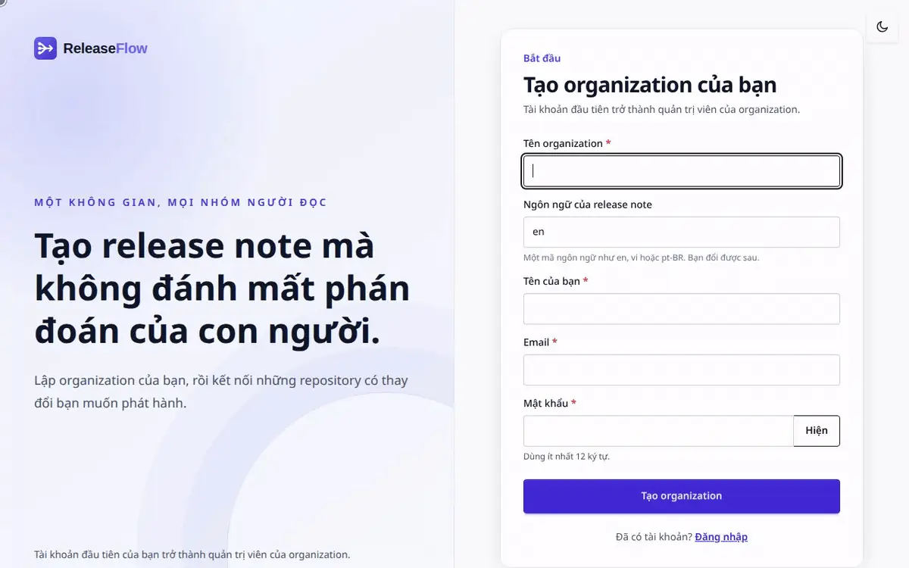
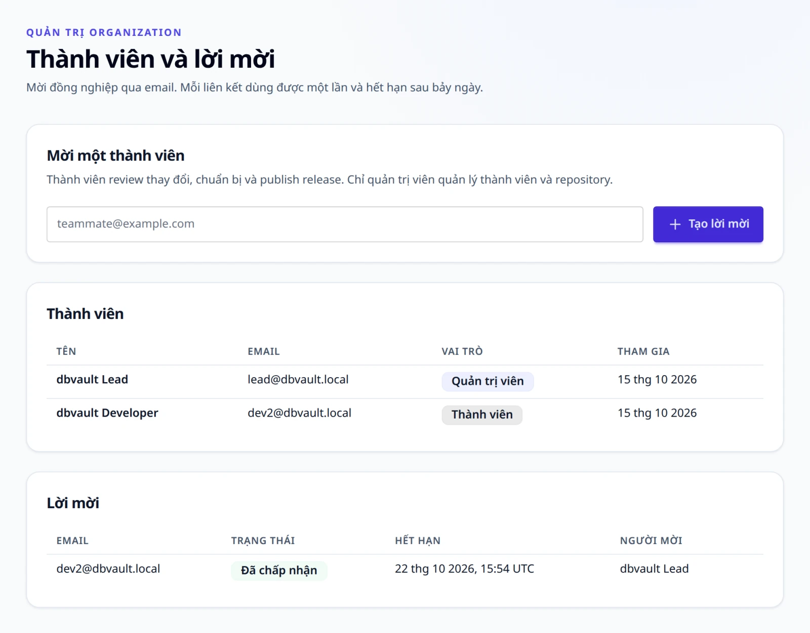
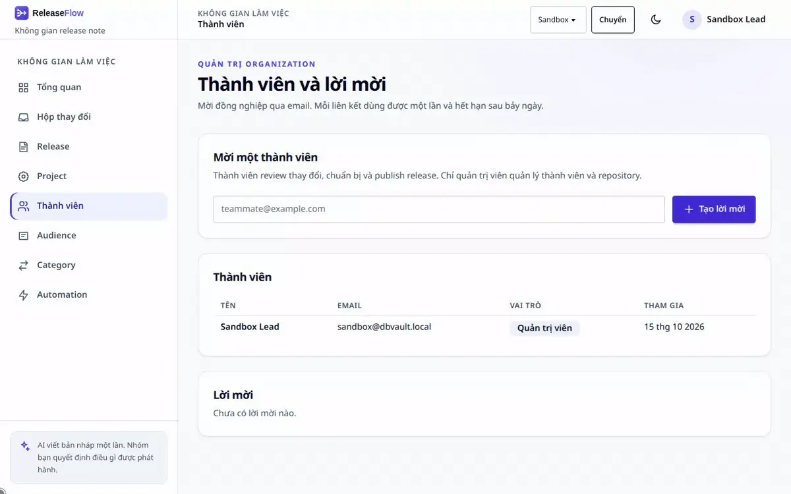
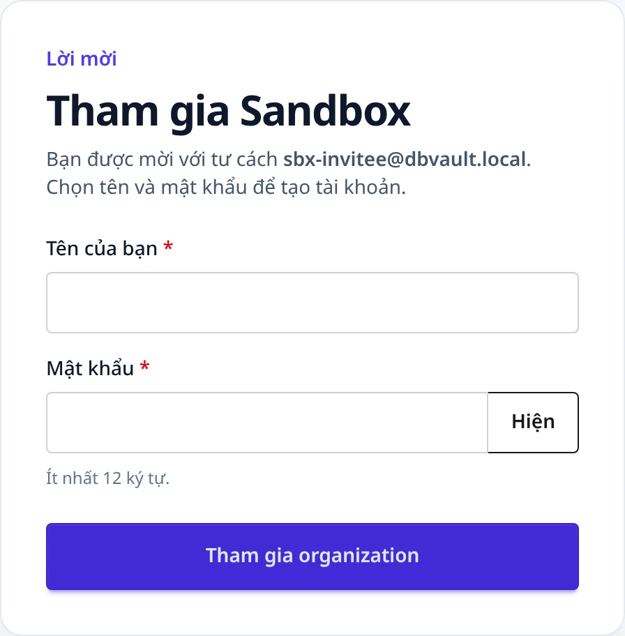
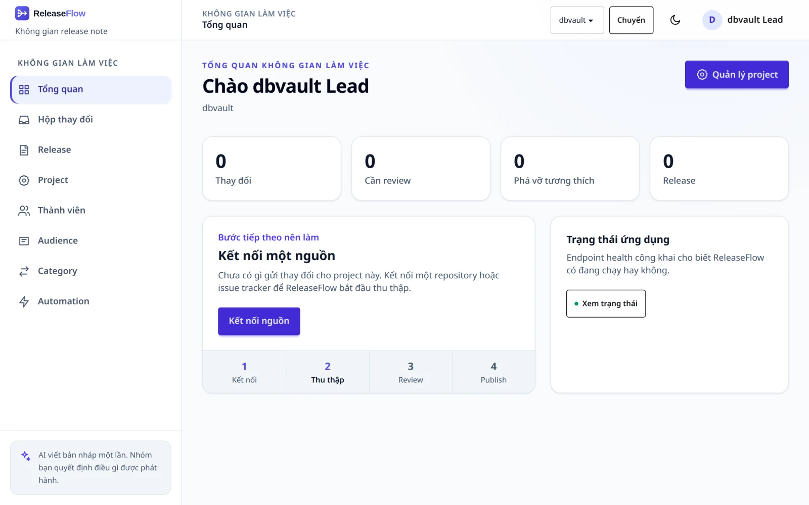
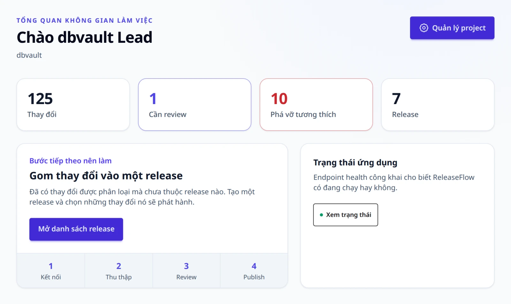
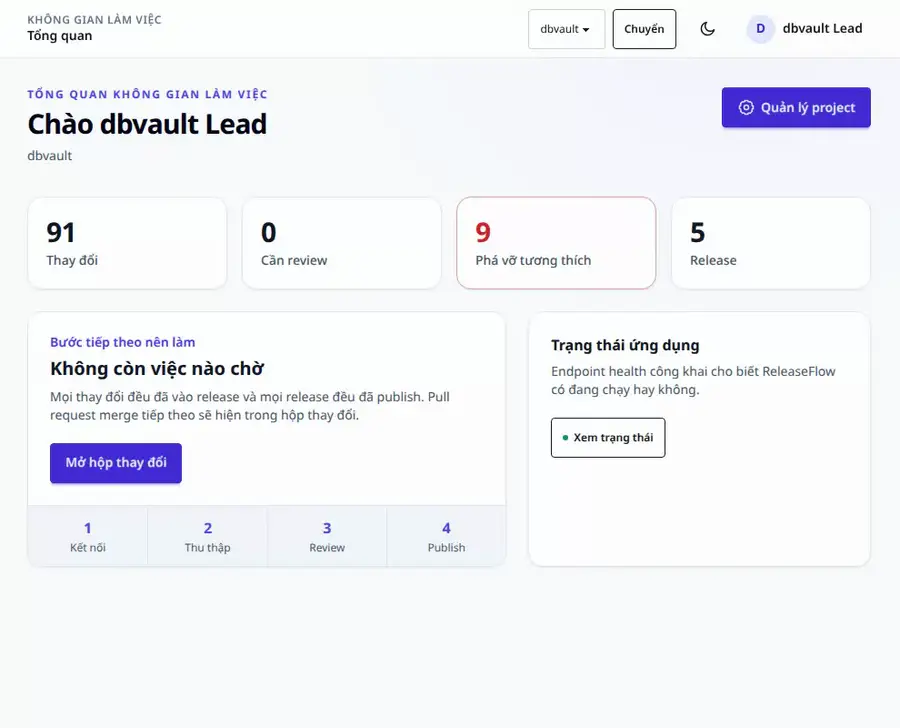
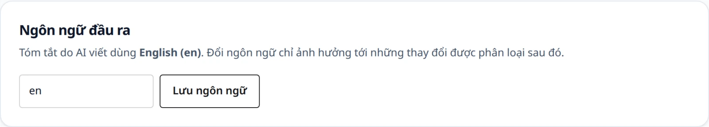

# Workspace

Đăng ký, thành viên và vai trò của họ, trang tổng quan mỗi người thấy khi đăng nhập, và
hai ngôn ngữ mà ReleaseFlow luôn tách riêng: ngôn ngữ một người đọc giao diện, và ngôn ngữ
ReleaseFlow dùng để viết.

## Đăng ký {#registration}

Mở `/register` để tạo một Organization cùng tài khoản đầu tiên của nó, tài khoản này là
**quản trị viên**. REST client gọi `POST /api/registrations` với
`{"organizationName", "displayName", "email", "password", "outputLanguage"}` sau khi lấy
CSRF token (xem [REST API](api.md#sessions-and-csrf)); `outputLanguage` không bắt buộc và
mặc định là tiếng Anh. Mỗi địa chỉ email chỉ thuộc về một tài khoản trên toàn bộ hệ thống
triển khai, nên đăng ký lại cùng một email sẽ trả về `409 email_already_registered`.
Việc đăng ký cũng tạo sẵn [danh mục category](changes.md#categories) của Organization,
bốn [audience](release-notes.md#audiences) mẫu, và địa chỉ changelog công khai.



Mật khẩu dài ít nhất 12 ký tự và tối đa 72 byte UTF-8, giới hạn mà BCrypt đọc được, và chỉ
được lưu dưới dạng mã băm BCrypt. Quy tắc này cũng áp dụng khi chấp nhận lời mời.

**Đăng ký luôn mở.** Bất kỳ ai truy cập được `/register` hoặc `POST /api/registrations` đều
tạo được thêm một Organization trên hệ thống của bạn, và không có cấu hình nào để tắt việc
này. Các Organization tách biệt hoàn toàn với nhau, nhưng một hệ thống mà internet truy cập
được — điều webhook cần — nên chặn cả hai đường dẫn này ở reverse proxy sau khi Organization
của bạn đã được tạo. Xem [Triển khai production](operations.md#deploying-to-production).

## Thành viên và lời mời {#members-and-invitations}

Một Organization có hai vai trò. **Quản trị viên** mở trang **Thành viên** để mời đồng
nghiệp qua email, và chỉ quản trị viên mới được:

- kết nối nguồn, đặt access token cho nguồn, và bắt đầu import lịch sử;
- thêm sensitive path cho một Project;
- quản lý danh mục category và quyết định với những gì AI đề xuất;
- quản lý audience và chọn các ngôn ngữ của release note;
- đổi ngôn ngữ đầu ra và địa chỉ changelog công khai;
- viết và chạy quy tắc automation.

**Thành viên** làm phần việc còn lại: tạo Project, review thay đổi, yêu cầu AI phân loại,
quyết định với các thay đổi có thể trùng lặp, và chuẩn bị, duyệt, publish release. Thành
viên đọc được nguồn, các lần import và sensitive path của một Project, danh mục category
và các ngôn ngữ release note, nhưng không vào được trang Thành viên, Audience và
Automation.



Liên kết mời có dạng `/accept-invite#token=…` và chỉ hiện một lần. ReleaseFlow chỉ lưu bản
băm của nó. Liên kết hết hạn sau bảy ngày (đặt `RELEASEFLOW_INVITATION_TTL`, ví dụ `P3D`,
để đổi thời hạn), chỉ dùng được một lần, và có thể cấp lại hoặc thu hồi ở trang Thành
viên. Người được mời xác nhận Organization, chọn tên và mật khẩu, rồi đăng nhập với vai
trò thành viên.

### Đổi vai trò hoặc xoá một thành viên {#change-a-role-or-remove-a-member}

Quản trị viên đổi vai trò của một thành viên, hoặc xoá một thành viên, ngay trên dòng của
thành viên đó ở trang **Thành viên**: **Đổi vai trò** cùng vai trò bên cạnh, hoặc **Xoá**,
sẽ hỏi lại trước. Quản trị viên cũng có thể đổi vai trò hoặc xoá chính mình, miễn là còn
một quản trị viên khác: **một Organization luôn giữ một quản trị viên**, và việc đổi hay
xoá quản trị viên cuối cùng bị từ chối với `409 member_last_administrator`, kể cả khi hai
quản trị viên cùng làm một lúc.

- **Các phiên của họ dừng ở request tiếp theo**, trên mọi trình duyệt và qua API. Thành
  viên bị đổi vai trò đăng nhập lại và nhận vai trò mới; thành viên bị xoá không đăng nhập
  được nữa. Trang họ mở sau đó giải thích rằng quyền truy cập của họ đã thay đổi.
- **Các lời mời đang chờ của họ bị thu hồi** khi họ bị xoá, và khi một quản trị viên bị hạ
  vai trò, vì chỉ quản trị viên mới mời được người khác. Lịch sử ghi lại bao nhiêu lời mời.
- **Những gì họ đã ghi vẫn giữ tên họ**: review, phê duyệt, publish, chỉnh sửa release
  note, loại trừ, trạng thái được chấp nhận lúc review, quyết định gộp và các thứ khác đều
  hiện tên họ có lúc làm việc đó.
- **Người bị xoá được mời lại là một thành viên mới.** Địa chỉ email của họ được giải phóng,
  nên quản trị viên có thể mời lại, hoặc người đó có thể tham gia hay đăng ký một
  Organization khác. Việc nhận lời mời tạo một thành viên mới với tên mới; mọi thứ họ làm
  trước đây vẫn thuộc về thành viên đã bị xoá, dưới tên được ghi lúc đó.
- **Ai đã đổi gì, và khi nào**, được liệt kê ở mục **Thay đổi thành viên**, còn người đã bị
  xoá ở mục **Thành viên đã xoá**, kèm người đã xoá họ.

Kết thúc phiên không chạm tới các secret mà một người đã thấy. Một quản trị viên rời đi có
thể đã thấy webhook secret của một nguồn, secret gọi của một quy tắc Automation, hoặc một
access token họ đã nhập: [đổi secret của nguồn](sources.md#rotate-a-webhook-secret), đổi
secret của quy tắc ở trang Automation, và thu hồi token ở phía nhà cung cấp.





REST client tuân theo cùng các quy tắc:

```text
GET    /api/members                         (administrator)
PUT    /api/members/{id}/role {"role"}      (administrator; ADMIN or MEMBER)
DELETE /api/members/{id}                    (administrator; 204)
GET    /api/members/changes                 (administrator; newest first)
GET    /api/invitations                     (administrator)
POST   /api/invitations {"email"}           (administrator; 201, returns acceptancePath once)
POST   /api/invitations/{id}/reissue        (administrator)
DELETE /api/invitations/{id}                (administrator)
POST   /api/public/invitations/inspect {"token"}
POST   /api/public/invitations/accept  {"token", "displayName", "password"}
```

Các endpoint công khai cần CSRF token lấy từ `GET /api/csrf`. Mọi token không dùng được
đều trả về `400 invitation_invalid`. Các lỗi khác là `409 invitation_already_pending`,
`409 invitation_email_unavailable` (email đã thuộc về một thành viên chưa bị xoá),
`404 invitation_not_found`, `404 member_not_found` (thành viên không tồn tại, đã bị xoá,
hoặc thuộc Organization khác), `409 member_last_administrator`, và `403 access_denied` khi
thành viên gọi endpoint dành cho quản trị viên. Phiên bị từ chối vì thành viên của nó đã
thay đổi trả lời `401 authentication_required`, như mọi request không có phiên. Xem
[ADR-0043](adr/0043-member-roles-and-removal.md).

## Tổng quan workspace {#workspace-overview}

Sau khi đăng nhập, bạn thấy trang tổng quan của một Project: có bao nhiêu thay đổi, bao
nhiêu thay đổi cần review, bao nhiêu thay đổi phá vỡ tương thích, và có bao nhiêu release
— mỗi con số là một liên kết tới trang xử lý được nó. Bên cạnh là **một** bước tiếp theo
chưa xong, theo thứ tự cố định: tạo project, kết nối nguồn, chờ thay đổi đầu tiên, gom thay
đổi vào một release, hoàn tất review, publish release đã duyệt, làm tiếp bản nháp, hoặc
không còn gì phải chờ. Một workspace có bản nháp đang mở mà chưa có thay đổi nào vẫn được
coi là đang chờ thay đổi đầu tiên, vì chưa có gì để đưa vào bản nháp. Nguồn đã ngắt kết nối
không được tính là đang kết nối.

Bên cạnh các con số, trang tổng quan liệt kê các nguồn của Project cùng
[tình trạng](sources.md#source-health) của chúng: lần gửi hoặc lần đọc cuối, các lần gửi bị từ
chối vì chữ ký, và nguồn có đang im lặng, quá hạn hay đã ngắt kết nối không. Đây là thông tin,
không phải một bước, nên nó không thay đổi bước nào được đề xuất.





Thanh tiêu đề và menu trên di động dùng để chuyển giữa các Project. ReleaseFlow nhớ Project
gần nhất trong cookie `releaseflow_project`, nên một trang mở ra không kèm `?project=` sẽ
mở đúng Project đó thay vì Project nào tình cờ đứng đầu. `projectId` trong URL của tài
nguyên được ưu tiên hơn tham số query, và query được ưu tiên hơn cookie. Chuyển Project từ
trang thay đổi hoặc trang release vẫn giữ nguyên chức năng đang xem; chuyển từ trang chi
tiết một release sẽ mở danh sách release của Project được chọn, và chuyển từ một trang quản
trị Organization sẽ mở trang tổng quan của Project được chọn. Cookie này là `HttpOnly` và
không mang quyền hạn nào: Project vẫn được tra cứu trong Organization của bạn, nên query
hoặc cookie trỏ tới Project của người khác sẽ bị trang xử lý yêu cầu bỏ qua hoặc từ chối.

Menu trên di động là một vùng mở rộng thao tác được bằng bàn phím: khi mở, focus chuyển vào
trong; `Escape` đóng nó lại, và focus quay về nút đã mở nó. Khi server kiểm tra biểu mẫu,
mỗi lỗi được gắn với đúng trường của nó và focus chuyển tới trường sai đầu tiên. Các vùng
mở rộng và nút điều khiển có vùng chạm tối thiểu 44 px; những thao tác huỷ công việc, vô
hiệu hoá một secret hoặc lưu trữ một quy tắc đều cho thấy tác động của chúng trước lần bấm
xác nhận cuối cùng.

Logo chữ đầy đủ của ReleaseFlow đổi theo theme sáng hoặc tối đã chọn trên các trang
workspace và tài khoản. Phần đầu trang changelog công khai chỉ giữ biểu tượng thu gọn bên
cạnh tên Organization, để Organization luôn là danh tính chính.

Một địa chỉ gõ sai trả về cho trình duyệt một trang thay vì JSON thô, và một địa chỉ vai trò
của bạn không được vào sẽ nói rõ như vậy mà không để lộ nội dung. Biểu mẫu gửi sau khi phiên
đăng nhập đã hết sẽ đưa bạn về trang đăng nhập, còn biểu mẫu cũ hơn lần đăng nhập gần nhất
sẽ bị báo là đã cũ; cả hai trường hợp đều không lưu gì. REST client, và mọi thứ dưới `/api`,
vẫn nhận `application/problem+json` như trước. Một địa chỉ trỏ tới thứ mà Organization của
bạn không có — một Project, một release, một quy tắc — trả về trang không tìm thấy kèm một
dòng cho biết thứ gì bị thiếu.

Kết quả của một biểu mẫu đã lưu được báo một lần, sau khi chuyển hướng, trong một thông báo
nhỏ bạn tự đóng; tải lại trang sẽ không báo lại. Thông báo có bốn loại — thành công, thông
tin, cảnh báo và lỗi — mỗi loại có màu và biểu tượng riêng. Trình duyệt không bao giờ tự
chặn biểu mẫu bằng bong bóng thông báo của nó: server kiểm tra mọi trường, viết từng lỗi
ngay dưới trường liên quan bằng ngôn ngữ của bạn, và với biểu mẫu nhiều hơn một trường thì
tóm tắt các lỗi ở phía trên. Trường bắt buộc được đánh dấu `*`.

## Ngôn ngữ giao diện {#interface-language}

Mỗi người đọc ReleaseFlow bằng tiếng Anh hoặc tiếng Việt. Ngôn ngữ được chọn theo từng yêu
cầu, theo thứ tự sau:

1. tham số `?lang=` trên một yêu cầu GET, ví dụ `/login?lang=vi`;
2. cookie `releaseflow_lang`;
3. ngôn ngữ đã lưu trong tài khoản (`app_users.ui_locale`);
4. `Accept-Language`, thu hẹp từ vùng về ngôn ngữ, nên `vi-VN` sẽ được hiểu là `vi`;
5. mục đầu tiên của `RELEASEFLOW_UI_LANGUAGES` (mặc định `en,vi`).

Bước nào chỉ định một ngôn ngữ mà hệ thống này không có sẽ được bỏ qua để xét bước tiếp
theo. Một giá trị `?lang=` được hỗ trợ sẽ được ghi vào cookie, nên một liên kết có thể mở
ReleaseFlow bằng một ngôn ngữ và các trang sau đó giữ nguyên ngôn ngữ ấy; lựa chọn trong tài
khoản không bị đụng tới, và một giá trị không được hỗ trợ không thay đổi gì. Trên trang
changelog công khai, vốn được cache công khai, `?lang=` chỉ đổi riêng trang đó và không đặt
cookie. Bộ chọn ngôn ngữ nằm trong menu người dùng; chọn một ngôn ngữ sẽ lưu nó vào tài khoản
và ghi cookie, mà cookie được ưu tiên hơn tài khoản, nên thay đổi hiện ra ngay. Cookie là
`HttpOnly`, có hiệu lực một năm, và là `Secure` khi yêu cầu dùng HTTPS.



Bước tài khoản đọc tài khoản ở thời điểm hiện tại, nên một lựa chọn được thực hiện ở trình
duyệt khác, hoặc qua API, tới được mọi session của người đó ngay ở yêu cầu kế tiếp, trừ khi
cookie của chính session đó hoặc một `?lang=` nói khác.

```text
GET /api/me/ui-locale                  (any member)
PUT /api/me/ui-locale {"uiLocale"}     (the same member)
```

Cả hai đều trả về `{uiLocale, supported}`. `uiLocale` là null khi để trình duyệt quyết định;
đó cũng là trạng thái của tài khoản mới và là trạng thái quay về khi gửi `null`. Một ngôn ngữ
hệ thống này không có sẽ trả về `400 ui_locale_invalid`.

Trang changelog công khai theo cùng thứ tự, trừ bước tài khoản: đọc changelog vẫn không tạo
phiên đăng nhập. Các trang này khai báo `Vary: Accept-Language, Cookie`, vì release note bên
trong giống nhau với mọi người còn phần khung trang thì không. RSS feed là một tài liệu dùng
chung và luôn bằng tiếng Anh.

Nội dung trang, thông báo của biểu mẫu, và `title` cùng `detail` của mọi phản hồi
`application/problem+json` được viết bằng ngôn ngữ này. **`code` của một lỗi không bao giờ
thay đổi**, nên bên gọi so khớp theo nó không bị ảnh hưởng. Bằng chứng đã ghi lại không phải
là chữ của giao diện và giữ nguyên như lúc ghi: một lỗi AI đã lưu, lý do phân loại, và tên
riêng của nhà cung cấp đọc giống nhau ở mọi ngôn ngữ.

Đây không phải ngôn ngữ của bất cứ thứ gì ReleaseFlow viết ra. Release note và bản tóm tắt
của AI theo ngôn ngữ đầu ra của Organization và các ngôn ngữ release note, mô tả bên dưới,
bất kể người duyệt chúng đang đọc giao diện bằng ngôn ngữ nào.

## Ngôn ngữ đầu ra {#output-language}

Mỗi Organization viết bản tóm tắt AI bằng một ngôn ngữ đầu ra, là một language tag như `en`,
`vi` hoặc `pt-BR`. Ngôn ngữ này được chọn lúc đăng ký (`outputLanguage`, mặc định tiếng Anh)
và hiện trên trang Project, nơi quản trị viên có thể đổi nó. Thay đổi chỉ áp dụng cho các
thay đổi được phân loại sau đó.



```text
GET /api/organization/output-language                     (any member)
PUT /api/organization/output-language {"outputLanguage"}  (administrator)
```

Cả hai đều trả về `{outputLanguage, displayName, supported}`. Tag được chuẩn hoá (`vi_VN`
thành `vi-VN`); mọi tag có phần ngôn ngữ là mã ISO 639 đều được chấp nhận, và tag không hợp
lệ trả về `400 output_language_invalid`. `RELEASEFLOW_OUTPUT_LANGUAGES` (mặc định `en,vi`)
liệt kê các gợi ý hiển thị trong biểu mẫu.
